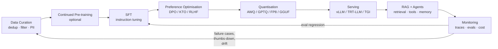

# Module 01 — LLMOps Foundations & Architecture

> **Goal:** After this chapter you can (a) explain why LLMOps is a different discipline from MLOps, (b) draw the full LLM lifecycle from memory, and (c) size GPU memory for any model, for both training and inference, on a whiteboard in under five minutes.

---

## Table of Contents

1. [Module Overview & First-Principles Architecture](#1-module-overview--first-principles-architecture)
2. [Mathematical Foundations & Formulas](#2-mathematical-foundations--formulas)
3. [Production-Ready Code](#3-production-ready-executable-code)
4. [Hard-Learned Production Failures](#4-hard-learned-production-failures--edge-cases)
5. [Senior/Staff Interview Questions](#5-seniorstaff-llmops-interview-questions)

---

## 1. Module Overview & First-Principles Architecture

### 1.1 Why LLMOps is not "MLOps with a bigger model"

Classical MLOps assumes you **own the model end to end**: you collect labelled data, train a model from scratch (or a small fine-tune), evaluate against a held-out label set, and deploy a small artifact (tens of MB to a few GB) behind a REST endpoint. The unit of change is *a retrained model*, and correctness is measured by a scalar metric (AUC, F1, RMSE).

LLM systems invert almost every one of these assumptions:

| Dimension | Traditional MLOps | LLMOps |
|---|---|---|
| **Primary artifact** | Trained model weights | Weights **+ prompts + retrieval index + tool schemas + guardrail policies** |
| **Unit of change** | Retrain & redeploy | Prompt edit, index refresh, adapter swap, router rule — most changes need no training |
| **Data** | Labelled tabular / image sets | Unlabelled web-scale text, preference pairs, synthetic data, user conversations |
| **Evaluation** | Deterministic metric on held-out labels | Probabilistic, open-ended output; needs LLM-as-judge, human review, task-specific rubrics |
| **Latency model** | Single forward pass, ms | Autoregressive decode: `TTFT + N × ITL`, seconds |
| **Cost driver** | Training compute (amortised) | **Inference tokens** (dominant, scales with traffic) and GPU-hours |
| **Failure modes** | Drift, bad features | Hallucination, prompt injection, jailbreaks, tool misuse, context overflow, non-determinism |
| **Versioning** | Model registry | Model + prompt + index + guardrail + tool-schema **bundle** |
| **Memory profile** | Weights dominate | Weights **and KV cache** (grows with concurrency × context) |
| **Feedback loop** | Periodic retrain | Continuous: traces → eval → data flywheel → adapter fine-tune |
| **Security surface** | Adversarial examples (rare) | Natural-language attack surface: any text the model reads is a potential instruction |

**Key insight for interviews:** in LLMOps, *the model is a component, not the product.* The product is the **compound system** (retrieval, routing, caching, guardrails, tools, evals) wrapped around one or more models. Reliability comes from the system, not the weights.

### 1.2 The LLM Lifecycle



Each stage has its own *artifact*, *owner*, *gate*, and *rollback*:

| Stage | Artifact | Gate to proceed | Rollback |
|---|---|---|---|
| Data curation | Versioned dataset shards (Parquet + manifest) | Dedup rate, quality score, PII scan = 0 hits | Pin previous dataset hash |
| SFT | LoRA adapter / full checkpoint | Held-out task eval ≥ baseline − ε; no safety regression | Keep previous adapter in registry |
| Preference tuning | DPO adapter | Win-rate vs SFT ≥ 55% on judge; refusal-rate within band | Same |
| Quantisation | AWQ/GPTQ/FP8 weights | Perplexity delta < 0.3; task eval delta < 1% | Serve BF16 fallback |
| Serving | Container image + engine config | Load test: p95 TTFT, p95 ITL, OOM-free at target concurrency | Blue/green traffic shift |
| RAG/Agents | Index version + prompt version + tool schema | RAG triad ≥ thresholds (Module 07) | Index alias swap |
| Monitoring | Traces, metrics, eval scores | SLO burn-rate alerts | Auto-route to fallback model |

### 1.3 Reference Topology of a Production LLM Platform

```
                         ┌──────────────────────────────────────────────┐
   Client / App  ───────▶│ API Gateway (auth, rate-limit, tenant quota)  │
                         └───────────────┬──────────────────────────────┘
                                         ▼
                         ┌──────────────────────────────────────────────┐
                         │ Input Guardrails (PII, injection, topic)     │  ← Module 08
                         └───────────────┬──────────────────────────────┘
                                         ▼
                         ┌──────────────────────────────────────────────┐
                         │ Semantic Cache (Redis + vector match)        │  ← Module 11
                         └───────┬───────────────────────┬──────────────┘
                              hit│                       │miss
                                 │                       ▼
                                 │       ┌───────────────────────────────┐
                                 │       │ Router / Cascade (8B → 70B)   │  ← Module 11
                                 │       └───────────────┬───────────────┘
                                 │                       ▼
                                 │       ┌───────────────────────────────┐
                                 │       │ Orchestrator (LangGraph/MCP)  │  ← Module 09
                                 │       │  ├─ Retriever ─▶ Qdrant       │  ← Module 06
                                 │       │  ├─ Tools (sandboxed)         │
                                 │       │  └─ Prompt assembly (Jinja2)  │  ← Module 03
                                 │       └───────────────┬───────────────┘
                                 │                       ▼
                                 │       ┌───────────────────────────────┐
                                 │       │ Inference: vLLM (PagedAttn)   │  ← Module 05
                                 │       │  base + multi-LoRA adapters   │
                                 │       └───────────────┬───────────────┘
                                 ▼                       ▼
                         ┌──────────────────────────────────────────────┐
                         │ Output Guardrails (groundedness, toxicity)   │
                         └───────────────┬──────────────────────────────┘
                                         ▼
                                      Response
   ── all hops emit OpenTelemetry spans ──▶ LangFuse / Phoenix ──▶ Eval engine ──▶ Fine-tune trigger
```

### 1.4 The Two Phases of Inference and Why They Matter

Every autoregressive request has two physically different phases:

1. **Prefill (prompt processing).** All `S_in` prompt tokens are processed in parallel. This is **compute-bound** (large matmuls, high arithmetic intensity). It determines **TTFT**.
2. **Decode (token generation).** One token per step, each step reads *all* the weights and the whole KV cache from HBM to produce a single token per sequence. This is **memory-bandwidth-bound**. It determines **ITL / TPS**.

This asymmetry drives nearly every optimisation in this course:

- *Batching* amortises weight reads across sequences → raises decode throughput (Module 05).
- *Quantisation* shrinks bytes read per step → lowers ITL (Module 04).
- *KV cache paging* removes fragmentation so more sequences fit in the batch (Module 05).
- *Chunked prefill* prevents compute-heavy prefills from stalling memory-bound decodes (Module 05).
- *Speculative decoding* converts several memory-bound steps into one compute-bound verification (Module 05).

### 1.5 Roofline Intuition

For an accelerator with peak compute `P` (FLOP/s) and memory bandwidth `B` (bytes/s), the **ridge point** is `I* = P / B` (FLOP per byte). An operation with arithmetic intensity `I < I*` is memory-bound.

For an H100 SXM (BF16 dense ≈ 989 TFLOP/s, HBM3 ≈ 3.35 TB/s): `I* ≈ 295 FLOP/byte`.

Decode with batch size `b` on BF16 weights has intensity ≈ `b` FLOP/byte (2 FLOPs per parameter per token, 2 bytes per parameter, so `2b/2 = b`). To become compute-bound you would need `b ≈ 295` — which is why batching is so effective and why decode is almost always memory-bound in practice.

---

## 2. Mathematical Foundations & Formulas

### 2.1 Parameter Count of a Decoder-Only Transformer

For `L` layers, hidden size `d`, FFN intermediate size `d_ff`, vocab size `V`, `n_h` query heads, `n_kv` KV heads, head dim `d_h = d / n_h`:

```
Attention params / layer = d·(n_h·d_h)            # W_Q
                         + d·(n_kv·d_h)           # W_K
                         + d·(n_kv·d_h)           # W_V
                         + (n_h·d_h)·d            # W_O

FFN params / layer (SwiGLU) = 3 · d · d_ff        # gate, up, down

Embedding params         = V · d     (×2 if untied output head)

N ≈ L · (attn + ffn) + embeddings   (norms are negligible)
```

Sanity check, Llama-3-8B: `L=32, d=4096, d_ff=14336, n_h=32, n_kv=8, d_h=128, V=128256`.

- Attention/layer = `4096·4096 + 2·4096·1024 + 4096·4096 = 41.9M`
- FFN/layer = `3·4096·14336 = 176.2M`
- 32 layers → `32 × 218.1M = 6.98B`
- Embeddings: `2 × 128256 × 4096 = 1.05B`
- **Total ≈ 8.03B** ✔

### 2.2 Weight Memory

```
M_weights = N × b_w
```

| Precision | bytes/param (`b_w`) | 7–8B | 13B | 70B |
|---|---|---|---|---|
| FP32 | 4 | 32 GB | 52 GB | 280 GB |
| BF16 / FP16 | 2 | 16 GB | 26 GB | 140 GB |
| FP8 / INT8 | 1 | 8 GB | 13 GB | 70 GB |
| INT4 (+scales ≈ 4.25 b effective) | ~0.53 | ~4.3 GB | ~7 GB | ~37 GB |

### 2.3 KV Cache Memory (the inference killer)

Per token, per layer, you store one K and one V vector for each KV head:

```
bytes_per_token = 2 · L · n_kv · d_h · b_kv          # 2 = K and V
M_kv           = bytes_per_token · S · B             # S = context length, B = concurrent sequences
```

**Llama-3-8B (GQA, n_kv=8) at BF16 KV (b_kv = 2):**

```
bytes_per_token = 2 · 32 · 8 · 128 · 2 = 131,072 B = 128 KiB
S = 8192, B = 32  → 128 KiB × 8192 × 32 = 32 GiB
```

**Llama-3-70B (L=80, n_kv=8, d_h=128):**

```
bytes_per_token = 2 · 80 · 8 · 128 · 2 = 327,680 B = 320 KiB
S = 8192, B = 16  → 320 KiB × 8192 × 16 = 40 GiB
```

**Why GQA matters:** with full multi-head attention (`n_kv = n_h = 32`), Llama-3-8B would need 4× the KV cache (512 KiB/token). GQA is a *memory* optimisation first, a compute one second.

**FP8 KV cache** halves `b_kv` to 1 with typically <0.5% quality loss — often the cheapest capacity win available.

### 2.4 Activation Memory

*Inference:* activations are transient, one layer at a time. Budget ≈ `B_tokens × d × b × c` where `c ≈ 4–10` for the largest intermediate (FFN `d_ff` activation dominates) and `B_tokens` is tokens in the *current forward step* (large during prefill — which is why chunked prefill caps it).

*Training (no checkpointing)*, following Korthikanti et al., per layer with sequence `s`, micro-batch `b`, hidden `d`, heads `a`:

```
A_layer ≈ s·b·d·(34 + 5·a·s/d)   bytes   (BF16, no recompute, no flash-attn)
```

With FlashAttention the `5·a·s/d` term (the s² attention matrix) vanishes → `≈ 34·s·b·d` per layer. With full activation checkpointing only layer inputs are stored: `≈ 2·s·b·d` per layer plus one layer's recompute buffer.

### 2.5 Training Memory (Adam, mixed precision)

Per parameter:

| Component | Bytes |
|---|---|
| BF16 weights (forward/backward copy) | 2 |
| BF16 gradients | 2 |
| FP32 master weights | 4 |
| Adam first moment `m` (FP32) | 4 |
| Adam second moment `v` (FP32) | 4 |
| **Total (model states)** | **16** |

```
M_train ≈ 16·N + A_total + workspace
```

A **7B** full fine-tune therefore needs `16 × 7e9 = 112 GB` of model states *before* activations → does not fit on one 80 GB GPU. Remedies: ZeRO-3/FSDP sharding, 8-bit optimisers (`m,v` → 1 B each, total ≈ 10 B/param), or PEFT.

**QLoRA memory (7B):**

```
base weights NF4:         7e9 × 0.5  ≈ 3.5 GB (+ ~0.4 GB quant constants w/ double quant)
LoRA params (r=16, all linear): ≈ 40M → BF16 weights 80 MB
LoRA grads + Adam (FP32 m,v + master): 40M × (2+4+4+4) ≈ 560 MB
activations w/ grad checkpointing (s=2048,b=4): ≈ 2–4 GB
paged optimiser spikes: absorbed by CPU
Total ≈ 8–10 GB   → fits a 12–16 GB consumer GPU
```

### 2.6 Latency Equations

```
TTFT  ≈ T_queue + T_prefill
T_prefill ≈ (2 · N · S_in) / (η_c · P_gpu · n_gpu)           # compute-bound
ITL   ≈ (M_weights/n_gpu + M_kv_read) / (η_b · B_hbm) + T_comm   # memory-bound
E2E   = TTFT + (S_out − 1) · ITL
TPS_per_user = 1 / ITL
TPS_system   ≈ B_eff / ITL                                   # B_eff = avg concurrent decoding seqs
```

`η_c ≈ 0.4–0.6` (MFU), `η_b ≈ 0.6–0.8` (bandwidth utilisation) are realistic efficiency factors.

**Worked example — Llama-3-8B BF16 on one H100 (3.35 TB/s):**

```
ITL_min ≈ 16 GB / (0.7 × 3350 GB/s) ≈ 6.8 ms  →  ~147 tok/s single-stream
At batch 64, weights read once: system ≈ 64 / (≈9 ms) ≈ 7,000 tok/s
```

**Worked example — prefill 4,000 tokens:**

```
FLOPs = 2 × 8e9 × 4000 = 6.4e13
T = 6.4e13 / (0.5 × 989e12) ≈ 130 ms
```

### 2.7 Attention Complexity

- Compute: `O(S² · d)` per layer for prefill; `O(S · d)` per decode step.
- Memory (naive): `O(S²)` attention matrix; **FlashAttention** tiles in SRAM → `O(S)` extra memory, same FLOPs, far fewer HBM reads.
- Decode cost grows **linearly** in context because every step reads the entire KV cache → long-context decode is bandwidth-bound by `M_kv`, not by weights.

### 2.8 Cost Per Million Tokens

```
$/1M output tokens = (GPU_$/hr × n_gpu) / (TPS_system × 3600) × 1e6
```

H100 at $3.00/hr, 5,000 tok/s sustained: `3 / (5000×3600) × 1e6 = $0.167 / 1M tokens`. At 25% utilisation it is `$0.67`. **Utilisation is the cost lever.**

### 2.9 Quantisation Error Preview (full treatment in Module 04)

Uniform symmetric quantisation to `k` bits with scale `Δ = max|w| / (2^{k-1}-1)`: expected MSE `≈ Δ²/12`. Halving bit-width multiplies noise power by `2^{2·Δk}`, which is why per-group scaling (group size 128) is crucial at 4-bit.

---

## 3. Production-Ready Executable Code

### 3.1 Full GPU Memory Calculator (typed, tested, CLI)

Save as `tools/vram_calculator.py`. Runs on CPU with no dependencies besides the standard library.

```python
#!/usr/bin/env python3
"""LLM VRAM calculator for inference and training.

Usage:
    python vram_calculator.py infer --model llama3-8b --dtype bf16 --ctx 8192 --batch 32
    python vram_calculator.py train --model llama3-8b --mode qlora --seq 2048 --micro-batch 4
    python vram_calculator.py fit   --model llama3-70b --dtype int4 --ctx 8192 --batch 16 --gpu h100-80
"""
from __future__ import annotations

import argparse
import sys
from dataclasses import dataclass
from typing import Final, Literal

GIB: Final[int] = 1024**3

DTYPE_BYTES: Final[dict[str, float]] = {
    "fp32": 4.0,
    "bf16": 2.0,
    "fp16": 2.0,
    "fp8": 1.0,
    "int8": 1.0,
    "int4": 0.53,  # 4-bit + group-128 scales/zeros overhead
    "nf4": 0.53,
}

GPUS_GIB: Final[dict[str, float]] = {
    "l4-24": 24.0,
    "a10g-24": 24.0,
    "rtx4090-24": 24.0,
    "a100-40": 40.0,
    "a100-80": 80.0,
    "h100-80": 80.0,
    "h200-141": 141.0,
    "b200-192": 192.0,
}


@dataclass(frozen=True)
class ModelSpec:
    """Architecture hyper-parameters needed for memory math."""

    name: str
    n_layers: int
    hidden: int
    ffn: int
    n_heads: int
    n_kv_heads: int
    vocab: int
    tied_embeddings: bool = False

    @property
    def head_dim(self) -> int:
        return self.hidden // self.n_heads

    @property
    def n_params(self) -> int:
        """Approximate parameter count (ignores norms/bias)."""
        hd = self.head_dim
        attn = (
            self.hidden * self.n_heads * hd
            + 2 * self.hidden * self.n_kv_heads * hd
            + self.n_heads * hd * self.hidden
        )
        ffn = 3 * self.hidden * self.ffn  # SwiGLU
        emb = self.vocab * self.hidden * (1 if self.tied_embeddings else 2)
        return self.n_layers * (attn + ffn) + emb


MODELS: Final[dict[str, ModelSpec]] = {
    "llama3-8b": ModelSpec("llama3-8b", 32, 4096, 14336, 32, 8, 128256),
    "llama3-70b": ModelSpec("llama3-70b", 80, 8192, 28672, 64, 8, 128256),
    "mistral-7b": ModelSpec("mistral-7b", 32, 4096, 14336, 32, 8, 32000),
    "qwen2.5-14b": ModelSpec("qwen2.5-14b", 48, 5120, 13824, 40, 8, 152064),
    "qwen2.5-72b": ModelSpec("qwen2.5-72b", 80, 8192, 29568, 64, 8, 152064),
}


def weight_bytes(m: ModelSpec, dtype: str) -> float:
    """Bytes occupied by model weights at the given dtype."""
    return m.n_params * DTYPE_BYTES[dtype]


def kv_bytes_per_token(m: ModelSpec, kv_dtype: str) -> float:
    """K and V for every layer and KV head, for a single token."""
    return 2 * m.n_layers * m.n_kv_heads * m.head_dim * DTYPE_BYTES[kv_dtype]


def kv_cache_bytes(m: ModelSpec, kv_dtype: str, ctx: int, batch: int) -> float:
    """Total KV cache for `batch` sequences each holding `ctx` tokens."""
    return kv_bytes_per_token(m, kv_dtype) * ctx * batch


def inference_activation_bytes(m: ModelSpec, max_batched_tokens: int, dtype: str) -> float:
    """Peak transient activation budget for one forward step (FFN dominated)."""
    return max_batched_tokens * max(m.ffn, 3 * m.hidden) * DTYPE_BYTES[dtype] * 3


def inference_estimate(
    m: ModelSpec,
    dtype: str,
    kv_dtype: str,
    ctx: int,
    batch: int,
    max_batched_tokens: int = 8192,
    tp: int = 1,
    overhead_frac: float = 0.08,
) -> dict[str, float]:
    """Return a per-GPU memory breakdown in GiB for tensor-parallel inference."""
    w = weight_bytes(m, dtype) / tp
    kv = kv_cache_bytes(m, kv_dtype, ctx, batch) / tp
    act = inference_activation_bytes(m, max_batched_tokens, "bf16") / tp
    subtotal = w + kv + act
    overhead = subtotal * overhead_frac + 1.0 * GIB  # CUDA context + graphs + fragmentation
    total = subtotal + overhead
    return {
        "weights_gib": w / GIB,
        "kv_cache_gib": kv / GIB,
        "activations_gib": act / GIB,
        "overhead_gib": overhead / GIB,
        "total_gib": total / GIB,
    }


TrainMode = Literal["full", "lora", "qlora"]


def training_estimate(
    m: ModelSpec,
    mode: TrainMode,
    seq: int,
    micro_batch: int,
    lora_rank: int = 16,
    grad_checkpointing: bool = True,
    optimizer_8bit: bool = False,
    zero_shards: int = 1,
) -> dict[str, float]:
    """Estimate training memory per GPU (GiB)."""
    n = m.n_params
    if mode == "full":
        weights = n * 2
        grads = n * 2
        master = n * 4
        opt = n * (2 if optimizer_8bit else 8)
        trainable = n
    else:
        base_dtype = "nf4" if mode == "qlora" else "bf16"
        weights = n * DTYPE_BYTES[base_dtype]
        # LoRA on q,k,v,o,gate,up,down: r*(d_in+d_out) per matrix.
        hd = m.head_dim
        per_layer = (
            lora_rank * (m.hidden + m.n_heads * hd)  # q
            + 2 * lora_rank * (m.hidden + m.n_kv_heads * hd)  # k, v
            + lora_rank * (m.n_heads * hd + m.hidden)  # o
            + 2 * lora_rank * (m.hidden + m.ffn)  # gate, up
            + lora_rank * (m.ffn + m.hidden)  # down
        )
        trainable = per_layer * m.n_layers
        weights += trainable * 2
        grads = trainable * 2
        master = trainable * 4
        opt = trainable * 8
    # Activations (FlashAttention assumed -> no s^2 term).
    per_layer_act = (
        2 * seq * micro_batch * m.hidden if grad_checkpointing else 34 * seq * micro_batch * m.hidden
    )
    recompute_buf = 34 * seq * micro_batch * m.hidden
    acts = per_layer_act * m.n_layers + (recompute_buf if grad_checkpointing else 0)
    # Logits (fp32) are often the surprise peak: seq*batch*vocab*4 bytes (+ grad).
    logits = seq * micro_batch * m.vocab * 4 * 2
    states = (weights + grads + master + opt) / zero_shards
    total = states + acts + logits + 1.5 * GIB
    return {
        "trainable_params_m": trainable / 1e6,
        "model_states_gib": states / GIB,
        "activations_gib": acts / GIB,
        "logits_gib": logits / GIB,
        "total_gib": total / GIB,
    }


def pretty(d: dict[str, float]) -> str:
    return "\n".join(f"  {k:<22} {v:>10.2f}" for k, v in d.items())


def main(argv: list[str] | None = None) -> int:
    p = argparse.ArgumentParser(description=__doc__)
    sub = p.add_subparsers(dest="cmd", required=True)

    pi = sub.add_parser("infer")
    pi.add_argument("--model", choices=MODELS, required=True)
    pi.add_argument("--dtype", choices=DTYPE_BYTES, default="bf16")
    pi.add_argument("--kv-dtype", choices=DTYPE_BYTES, default="bf16")
    pi.add_argument("--ctx", type=int, default=8192)
    pi.add_argument("--batch", type=int, default=16)
    pi.add_argument("--tp", type=int, default=1)

    pt = sub.add_parser("train")
    pt.add_argument("--model", choices=MODELS, required=True)
    pt.add_argument("--mode", choices=["full", "lora", "qlora"], default="qlora")
    pt.add_argument("--seq", type=int, default=2048)
    pt.add_argument("--micro-batch", type=int, default=4)
    pt.add_argument("--rank", type=int, default=16)
    pt.add_argument("--zero-shards", type=int, default=1)

    pf = sub.add_parser("fit")
    pf.add_argument("--model", choices=MODELS, required=True)
    pf.add_argument("--dtype", choices=DTYPE_BYTES, default="bf16")
    pf.add_argument("--kv-dtype", choices=DTYPE_BYTES, default="bf16")
    pf.add_argument("--ctx", type=int, default=8192)
    pf.add_argument("--batch", type=int, default=16)
    pf.add_argument("--gpu", choices=GPUS_GIB, required=True)

    a = p.parse_args(argv)
    m = MODELS[a.model]
    print(f"{m.name}: {m.n_params / 1e9:.2f}B params")

    if a.cmd == "infer":
        print(pretty(inference_estimate(m, a.dtype, a.kv_dtype, a.ctx, a.batch, tp=a.tp)))
    elif a.cmd == "train":
        print(pretty(training_estimate(m, a.mode, a.seq, a.micro_batch, a.rank, zero_shards=a.zero_shards)))
    else:
        cap = GPUS_GIB[a.gpu]
        for tp in (1, 2, 4, 8):
            est = inference_estimate(m, a.dtype, a.kv_dtype, a.ctx, a.batch, tp=tp)
            ok = est["total_gib"] <= cap * 0.90  # vLLM default gpu_memory_utilization
            print(f"  TP={tp}: {est['total_gib']:.1f} GiB/GPU vs {cap * 0.9:.1f} usable -> {'FITS' if ok else 'NO'}")
            if ok:
                break
        else:
            print("  Does not fit within TP=8; reduce batch/ctx or quantise further.")
            return 1
    return 0


if __name__ == "__main__":
    sys.exit(main())
```

Try it:

```bash
python tools/vram_calculator.py infer --model llama3-8b --dtype bf16 --ctx 8192 --batch 32
python tools/vram_calculator.py train --model llama3-8b --mode qlora --seq 2048 --micro-batch 4
python tools/vram_calculator.py fit --model llama3-70b --dtype int4 --ctx 8192 --batch 16 --gpu h100-80
```

### 3.2 Capacity Planner: "How many concurrent users per GPU?"

```python
"""Translate free VRAM after weights into maximum concurrent sequences."""
from __future__ import annotations

from dataclasses import dataclass


@dataclass(frozen=True)
class CapacityInput:
    gpu_gib: float
    gpu_util: float          # vLLM --gpu-memory-utilization, e.g. 0.90
    weight_gib: float        # per GPU after TP
    kv_bytes_per_token: int  # per GPU after TP
    avg_ctx_tokens: int      # mean (prompt + generated) across users
    activation_gib: float = 3.0
    page_size_tokens: int = 16  # PagedAttention block size


def max_concurrent_sequences(c: CapacityInput) -> int:
    """Number of concurrent sequences supported by the paged KV pool."""
    pool_bytes = (c.gpu_gib * c.gpu_util - c.weight_gib - c.activation_gib) * 1024**3
    if pool_bytes <= 0:
        raise ValueError("Weights + activations exceed usable VRAM; shard or quantise.")
    blocks_per_seq = -(-c.avg_ctx_tokens // c.page_size_tokens)  # ceil
    bytes_per_seq = blocks_per_seq * c.page_size_tokens * c.kv_bytes_per_token
    return int(pool_bytes // bytes_per_seq)


if __name__ == "__main__":
    # Llama-3-8B BF16 on an 80 GB H100, average conversation 3k tokens.
    cap = CapacityInput(
        gpu_gib=80, gpu_util=0.90, weight_gib=15.0,
        kv_bytes_per_token=131_072, avg_ctx_tokens=3000,
    )
    print("Max concurrent sequences:", max_concurrent_sequences(cap))  # ~ 160
```

### 3.3 Baseline Production Launch: vLLM on a Single GPU

`scripts/launch_vllm.sh`

```bash
#!/usr/bin/env bash
set -euo pipefail

MODEL="${MODEL:-meta-llama/Llama-3.1-8B-Instruct}"
PORT="${PORT:-8000}"

exec python -m vllm.entrypoints.openai.api_server \
  --model "${MODEL}" \
  --served-model-name llm-primary \
  --dtype bfloat16 \
  --max-model-len 8192 \
  --gpu-memory-utilization 0.90 \
  --max-num-seqs 128 \
  --max-num-batched-tokens 8192 \
  --enable-chunked-prefill \
  --enable-prefix-caching \
  --kv-cache-dtype auto \
  --port "${PORT}" \
  --host 0.0.0.0 \
  --disable-log-requests
```

### 3.4 Lifecycle-as-Code: A Minimal Pipeline Manifest

Treat the whole lifecycle as a **versioned bundle**. This `release.yaml` is what CI promotes between environments:

```yaml
# release.yaml - the unit of deployment is a bundle, not a model
apiVersion: llmops.example.com/v1
kind: LLMRelease
metadata:
  name: support-assistant
  version: 2026.10.3
spec:
  model:
    base: meta-llama/Llama-3.1-8B-Instruct
    revision: 0e9e39f249a16976918f6564b8830bc894c89659
    quantization: awq-int4
    adapters:
      - name: support-v14
        path: s3://models/adapters/support/v14
        sha256: 9f2c...e1
  prompts:
    registry: langfuse
    name: support-system
    version: 23
  retrieval:
    collection: kb_prod
    index_alias: kb_prod_current
    embedding_model: BAAI/bge-m3
    reranker: BAAI/bge-reranker-v2-m3
  guardrails:
    config: guardrails/config-v7
  gates:
    offline_eval:
      faithfulness: ">=0.88"
      answer_relevance: ">=0.90"
      safety_violation_rate: "<=0.002"
    load_test:
      p95_ttft_ms: "<=700"
      p95_itl_ms: "<=40"
      oom_events: "==0"
  rollout:
    strategy: canary
    steps: [5, 25, 100]
    auto_rollback_on: ["slo_burn_rate>2", "eval_drop>0.03"]
```

### 3.5 Unit Tests for the Calculator

```python
# tests/test_vram_calculator.py
import pytest
from tools.vram_calculator import MODELS, kv_bytes_per_token, inference_estimate


def test_llama3_8b_param_count() -> None:
    assert MODELS["llama3-8b"].n_params == pytest.approx(8.03e9, rel=0.01)


def test_kv_bytes_per_token_llama3_8b() -> None:
    assert kv_bytes_per_token(MODELS["llama3-8b"], "bf16") == 131_072


def test_fp8_kv_halves_cache() -> None:
    m = MODELS["llama3-8b"]
    bf16 = inference_estimate(m, "bf16", "bf16", 8192, 32)["kv_cache_gib"]
    fp8 = inference_estimate(m, "bf16", "fp8", 8192, 32)["kv_cache_gib"]
    assert fp8 == pytest.approx(bf16 / 2)
```

---

## 4. Hard-Learned Production Failures & Edge Cases

### Incident 1 — KV-Cache OOM at 3 a.m. under a traffic spike

**Symptom.** A Llama-3-8B service passed load tests at 32 concurrent users, then crashed with `torch.cuda.OutOfMemoryError` when a marketing email pushed concurrency to ~150. Pods restarted in a loop; retries amplified load (retry storm).

**Root-cause analysis (step by step).**
1. Load test used 512-token prompts; production RAG prompts averaged 6,000 tokens.
2. KV per sequence = `128 KiB × 6000 ≈ 750 MiB`. Free pool after weights ≈ 50 GiB → ~68 sequences max, not 150.
3. vLLM *preempts* (recomputes/swap) when the pool is exhausted; with `--swap-space` too small and `max-num-seqs=256` admission was unbounded, so preemption thrashed and a prefill spike with `max-num-batched-tokens=32768` allocated activations beyond the 10% headroom → CUDA OOM.
4. Kubernetes restarted the pod; the readiness probe passed before the model was loaded, so traffic hit a cold server.

**Remediation.**

```bash
# Bound admission to what the pool can hold; leave real headroom.
--max-num-seqs 64 \
--max-num-batched-tokens 8192 \
--gpu-memory-utilization 0.88 \
--kv-cache-dtype fp8 \
--enable-chunked-prefill
```

```yaml
# Kubernetes: readiness must reflect model-loaded + a real generation
readinessProbe:
  httpGet: { path: /health, port: 8000 }
  initialDelaySeconds: 120
  periodSeconds: 10
startupProbe:
  httpGet: { path: /health, port: 8000 }
  failureThreshold: 60
  periodSeconds: 10
```

```python
# Gateway-side admission control: shed load before the GPU does.
import asyncio

SEM = asyncio.Semaphore(60)  # < max-num-seqs, leaves slack for retries

async def guarded_generate(call, *args, **kw):
    if SEM.locked():
        raise RuntimeError("429: capacity")  # map to HTTP 429 + Retry-After
    async with SEM:
        return await call(*args, **kw)
```

**Prevention.** Load-test with the *production* prompt-length distribution (p50/p95/p99), compute the capacity plan with §3.2, alert on `vllm:gpu_cache_usage_perc > 0.9` and `vllm:num_requests_waiting`.

### Incident 2 — Context Window Overflow silently truncating the system prompt

**Symptom.** After adding a new RAG source, the assistant began ignoring safety rules and answered with a different persona. No errors in logs.

**Root-cause analysis.**
1. Prompt assembly was `system + history + retrieved_docs + user`. Retrieved docs grew from 3 → 12 chunks.
2. Total tokens exceeded `max_model_len`; the client library used `truncation="left"` (drop-oldest), which removed the **system prompt first**.
3. The model then behaved as a generic assistant with no policy.

**Remediation: a budgeted prompt assembler that never drops the system prompt.**

```python
from __future__ import annotations

from dataclasses import dataclass
from typing import Callable, Sequence


@dataclass(frozen=True)
class Budget:
    max_model_len: int
    reserve_output: int
    system_floor: int = 0


class ContextOverflow(Exception):
    """Raised when mandatory segments alone exceed the budget."""


def assemble(
    system: str,
    user: str,
    history: Sequence[str],
    docs: Sequence[str],
    count: Callable[[str], int],
    budget: Budget,
) -> list[str]:
    """Return ordered prompt segments that fit; drop docs, then history, never system/user."""
    avail = budget.max_model_len - budget.reserve_output
    mandatory = count(system) + count(user)
    if mandatory > avail:
        raise ContextOverflow(f"mandatory={mandatory} > available={avail}")
    remaining = avail - mandatory
    kept_docs: list[str] = []
    for d in docs:  # docs are pre-ranked by relevance
        c = count(d)
        if c > remaining * 0.6:  # docs may use at most 60% of leftover
            break
        kept_docs.append(d)
        remaining -= c
    kept_hist: list[str] = []
    for h in reversed(history):  # newest turns first
        c = count(h)
        if c > remaining:
            break
        kept_hist.insert(0, h)
        remaining -= c
    return [system, *kept_hist, *kept_docs, user]
```

Also emit a metric `prompt_segments_dropped{segment="docs"}` and alert when `docs` drops exceed 5%.

### Incident 3 — "BF16 → INT4" regression only visible on long documents

**Symptom.** After AWQ quantisation, offline eval (short Q&A) showed −0.4%; a week later users complained about wrong numbers in long contract summaries.

**Root cause.** Calibration set contained only short chat samples. Outlier channels relevant to long-context numeric tokens were under-represented, so scale factors clipped them. Perplexity on WikiText was fine; accuracy on a 16k-token needle-retrieval test dropped 9 points.

**Remediation.** Calibrate on a mixture representative of production length and domain; gate the release on a *long-context* eval:

```python
CALIB_MIX = {"short_chat": 0.3, "rag_prompts_4k": 0.4, "long_docs_16k": 0.3}
GATES = {"needle_16k_acc_delta": -0.01, "ppl_delta": 0.3}
```

### Incident 4 — Mismatched tokenizer after adapter merge

**Symptom.** A merged LoRA model produced garbled output only for special tokens (chat template), passing unit tests that used plain text.

**Root cause.** Adapter was trained with an expanded vocabulary (`<|tool_call|>` tokens added) but merged onto the base whose `embed_tokens` was not resized, and the served tokenizer came from the base model.

**Remediation.** Ship tokenizer + resized embeddings *with* the merged artifact; add a CI test that round-trips every special token and renders the chat template against golden strings.

---

## 5. Senior/Staff LLMOps Interview Questions

### Scenario 1 — "Will Llama-3-70B fit on one 80 GB GPU?"

**Junior/Mid Trap Answer:** "70B × 2 bytes = 140 GB, so no. You need two GPUs." (Stops there.)

**Staff Production Answer:** "In BF16 no — 140 GB of weights alone. But the right answer depends on the SLO. Options: (1) **TP=2 on 2×H100-80** with BF16: 70 GB weights/GPU leaves ~2 GB, almost no KV — bad. (2) **FP8 weights** (70 GB total) over TP=2: 35 GB/GPU, ~35 GB/GPU of KV → good quality (<1% regression), native H100 FP8 tensor cores speed up decode ~1.5×. (3) **INT4 AWQ on one 80 GB GPU**: ~37 GB weights, ~30 GB KV → at 320 KiB/token that's ~95k tokens, i.e. ~11 sequences of 8k. Throughput is poor, so it only suits low-concurrency use. I'd pick FP8 TP=2 for production and AWQ-INT4 on a single GPU for dev/cost-sensitive internal tools. I'd validate with a long-context eval and p95 ITL measured at target concurrency — not by arithmetic alone."

### Scenario 2 — "Our p95 TTFT doubled but GPU utilisation is 40%. Why?"

**Junior/Mid Trap Answer:** "We need more GPUs / a bigger GPU."

**Staff Production Answer:** "Low utilisation with high TTFT signals queuing or scheduling, not lack of compute. I'd decompose TTFT = queue + prefill. Check `num_requests_waiting` and scheduler config: if `max-num-seqs` is too low, requests wait while the GPU idles; if long prefills are not chunked, a single 30k-token prompt blocks decodes and everything queued behind it (head-of-line blocking). Fixes in order: enable chunked prefill with `max-num-batched-tokens` ≈ 2–8k, raise `max-num-seqs` to what the KV pool supports, enable prefix caching for shared system prompts, and add a separate pool (or priority) for long-context requests. I'd confirm with a trace breakdown (queue vs prefill) in LangFuse before touching hardware."

### Scenario 3 — "Why is LLM inference memory-bound, and what does that imply for optimisation?"

**Junior/Mid Trap Answer:** "Because the models are huge and need a lot of RAM."

**Staff Production Answer:** "That conflates capacity with bandwidth. Memory-*bound* means arithmetic intensity is below the hardware ridge point: at decode each step performs ~2 FLOPs per weight but must stream each weight (2 bytes in BF16) from HBM once per step, so intensity ≈ batch size. H100's ridge is ≈ 295 FLOP/B, so unless batch ≈ hundreds we're bandwidth-limited. Implications: (a) weight-only quantisation (AWQ/GPTQ) speeds decode because it cuts bytes moved even though compute is unchanged; (b) continuous batching is the highest-leverage optimisation; (c) speculative decoding helps because verifying k draft tokens costs ~one weight read; (d) KV cache reads add per-sequence bandwidth that scales with context, so GQA/MQA and KV quantisation reduce ITL at long context; (e) prefill is the opposite — compute-bound — so FP8 compute and tensor parallelism help TTFT."

### Scenario 4 — "Estimate the GPU fleet for 500 RPS of RAG chat (6k prompt, 300 output tokens)."

**Junior/Mid Trap Answer:** "Each request takes about 2 seconds, so 500 × 2 = 1000 GPU-seconds per second → ~1000 GPUs?" (or guesses a number without a model).

**Staff Production Answer:** "I'd compute prefill and decode separately. Prefill: 6k tokens × 500 RPS = 3M prompt tok/s. With prefix caching on a shared 1.5k system+instructions prefix, effective prefill ≈ 4.5k × 500 = 2.25M tok/s. An 8B model on H100 prefills ≈ 40–60k tok/s → ≈ 40–55 GPUs for prefill. Decode: 500 × 300 = 150k tok/s; at ~5k tok/s/GPU system throughput (batch ~64 at ITL ≈ 12 ms) → 30 GPUs. Total ≈ 70–85 H100s at 100% util; plan for 60% target utilisation and N+2 redundancy → ≈ 130. Then I'd attack the number: semantic caching (20–40% hit on FAQ-style traffic), reranking to cut context from 6k to 3k, FP8, and disaggregated prefill/decode pools. Final answer: a range with assumptions stated, validated by a load test with the real prompt distribution."

### Scenario 5 — "When does a full fine-tune of a 7B model fit, and what would you do on a single 80 GB GPU?"

**Junior/Mid Trap Answer:** "7B × 2 bytes = 14 GB, so it fits easily."

**Staff Production Answer:** "That's only the weights. Mixed-precision Adam costs 16 bytes/param (BF16 weights+grads, FP32 master, FP32 m and v) = 112 GB of states, plus activations and the FP32 logits tensor (seq×batch×vocab×4 B, easily 4–8 GB at 128k vocab). It doesn't fit. On one 80 GB GPU I'd (1) use QLoRA or LoRA r=16–64 on all linear layers — ~10–20 GB total; (2) if a full fine-tune is truly justified, use an 8-bit/paged optimiser and gradient checkpointing, or FSDP/ZeRO-3 across ≥2 GPUs; (3) chunk the cross-entropy loss (Liger-kernel style) to avoid the logits spike. I'd start with LoRA because it keeps the base frozen, gives per-tenant adapters, and ships a 100-MB artifact instead of 14 GB."

### Scenario 6 — "Explain why MLOps tooling alone is insufficient for an LLM product."

**Junior/Mid Trap Answer:** "LLMs are bigger so you need more GPUs and a model registry."

**Staff Production Answer:** "Because the failure surface moved from the weights to the system around them. MLOps tooling versions models and monitors feature drift; for LLMs I additionally need: prompt and tool-schema versioning bound to model versions; retrieval index lifecycle and freshness; an evaluation harness for open-ended output (LLM-as-judge calibrated against humans); runtime safety (injection defence, PII, tool sandboxing); token-level cost attribution per tenant/feature; and trace-level observability of multi-step agent runs. Deployments are mostly *config* changes, so I need progressive delivery with eval-gated promotion and instant rollback for prompts and indices, not just for model binaries."

### Scenario 7 — "Throughput benchmark says 9,000 tok/s but users complain of slow responses."

**Junior/Mid Trap Answer:** "The benchmark proves the system is fast; it must be the network or the client."

**Staff Production Answer:** "System throughput and per-user latency are different axes. 9,000 tok/s may have been measured at batch 256 with ITL of 90 ms — each user sees ~11 tok/s, below reading speed, and TTFT could be seconds due to queuing. I'd report the Pareto frontier: throughput vs p95 ITL vs p95 TTFT at fixed concurrency levels, using production-shaped prompts, with `goodput` (requests meeting SLO per second) as the headline metric. Then tune `max-num-seqs` and chunk size to the knee of the curve and, if needed, split interactive and batch traffic onto separate deployments."

### Scenario 8 — "How would you version and roll back an LLM application?"

**Junior/Mid Trap Answer:** "Tag the model in the registry and redeploy the old one."

**Staff Production Answer:** "I version the **bundle** — base model revision (commit hash), adapter hash, quantisation recipe, prompt version, retrieval index alias, embedding model, guardrail config, and tool schemas — in one release manifest (see §3.4). Promotion is gated on offline evals and a load test, then canary 5→25→100% with automatic rollback on SLO burn or eval-score drop computed on sampled live traffic. Prompts and index aliases are rolled back by flipping a pointer (seconds); model rollbacks use blue/green deployments with the previous image still warm. Embedding-model changes are special: they require a *new* collection and dual-read period because vectors from different models are not comparable."

---

### Key Takeaways

- LLMOps manages a **compound system**; the model is one versioned component.
- Memory = **weights + KV cache + activations (+ optimizer states when training)**; KV cache is what limits concurrency.
- Prefill is compute-bound, decode is memory-bound; nearly every optimisation targets one of these.
- Always size with the **production prompt distribution**, never a toy benchmark.
- Utilisation, not list price per GPU-hour, determines cost per token.
