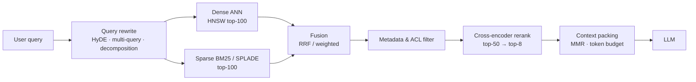

# Module 06 — Vector Databases & Retrieval Operations

> **Goal:** Design, tune and operate the retrieval layer: choose a vector store, tune HNSW, build hybrid (BM25 + dense) search with rank fusion, add cross-encoder reranking, chunk intelligently, and filter by metadata at scale — with the failure modes that only appear in production.

---

## Table of Contents
1. [Module Overview & First-Principles Architecture](#1-module-overview--first-principles-architecture)
2. [Mathematical Foundations](#2-mathematical-foundations--formulas)
3. [Production-Ready Code](#3-production-ready-executable-code)
4. [Hard-Learned Production Failures](#4-hard-learned-production-failures--edge-cases)
5. [Interview Questions](#5-seniorstaff-llmops-interview-questions)

---

## 1. Module Overview & First-Principles Architecture

### 1.1 Retrieval as a multi-stage funnel

Production retrieval is never "embed query → top-k". It is a funnel that trades recall for precision as candidate count shrinks and per-candidate cost rises:



| Stage | Candidates | Cost / candidate | Goal |
|---|---|---|---|
| ANN (dense) | 10⁶–10⁹ → 100 | ~µs (index) | High **recall** |
| BM25 (sparse) | → 100 | ~µs | Exact terms, IDs, rare words |
| Fusion | 200 → 100 | negligible | Robust blending |
| Cross-encoder | 50–100 → 8 | 5–30 ms on GPU (batch) | High **precision** |

### 1.2 Vector database landscape

| System | Architecture | Index types | Strengths | Watch-outs |
|---|---|---|---|---|
| **Qdrant** | Rust, single-binary or distributed (sharding + replicas), segment-based storage with WAL | HNSW (+ payload indexes), scalar/product/binary quantization, sparse vectors, multivector (ColBERT) | Excellent filtered search (filterable HNSW), hybrid via `query_points` prefetch + fusion, simple ops, on-disk/mmap modes | Rebalancing shards needs planning; cluster feature set evolves |
| **Milvus** | Cloud-native disaggregated (proxy, query nodes, data nodes, index nodes; etcd, Pulsar/Kafka, object store) | HNSW, IVF_FLAT/IVF_PQ, DiskANN, GPU CAGRA, SCANN, sparse | Billion-scale; GPU indexes; partitions | Operationally heavy; many components |
| **Pinecone** | Managed serverless / pod-based | Proprietary (graph + quantization) | Zero-ops, namespaces for multi-tenancy | Cost at scale; closed internals; data residency |
| **pgvector** (Postgres) | Extension; MVCC heap tables | HNSW, IVFFlat; `halfvec`, `bit`, sparsevec | Transactional joins with relational data, one system, SQL filters | Single-node scaling limits; HNSW build memory; recall drops with strong filters unless iterative scan |
| **OpenSearch / Elasticsearch** | Lucene | HNSW (+ BM25 native) | Hybrid in one engine, mature ops | Heavier JVM footprint |

**Selection heuristic:** < ~5M vectors and you already run Postgres → **pgvector**. Heavy filtering + moderate/large scale + simple ops → **Qdrant**. Billions of vectors / GPU indexing / team with platform skills → **Milvus**. No ops budget → **Pinecone**/managed Qdrant.

### 1.3 HNSW from first principles

Hierarchical Navigable Small World: a multi-layer proximity graph. Each point is assigned a max layer `ℓ ~ ⌊−ln(U)·m_L⌋` (exponential decay, `m_L = 1/ln M`). Upper layers are sparse "express lanes"; layer 0 contains all points.

```
 Layer 2:   o─────────────────o            (few nodes, long links)
 Layer 1:   o─────o─────o─────o─────o
 Layer 0:   o─o─o─o─o─o─o─o─o─o─o─o─o─o   (all nodes, short links, M0 = 2M)
 Search: enter at top, greedy descend to nearest in each layer, then beam search (width ef) at layer 0.
```

Parameters:
- `M` (a.k.a. `m`): max neighbours per node (layers ≥1; 2M at layer 0). ↑M → higher recall, more RAM (~ `M·8..16` bytes/vector for links), slower build.
- `ef_construct`: beam width while inserting. ↑ → better graph quality, slower build. 
- `ef` (query-time `hnsw_ef`): beam width at search. ↑ → higher recall, higher latency. **The main runtime knob.**

Memory: `RAM ≈ N × (d × bytes_per_dim + M × 2 × 4..8 B)`  (vectors + links) × ~1.1–1.3 for allocator/overhead.

### 1.4 Quantization in vector stores

| Method | Compression | Recall impact | Notes |
|---|---|---|---|
| Scalar (int8) | 4× | −0.5–2 % | Fast; use `rescore` with original vectors |
| Product Quantization | 8–64× | −3–10 % | Slower distance (LUT); good for huge corpora |
| Binary (1-bit) | 32× | big drop unless `d ≥ 1024` and with oversampling+rescore | Works well with high-dim embeddings (OpenAI 3-large, bge-m3) |
| Matryoshka truncation | d/k | model-dependent | Train with MRL; use shorter prefix for first stage then full for rescoring |

Pattern: **quantized vectors in RAM for candidate generation, full-precision on disk (mmap) for rescoring** → large memory reduction at ~1 % recall cost.

### 1.5 Hybrid search

Dense embeddings capture semantics but fail on exact tokens (SKUs, error codes, names, rare acronyms); BM25 is the reverse. Hybrid fuses both lists. Methods:

1. **Reciprocal Rank Fusion (RRF)** — score-free, robust: `score(d) = Σ_i 1/(k + rank_i(d))`, `k≈60`.
2. **Weighted score fusion** — requires score normalisation (min-max or z-score) because BM25 and cosine are on different scales.
3. **Learned sparse (SPLADE, BGE-M3 sparse)** — sparse vectors with term expansion, stored in the same DB.
4. **Late interaction (ColBERT / multivector)** — per-token vectors with MaxSim; higher quality, 10–100× storage.

### 1.6 Reranking

A **bi-encoder** embeds query and doc independently (fast, index-able) but loses fine-grained interaction. A **cross-encoder** reads `[query ; doc]` jointly through all transformer layers and outputs relevance — far more accurate but O(candidates) model calls. Standard use: retrieve 50–100, rerank to 5–10. Models: `BAAI/bge-reranker-v2-m3`, `bge-reranker-large`, `mxbai-rerank`, Cohere Rerank 3.x, Jina reranker. LLM listwise rerankers (RankGPT/RankZephyr) are better but slower/costlier.

### 1.7 Chunking strategies

| Strategy | Description | Best for |
|---|---|---|
| Fixed-size + overlap | 256–512 tokens, 10–20 % overlap | Baseline |
| Recursive / structure-aware | Split on headings → paragraphs → sentences; keep tables/code intact | Docs, wikis, manuals |
| Semantic chunking | Split where adjacent-sentence embedding similarity drops | Prose with topic shifts |
| Parent–child (small-to-big) | Index small chunks (≈128–256 tok) for precision, return parent (≈1,024) for context | Most RAG; best default |
| Sentence-window | Index sentences; return ±N neighbours | QA over narrative |
| Late chunking | Embed the whole doc with long-context embedder, pool per chunk | Preserves cross-chunk context |
| Contextual retrieval | Prepend an LLM-generated 1–2 sentence document context to each chunk before embedding & BM25 | Large improvement (~35–49 % fewer retrieval failures in published results) at ingest cost |

### 1.8 Metadata filtering at scale

Filters (`tenant_id`, `acl_groups`, `doc_type`, `date`) interact badly with ANN:
- **Post-filtering** (ANN then filter) can return < k results (or none) when the filter is selective.
- **Pre-filtering** (brute force on matching set) is exact but slow for large sets.
- **Filterable HNSW** (Qdrant): payload indexes + additional graph links so traversal respects filters; planner switches to brute-force when the filter cardinality is below `full_scan_threshold`.
- Multi-tenancy: one collection + `tenant_id` payload index (with `is_tenant=true` optimisation), *not* a collection per tenant beyond a few dozen. Milvus: partition key. Pinecone: namespaces. pgvector: partial indexes or partitioned tables.

---

## 2. Mathematical Foundations & Formulas

### 2.1 Similarity metrics

```
cosine(q,d)  = q·d / (‖q‖‖d‖)           (normalise once → use dot product)
L2²(q,d)     = ‖q‖² + ‖d‖² − 2 q·d
dot(q,d)     = q·d                       (use when the model was trained with MIPS)
```

For unit vectors: `L2² = 2 − 2cos`. Use the metric the embedding model was trained for.

### 2.2 Recall@k and ANN trade-off

```
Recall@k = |ANN_topk ∩ Exact_topk| / k
```

HNSW query cost ≈ `O(ef · M · log N)` distance computations. Doubling `ef` roughly doubles latency near the knee while recall rises with diminishing returns (0.90 → 0.97 → 0.99).

### 2.3 Memory sizing

```
bytes ≈ N × ( d × b_dim + 2·M × 4 ) × 1.2           # float32: b_dim=4; link IDs 4 B
```

Example: N=10M, d=1024, float32, M=16 → `10e6 × (4096 + 128) × 1.2 ≈ 50.7 GB`. With int8 scalar quantization in RAM + originals on disk: `10e6 × (1024 + 128) × 1.2 ≈ 13.8 GB`.

At 1B vectors, d=768 fp32 = 3 TB raw → need PQ/DiskANN/binary + sharding.

### 2.4 RRF

```
RRF(d) = Σ_{r ∈ rankers} 1 / (k + rank_r(d)),   k = 60 (default)
```

Properties: ignores raw scores, bounded contribution per ranker; an item ranked 1st by only one retriever (1/61 = 0.0164) loses to one ranked 5th by both (2/65 = 0.0308) — rewards consensus.

### 2.5 BM25

```
BM25(q,d) = Σ_{t∈q} IDF(t) · ( f(t,d)·(k1+1) ) / ( f(t,d) + k1·(1 − b + b·|d|/avgdl) )
IDF(t) = ln( (N − n_t + 0.5)/(n_t + 0.5) + 1 )
```
Defaults `k1=1.2–2.0`, `b=0.75`.

### 2.6 Ranking metrics

```
MRR      = (1/|Q|) Σ 1/rank_first_relevant
nDCG@k   = DCG@k / IDCG@k,    DCG@k = Σ_{i=1..k} (2^{rel_i} − 1)/log2(i+1)
Hit@k    = fraction of queries with ≥1 relevant in top-k
```

### 2.7 Retrieval-latency budget

```
T_retrieval = T_embed(q) + max(T_dense, T_sparse) + T_fuse + T_rerank
            ≈ 8 ms + max(15, 10) ms + 1 ms + (n_cand / batch) × t_batch
```
Cross-encoder with 50 candidates × 256 tokens on an L4/A10: ~25–40 ms in one batch. Rerank cost scales linearly with candidates and ~quadratically with sequence length per pair.

### 2.8 Chunk size vs. recall (empirical shape)

Small chunks → high precision, lost context; large chunks → diluted embeddings (one vector averages many topics). Retrieval quality typically peaks at 200–500 tokens for factoid QA and 500–1,000 for explanatory content; parent–child lets you decouple the *retrieval unit* from the *generation unit*.

### 2.9 Staleness and index lag

```
freshness_lag = T_source_update → T_visible_in_search
              = T_event + T_chunk + T_embed (batched) + T_upsert + T_index_refresh
```
Qdrant is visible after upsert with `wait=true`; segment optimisation affects only performance. Elasticsearch default `refresh_interval=1s`.

---

## 3. Production-Ready Executable Code

### 3.1 Local Stack (Qdrant + Redis) via Docker Compose

```yaml
# docker-compose.retrieval.yml
services:
  qdrant:
    image: qdrant/qdrant:v1.12.4
    ports: ["6333:6333", "6334:6334"]
    volumes: ["qdrant-data:/qdrant/storage"]
    environment:
      QDRANT__SERVICE__API_KEY: ${QDRANT_API_KEY:-dev-key}
      QDRANT__STORAGE__PERFORMANCE__MAX_SEARCH_THREADS: "0"
    ulimits: { nofile: { soft: 65535, hard: 65535 } }
    healthcheck:
      test: ["CMD-SHELL", "bash -c ':> /dev/tcp/127.0.0.1/6333' || exit 1"]
      interval: 10s
      retries: 10
  tei-embed:
    image: ghcr.io/huggingface/text-embeddings-inference:1.5
    command: --model-id BAAI/bge-m3 --max-batch-tokens 65536
    ports: ["8081:80"]
    deploy: { resources: { reservations: { devices: [{ driver: nvidia, count: 1, capabilities: [gpu] }] } } }
  tei-rerank:
    image: ghcr.io/huggingface/text-embeddings-inference:1.5
    command: --model-id BAAI/bge-reranker-v2-m3
    ports: ["8082:80"]
    deploy: { resources: { reservations: { devices: [{ driver: nvidia, count: 1, capabilities: [gpu] }] } } }
volumes:
  qdrant-data:
```

### 3.2 Collection Design: Dense + Sparse + Payload Indexes + Quantization + Multi-tenancy

```python
"""Create a production Qdrant collection."""
from __future__ import annotations

from qdrant_client import QdrantClient, models

client = QdrantClient(url="http://localhost:6333", api_key="dev-key", timeout=30, prefer_grpc=True)
COLL = "kb_v3"

if client.collection_exists(COLL):
    raise SystemExit(f"{COLL} exists; create a new versioned collection and swap the alias")

client.create_collection(
    collection_name=COLL,
    vectors_config={
        "dense": models.VectorParams(
            size=1024,
            distance=models.Distance.COSINE,
            hnsw_config=models.HnswConfigDiff(m=16, ef_construct=200, on_disk=False),
            on_disk=True,                       # originals on disk (mmap) for rescoring
        )
    },
    sparse_vectors_config={"sparse": models.SparseVectorParams(index=models.SparseIndexParams(on_disk=False))},
    quantization_config=models.ScalarQuantization(
        scalar=models.ScalarQuantizationConfig(type=models.ScalarType.INT8, quantile=0.99, always_ram=True)
    ),
    optimizers_config=models.OptimizersConfigDiff(indexing_threshold=20_000, default_segment_number=4),
    shard_number=2,
    replication_factor=2,
    on_disk_payload=True,
)

# Payload indexes are mandatory for filtered search performance.
client.create_payload_index(COLL, "tenant_id", models.KeywordIndexParams(type="keyword", is_tenant=True))
client.create_payload_index(COLL, "acl_groups", models.PayloadSchemaType.KEYWORD)
client.create_payload_index(COLL, "doc_type", models.PayloadSchemaType.KEYWORD)
client.create_payload_index(COLL, "updated_at", models.PayloadSchemaType.DATETIME)

# Alias = atomic blue/green swap for re-indexing or embedding-model upgrades.
client.update_collection_aliases(
    change_aliases_operations=[models.CreateAliasOperation(create_alias=models.CreateAlias(collection_name=COLL, alias_name="kb_current"))]
)
```

### 3.3 Ingestion Pipeline: Parent–Child Chunking + Contextual Enrichment + Batched Embedding

```python
"""Ingest documents: structure-aware parent/child chunks, embeddings (dense+sparse), idempotent upserts."""
from __future__ import annotations

import hashlib
import re
import uuid
from dataclasses import dataclass
from typing import Iterable, Iterator, Sequence

import httpx
from qdrant_client import QdrantClient, models
from tenacity import retry, stop_after_attempt, wait_exponential

TEI = "http://localhost:8081"
client = QdrantClient(url="http://localhost:6333", api_key="dev-key", prefer_grpc=True)
_HEADING = re.compile(r"^(#{1,4})\s+(.*)$", re.M)


@dataclass(frozen=True)
class Chunk:
    id: str
    parent_id: str
    text: str
    parent_text: str
    doc_id: str
    section: str
    tenant_id: str
    acl_groups: tuple[str, ...]
    doc_type: str
    updated_at: str


def approx_tokens(s: str) -> int:
    return max(1, len(s) // 4)


def split_sections(md: str) -> Iterator[tuple[str, str]]:
    """Yield (heading_path, body) preserving heading hierarchy."""
    stack: list[tuple[int, str]] = []
    last = 0
    heads = list(_HEADING.finditer(md))
    if not heads:
        yield "", md
        return
    if heads[0].start() > 0:
        yield "", md[: heads[0].start()]
    for i, m in enumerate(heads):
        lvl, title = len(m.group(1)), m.group(2).strip()
        while stack and stack[-1][0] >= lvl:
            stack.pop()
        stack.append((lvl, title))
        end = heads[i + 1].start() if i + 1 < len(heads) else len(md)
        yield " > ".join(t for _, t in stack), md[m.end():end].strip()


def sentences(text: str) -> list[str]:
    return [s.strip() for s in re.split(r"(?<=[.!?])\s+|\n{2,}", text) if s.strip()]


def pack(sents: Sequence[str], max_tok: int, overlap_sents: int = 1) -> Iterator[str]:
    buf: list[str] = []
    tok = 0
    for s in sents:
        t = approx_tokens(s)
        if buf and tok + t > max_tok:
            yield " ".join(buf)
            buf = buf[-overlap_sents:] if overlap_sents else []
            tok = sum(approx_tokens(x) for x in buf)
        buf.append(s)
        tok += t
    if buf:
        yield " ".join(buf)


def make_chunks(doc_id: str, md: str, *, tenant_id: str, acl: tuple[str, ...], doc_type: str, updated_at: str,
                child_tok: int = 200, parent_tok: int = 900) -> Iterator[Chunk]:
    for section, body in split_sections(md):
        for parent in pack(sentences(body), parent_tok, overlap_sents=0):
            pid = hashlib.sha1(f"{doc_id}|{section}|{parent[:64]}".encode()).hexdigest()[:16]
            for child in pack(sentences(parent), child_tok, overlap_sents=1):
                cid = str(uuid.uuid5(uuid.NAMESPACE_URL, f"{doc_id}|{pid}|{child}"))  # idempotent
                yield Chunk(cid, pid, child, parent, doc_id, section, tenant_id, acl, doc_type, updated_at)


@retry(stop=stop_after_attempt(5), wait=wait_exponential(min=0.5, max=10))
def embed(texts: list[str]) -> list[list[float]]:
    r = httpx.post(f"{TEI}/embed", json={"inputs": texts, "normalize": True, "truncate": True}, timeout=60)
    r.raise_for_status()
    return r.json()


def bm25_sparse(text: str) -> models.SparseVector:
    """Lightweight lexical sparse vector (hashing TF). Swap for fastembed SPLADE/BM25 in production."""
    counts: dict[int, float] = {}
    for tok in re.findall(r"[a-z0-9_]+", text.lower()):
        h = int(hashlib.md5(tok.encode()).hexdigest()[:8], 16) % (1 << 20)
        counts[h] = counts.get(h, 0.0) + 1.0
    idx = sorted(counts)
    return models.SparseVector(indices=idx, values=[1.0 + __import__("math").log(counts[i]) for i in idx])


def upsert(chunks: Iterable[Chunk], collection: str = "kb_current", batch: int = 64) -> int:
    n = 0
    buf: list[Chunk] = []

    def flush() -> None:
        nonlocal n
        if not buf:
            return
        dense = embed([f"{c.section}\n{c.text}" for c in buf])   # section heading = cheap contextual retrieval
        points = [
            models.PointStruct(
                id=c.id,
                vector={"dense": d, "sparse": bm25_sparse(f"{c.section} {c.text}")},
                payload={"text": c.text, "parent_id": c.parent_id, "parent_text": c.parent_text, "doc_id": c.doc_id,
                         "section": c.section, "tenant_id": c.tenant_id, "acl_groups": list(c.acl_groups),
                         "doc_type": c.doc_type, "updated_at": c.updated_at},
            )
            for c, d in zip(buf, dense)
        ]
        client.upsert(collection, points=points, wait=True)
        n += len(points)
        buf.clear()

    for c in chunks:
        buf.append(c)
        if len(buf) >= batch:
            flush()
    flush()
    return n


def delete_doc(doc_id: str, collection: str = "kb_current") -> None:
    """Re-ingest = delete by doc_id then upsert; prevents orphaned chunks when a doc shrinks."""
    client.delete(collection, points_selector=models.FilterSelector(
        filter=models.Filter(must=[models.FieldCondition(key="doc_id", match=models.MatchValue(value=doc_id))])))
```

### 3.4 Hybrid Search (server-side RRF fusion) with ACL-aware Filtering

```python
"""Single round-trip hybrid retrieval: dense + sparse prefetch fused by RRF inside Qdrant."""
from __future__ import annotations

from dataclasses import dataclass

from qdrant_client import QdrantClient, models

client = QdrantClient(url="http://localhost:6333", api_key="dev-key", prefer_grpc=True)


@dataclass(frozen=True)
class Hit:
    id: str
    score: float
    text: str
    parent_text: str
    doc_id: str
    section: str


def build_filter(tenant_id: str, user_groups: list[str], doc_types: list[str] | None, since_iso: str | None) -> models.Filter:
    must: list[models.Condition] = [
        models.FieldCondition(key="tenant_id", match=models.MatchValue(value=tenant_id)),
        # ACL: the chunk is visible if ANY of its groups intersects the user's groups.
        models.FieldCondition(key="acl_groups", match=models.MatchAny(any=user_groups + ["public"])),
    ]
    if doc_types:
        must.append(models.FieldCondition(key="doc_type", match=models.MatchAny(any=doc_types)))
    if since_iso:
        must.append(models.FieldCondition(key="updated_at", range=models.DatetimeRange(gte=since_iso)))
    return models.Filter(must=must)


def hybrid_search(q_dense: list[float], q_sparse: models.SparseVector, flt: models.Filter, *, limit: int = 50,
                  prefetch: int = 100, hnsw_ef: int = 128) -> list[Hit]:
    res = client.query_points(
        collection_name="kb_current",
        prefetch=[
            models.Prefetch(query=q_dense, using="dense", limit=prefetch, filter=flt,
                            params=models.SearchParams(hnsw_ef=hnsw_ef,
                                                       quantization=models.QuantizationSearchParams(rescore=True, oversampling=2.0))),
            models.Prefetch(query=q_sparse, using="sparse", limit=prefetch, filter=flt),
        ],
        query=models.FusionQuery(fusion=models.Fusion.RRF),
        limit=limit,
        with_payload=True,
    )
    return [Hit(str(p.id), p.score, p.payload["text"], p.payload["parent_text"], p.payload["doc_id"], p.payload["section"])
            for p in res.points]
```

### 3.5 Cross-Encoder Reranking (local TEI or sentence-transformers) + Cohere option

```python
"""Rerank with BGE reranker via TEI; fallback to score order on failure (never fail the request)."""
from __future__ import annotations

import logging
import time
from typing import Sequence

import httpx

log = logging.getLogger("rerank")
RERANK_URL = "http://localhost:8082/rerank"


def rerank(query: str, hits: Sequence["Hit"], top_n: int = 8, timeout_s: float = 0.4) -> list["Hit"]:
    if not hits:
        return []
    t0 = time.perf_counter()
    try:
        r = httpx.post(RERANK_URL, json={"query": query, "texts": [h.text for h in hits], "truncate": True}, timeout=timeout_s)
        r.raise_for_status()
        order = sorted(r.json(), key=lambda x: x["score"], reverse=True)[:top_n]
        out = [hits[o["index"]] for o in order]
        log.info("rerank ok n=%d ms=%.1f", len(hits), (time.perf_counter() - t0) * 1e3)
        return out
    except Exception as e:           # degrade gracefully to fused order
        log.warning("rerank failed (%s); falling back to fusion order", e)
        return list(hits[:top_n])


# Cohere variant:
#   import cohere; co = cohere.ClientV2()
#   r = co.rerank(model="rerank-v3.5", query=q, documents=[h.text for h in hits], top_n=8)
#   out = [hits[x.index] for x in r.results]
```

Parent-document expansion and MMR packing:

```python
import numpy as np

def dedupe_parents(hits: list["Hit"], max_parents: int = 5) -> list[str]:
    seen: set[str] = set(); out: list[str] = []
    for h in hits:
        key = h.doc_id + "|" + h.parent_text[:60]
        if key in seen:
            continue
        seen.add(key); out.append(h.parent_text)
        if len(out) == max_parents:
            break
    return out

def mmr(query_vec: np.ndarray, doc_vecs: np.ndarray, k: int, lam: float = 0.7) -> list[int]:
    sims = doc_vecs @ query_vec
    chosen: list[int] = []; cand = list(range(len(doc_vecs)))
    while cand and len(chosen) < k:
        scores = [lam * sims[i] - (1 - lam) * max((doc_vecs[i] @ doc_vecs[j] for j in chosen), default=0.0) for i in cand]
        best = cand[int(np.argmax(scores))]
        chosen.append(best); cand.remove(best)
    return chosen
```

### 3.6 HNSW Tuning Harness (measure recall vs latency, choose `ef`)

```python
"""Sweep hnsw_ef; compare against exact (brute-force) results to compute recall@k."""
from __future__ import annotations

import statistics
import time

import numpy as np
from qdrant_client import QdrantClient, models

client = QdrantClient(url="http://localhost:6333", api_key="dev-key", prefer_grpc=True)
COLL = "kb_current"


def sweep(queries: list[list[float]], k: int = 10, efs: tuple[int, ...] = (16, 32, 64, 128, 256, 512)) -> None:
    exact = [
        {p.id for p in client.query_points(COLL, query=q, using="dense", limit=k,
                                          search_params=models.SearchParams(exact=True)).points}
        for q in queries
    ]
    print(f"{'ef':>5} {'recall@k':>9} {'p50 ms':>8} {'p95 ms':>8}")
    for ef in efs:
        lat: list[float] = []; rec: list[float] = []
        for q, truth in zip(queries, exact):
            t = time.perf_counter()
            got = {p.id for p in client.query_points(COLL, query=q, using="dense", limit=k,
                                                     search_params=models.SearchParams(hnsw_ef=ef)).points}
            lat.append((time.perf_counter() - t) * 1e3)
            rec.append(len(got & truth) / k)
        print(f"{ef:>5} {np.mean(rec):>9.3f} {statistics.median(lat):>8.1f} {np.percentile(lat, 95):>8.1f}")
```

Typical guidance: pick the smallest `ef` giving recall@10 ≥ 0.97–0.98 at p95 latency within budget; rebuild with higher `m`/`ef_construct` only if no `ef` reaches target.

### 3.7 Retrieval Evaluation (Hit@k / MRR / nDCG) with a Golden Set

```python
from __future__ import annotations

import math


def hit_at_k(results: list[list[str]], gold: list[set[str]], k: int) -> float:
    return sum(1 for r, g in zip(results, gold) if set(r[:k]) & g) / len(gold)


def mrr(results: list[list[str]], gold: list[set[str]]) -> float:
    total = 0.0
    for r, g in zip(results, gold):
        for i, d in enumerate(r, 1):
            if d in g:
                total += 1 / i
                break
    return total / len(gold)


def ndcg_at_k(results: list[list[str]], gold: list[dict[str, int]], k: int) -> float:
    def dcg(rels: list[int]) -> float:
        return sum((2**rel - 1) / math.log2(i + 2) for i, rel in enumerate(rels))
    vals = []
    for r, g in zip(results, gold):
        rels = [g.get(d, 0) for d in r[:k]]
        ideal = sorted(g.values(), reverse=True)[:k]
        vals.append(dcg(rels) / dcg(ideal) if ideal else 0.0)
    return sum(vals) / len(vals)
```

CI gate example: `Hit@10 ≥ 0.92`, `MRR ≥ 0.55`, `nDCG@10 ≥ 0.70`, and *no query-class slice* more than 5 points under the mean.

### 3.8 pgvector Option (SQL, HNSW, filtered iterative scan)

```sql
CREATE EXTENSION IF NOT EXISTS vector;

CREATE TABLE chunks (
  id          uuid PRIMARY KEY,
  tenant_id   text NOT NULL,
  acl_groups  text[] NOT NULL,
  doc_id      text NOT NULL,
  content     text NOT NULL,
  embedding   halfvec(1024) NOT NULL,      -- half precision halves memory
  tsv         tsvector GENERATED ALWAYS AS (to_tsvector('english', content)) STORED,
  updated_at  timestamptz NOT NULL DEFAULT now()
);

CREATE INDEX chunks_hnsw ON chunks USING hnsw (embedding halfvec_cosine_ops) WITH (m = 16, ef_construction = 200);
CREATE INDEX chunks_gin  ON chunks USING gin (tsv);
CREATE INDEX chunks_tenant ON chunks (tenant_id);

-- Filtered ANN: enable iterative scan so selective filters still return k rows (pgvector >= 0.8)
SET hnsw.ef_search = 100;
SET hnsw.iterative_scan = relaxed_order;
SET hnsw.max_scan_tuples = 20000;

-- Hybrid in one query via RRF
WITH dense AS (
  SELECT id, ROW_NUMBER() OVER (ORDER BY embedding <=> $1) AS r
  FROM chunks WHERE tenant_id = $2 AND acl_groups && $3
  ORDER BY embedding <=> $1 LIMIT 100),
sparse AS (
  SELECT id, ROW_NUMBER() OVER (ORDER BY ts_rank_cd(tsv, q) DESC) AS r
  FROM chunks, websearch_to_tsquery('english', $4) q
  WHERE tenant_id = $2 AND acl_groups && $3 AND tsv @@ q
  ORDER BY ts_rank_cd(tsv, q) DESC LIMIT 100)
SELECT COALESCE(d.id, s.id) AS id,
       COALESCE(1.0/(60+d.r), 0) + COALESCE(1.0/(60+s.r), 0) AS rrf
FROM dense d FULL OUTER JOIN sparse s USING (id)
ORDER BY rrf DESC LIMIT 50;
```

### 3.9 Milvus Option (partition key multi-tenancy + hybrid + RRF)

```python
from __future__ import annotations

from pymilvus import (AnnSearchRequest, Collection, CollectionSchema, DataType, FieldSchema, RRFRanker, connections, utility)

connections.connect(uri="http://localhost:19530")
fields = [
    FieldSchema("id", DataType.VARCHAR, is_primary=True, max_length=64),
    FieldSchema("tenant_id", DataType.VARCHAR, max_length=64, is_partition_key=True),
    FieldSchema("text", DataType.VARCHAR, max_length=8192),
    FieldSchema("dense", DataType.FLOAT_VECTOR, dim=1024),
    FieldSchema("sparse", DataType.SPARSE_FLOAT_VECTOR),
]
coll = Collection("kb_v3", CollectionSchema(fields), num_partitions=64)
coll.create_index("dense", {"index_type": "HNSW", "metric_type": "COSINE", "params": {"M": 16, "efConstruction": 200}})
coll.create_index("sparse", {"index_type": "SPARSE_INVERTED_INDEX", "metric_type": "IP"})
coll.load()


def hybrid(q_dense: list[float], q_sparse: dict[int, float], tenant: str, k: int = 50):
    expr = f'tenant_id == "{tenant}"'
    reqs = [
        AnnSearchRequest([q_dense], "dense", {"metric_type": "COSINE", "params": {"ef": 128}}, limit=100, expr=expr),
        AnnSearchRequest([q_sparse], "sparse", {"metric_type": "IP"}, limit=100, expr=expr),
    ]
    return coll.hybrid_search(reqs, RRFRanker(60), limit=k, output_fields=["text"])
```

### 3.10 Embedding-Model Migration (zero-downtime)

```python
"""Blue/green re-index when the embedding model changes (vectors from different models are NOT comparable)."""
from __future__ import annotations

from qdrant_client import QdrantClient, models

client = QdrantClient(url="http://localhost:6333", api_key="dev-key")


def migrate(old: str, new: str, alias: str, reembed, batch: int = 256) -> None:
    offset = None
    while True:
        pts, offset = client.scroll(old, limit=batch, offset=offset, with_payload=True, with_vectors=False)
        if not pts:
            break
        vecs = reembed([p.payload["text"] for p in pts])          # new model
        client.upsert(new, [models.PointStruct(id=p.id, vector={"dense": v}, payload=p.payload) for p, v in zip(pts, vecs)])
        if offset is None:
            break
    # 1) shadow-evaluate new vs old on the golden set  2) flip alias atomically
    client.update_collection_aliases([
        models.DeleteAliasOperation(delete_alias=models.DeleteAlias(alias_name=alias)),
        models.CreateAliasOperation(create_alias=models.CreateAlias(collection_name=new, alias_name=alias)),
    ])
```

### 3.11 Kubernetes: Qdrant Cluster via StatefulSet (core settings)

```yaml
apiVersion: apps/v1
kind: StatefulSet
metadata: { name: qdrant }
spec:
  serviceName: qdrant-headless
  replicas: 3
  selector: { matchLabels: { app: qdrant } }
  template:
    metadata: { labels: { app: qdrant } }
    spec:
      affinity:
        podAntiAffinity:
          requiredDuringSchedulingIgnoredDuringExecution:
            - labelSelector: { matchLabels: { app: qdrant } }
              topologyKey: topology.kubernetes.io/zone
      containers:
        - name: qdrant
          image: qdrant/qdrant:v1.12.4
          args: ["./entrypoint.sh"]
          env:
            - { name: QDRANT__CLUSTER__ENABLED, value: "true" }
            - { name: QDRANT__SERVICE__API_KEY, valueFrom: { secretKeyRef: { name: qdrant, key: api-key } } }
          ports: [{ containerPort: 6333 }, { containerPort: 6334 }, { containerPort: 6335 }]
          resources: { requests: { cpu: "4", memory: 24Gi }, limits: { memory: 32Gi } }
          readinessProbe: { httpGet: { path: /readyz, port: 6333 }, periodSeconds: 5 }
          volumeMounts: [{ name: storage, mountPath: /qdrant/storage }]
  volumeClaimTemplates:
    - metadata: { name: storage }
      spec: { accessModes: [ReadWriteOnce], storageClassName: fast-ssd, resources: { requests: { storage: 500Gi } } }
```

---

## 4. Hard-Learned Production Failures & Edge Cases

### Incident 1 — Filtered search returned zero results for a small tenant

**Symptom.** Tenants with few documents saw "I can't find anything" while the content existed; large tenants were fine.

**Root-cause analysis.**
1. The system did ANN top-100 globally, then applied `tenant_id` filter in application code (post-filtering).
2. A small tenant owned 0.01 % of vectors; the global top-100 contained none of their chunks.
3. Switching to server-side filtering without a payload index made Qdrant fall back to scanning the payload — latency of 4 s at 20M points.

**Remediation.** Create a keyword payload index with `is_tenant=true` (co-locates tenant vectors), pass the filter to Qdrant so the planner uses filterable HNSW or brute-force when cardinality is low, monitor `filter_cardinality` and p95 latency per tenant size bucket. In pgvector enable `hnsw.iterative_scan`.

### Incident 2 — Stale or deleted documents kept being cited (and a permission leak)

**Symptom.** A user quoted a policy that was withdrawn six months earlier; separately, an employee saw a snippet from a document they had lost access to.

**Root-cause analysis.**
1. Ingestion only upserted; when a document shrank or was deleted, orphaned chunks remained (the old chunk IDs were never removed).
2. ACLs were copied into payload at ingest time and never refreshed when group membership/permissions changed.

**Remediation.**
- Idempotent re-ingestion: `delete_doc(doc_id)` then upsert, or tombstone by `doc_version` and filter `doc_version == current`.
- Event-driven permission sync (webhook from IdP/DMS → `set_payload` on affected `doc_id`), with a nightly reconciliation job comparing source ACLs to payload ACLs and alerting on drift.
- **Enforce authorization at query time** with a filter built from the *current* user token groups (never trust cached ACLs alone) and re-check against the source of truth for top-k before returning snippets for high-sensitivity corpora.
- Add `valid_until` payload field and filter on it.

### Incident 3 — Embedding model upgrade silently destroyed recall

**Symptom.** After swapping `bge-large` → `bge-m3` Hit@10 dropped from 0.91 to 0.31 within one hour; no errors.

**Root-cause analysis.** New documents were embedded with the new model while the existing 12M vectors came from the old one, in the same collection. Cosine between spaces is meaningless; queries (embedded with the new model) only matched new documents.

**Remediation.** Never mix embedding models in a collection. Use the blue/green migration of §3.10, store `embedding_model` and `embedding_version` in the collection name and payload, and add a startup assertion that the query embedder's model id equals the collection's metadata. Shadow-evaluate with the golden set before flipping the alias.

### Incident 4 — HNSW memory blow-up on index build / OOM kills

**Symptom.** Qdrant pods OOM-killed during a bulk load of 60M vectors; restarts looped.

**Root cause.** `ef_construct=512`, `m=64`, all vectors in RAM, `indexing_threshold` low → many concurrent HNSW builds, and the working-set exceeded the pod limit (memory limit = request, no mmap headroom).

**Remediation.** Bulk-load with indexing disabled (`indexing_threshold=0`), then enable indexing; use scalar quantization with `always_ram`, originals `on_disk`; `m=16`, `ef_construct=128–200`; size memory with §2.3 plus 30 % headroom; stagger ingestion workers; set a higher memory limit than request for page-cache.

### Incident 5 — Reranker latency tail wrecked the SLA

**Symptom.** p99 retrieval latency 3 s, though median was 90 ms.

**Root cause.** Reranker received 100 candidates of variable length (some 4k-token chunks) in one batch; a single long pair dominated padded batch compute; GPU shared with embedding service.

**Remediation.** Truncate pairs (`max_length=512`), cap candidates at 50, dynamic batching by length, separate GPU/pool for reranker, a 400 ms timeout with graceful fallback to fusion order (§3.5), and cache rerank scores for hot queries.

### Incident 6 — "Lost in the middle": more context lowered answer quality

**Symptom.** Raising top-k from 5 to 20 reduced faithfulness.

**Root cause.** Long contexts bury the relevant passage mid-prompt; models attend better to start/end. Also the added chunks included distractors.

**Remediation.** Rerank, keep k small (5–8), place highest-ranked at the start and end, use parent-document expansion only for the top few, and evaluate the context-precision metric (Module 07) when changing k.

---

## 5. Senior/Staff LLMOps Interview Questions

### Scenario 1 — "Dense retrieval misses queries containing product SKUs and error codes. Fix it."

**Junior/Mid Trap Answer:** "Use a bigger/better embedding model or fine-tune the embedder."

**Staff Production Answer:** "Embedding models compress semantics; arbitrary identifiers like `ERR_4012` or `SKU-88-AX` are out-of-vocabulary-ish and get fuzzy vectors. The right tool is lexical matching, so I'd implement **hybrid search**: dense ANN plus BM25 or learned-sparse (SPLADE/BGE-M3 sparse), fused with RRF (k≈60) because it needs no score normalisation, then cross-encoder rerank the top 50. I'd also tokenise identifiers sensibly for BM25 (preserve punctuation, n-gram analyser), maybe add a query classifier that boosts the sparse leg when the query contains code-like tokens, and measure the improvement on a golden set sliced by query type (identifier vs natural-language). Fine-tuning the embedder is a last resort and risks regression elsewhere."

### Scenario 2 — "Choose a vector database for 200M chunks, multi-tenant, strict ACL filtering, 100 QPS, p95 < 100 ms."

**Junior/Mid Trap Answer:** "Pinecone because it's managed" (or "pgvector because we already have Postgres") without analysis.

**Staff Production Answer:** "Size first: 200M × 1024-d float32 = 820 GB raw; with HNSW links ~1 TB. That rules out single-node pgvector. With int8 scalar quantization in RAM (~230 GB) and originals on NVMe for rescoring, it fits a 6–8 node cluster. Because ACL and tenant filters are on every query, the engine must support **filterable HNSW** — Qdrant is a strong fit (payload indexes, `is_tenant`, planner switching to brute-force for selective filters, hybrid prefetch+RRF); Milvus with partition keys is the alternative if we also need GPU indexing or higher scale. I'd shard by tenant hash with 2× replication across zones, keep 99 % recall via `ef` tuning, and load-test with the real filter-selectivity distribution, not unfiltered queries. Operational plan: blue/green collections via aliases, ACL sync pipeline, per-tenant quotas. Managed Pinecone is viable if ops capacity is the constraint, but I'd model cost at 200M vectors and check data-residency/ACL-filter semantics."

### Scenario 3 — "Why add a reranker if the embedding model is already good?"

**Junior/Mid Trap Answer:** "It improves accuracy a bit."

**Staff Production Answer:** "Bi-encoders compress each document into one vector independently, so they cannot model query–document token interactions; they optimise for recall over a huge corpus cheaply. A cross-encoder attends jointly over query and passage and is far more precise, but costs a forward pass per pair, so it's only affordable on a short candidate list. The funnel is: ANN/hybrid top-100 for recall → cross-encoder top-5–8 for precision. Typical gains: +10–25 % nDCG@10 and, importantly, higher *context precision*, which improves groundedness because fewer distractors reach the LLM. Costs: ~20–40 ms GPU for 50 pairs, an extra service to operate. I'd add timeouts with fallback to fusion order, cap candidates and sequence length, and verify the gain on the golden set — if nDCG doesn't move, skip it."

### Scenario 4 — "Walk me through chunking for a corpus of PDFs with tables, code blocks and long policies."

**Junior/Mid Trap Answer:** "Split every 500 characters with 50 overlap."

**Staff Production Answer:** "Fixed character splitting shreds tables and code and strips headings. I'd parse structure first (layout-aware parser such as Docling/Unstructured; tables as Markdown/HTML units; code fenced), then split recursively on headings → paragraphs → sentences. I'd use **parent–child**: embed ~200-token child chunks for precision but return the ~900-token parent (or full section) for generation. Each chunk's embedding text is prefixed with its heading path (and optionally an LLM-generated contextual blurb — Anthropic-style contextual retrieval) so 'Section 4.2: Termination' is not lost. Tables are kept whole or summarised with the raw table in payload. Store `doc_id`, `section`, `page`, `version`, `acl`. Then tune empirically: sweep chunk sizes (128/256/512) and measure Hit@k and downstream faithfulness; there's no universal best size."

### Scenario 5 — "Recall dropped after we added a tenant filter. Why and how to fix?"

**Junior/Mid Trap Answer:** "The filter excludes some results, so recall is naturally lower."

**Staff Production Answer:** "That conflates correct filtering with ANN failure. If the engine post-filters the ANN candidates, a selective filter eliminates most of the top-`ef` candidates and you get fewer than k results — a recall artefact. If it pre-filters the graph without filter-aware links, HNSW traversal can get disconnected. Remedies: use an engine with filter-aware HNSW (Qdrant builds extra links per payload index, switches to exact scan under a cardinality threshold), create payload indexes on every filtered field, raise `ef` for filtered queries, or use iterative scans (pgvector ≥0.8). For hard multi-tenancy, partition (Milvus partition key, Pinecone namespaces, Qdrant tenant index) so each tenant's graph is separate. I'd measure recall against an exact filtered scan per selectivity bucket (1 %, 0.1 %, 0.01 %) to find the degraded regime."

### Scenario 6 — "How do you keep the index fresh and consistent with the source of truth?"

**Junior/Mid Trap Answer:** "Re-run the full ingestion nightly."

**Staff Production Answer:** "Nightly full rebuilds create up-to-24 h staleness and a large compute bill. I'd use CDC/webhooks from source systems onto a queue (Kafka/SQS), idempotent workers keyed by `doc_id + content_hash` that skip unchanged documents, delete-then-upsert per document (so shrunk docs leave no orphans) or version tag + filter on current version, and separate pipelines for permission changes (cheap `set_payload`) vs content changes (re-chunk, re-embed). A reconciliation job compares source inventory with index inventory and alerts on drift (count mismatch, missing doc, extra doc). Track freshness SLO as `now − source_updated_at` for the p95 of documents. Embedding model upgrades are blue/green into a new collection with alias flip. Deletions for compliance (GDPR) need guaranteed propagation and verification queries."

### Scenario 7 — "Explain HNSW parameters and how you'd tune them."

**Junior/Mid Trap Answer:** "Higher values are always more accurate so set them as high as possible."

**Staff Production Answer:** "`M` controls graph degree (memory ~ `8·M` bytes per vector for links, plus build time); `ef_construct` is the build-time beam width (index quality vs build cost); `ef`/`hnsw_ef` is the query-time beam width (the main recall/latency dial). Maxing them wastes RAM and CPU with diminishing returns. My procedure: fix `M=16`, `ef_construct=128–200`, build, then sweep `ef` against an exact-search ground truth on ~1k representative queries to chart recall@k vs p95 latency; choose the smallest `ef` meeting recall ≥0.97 within the latency budget. Only if no `ef` reaches target do I rebuild with higher `M`/`ef_construct`. For memory: scalar quantization with rescoring recovers most recall at 4× less RAM. Re-tune when data distribution, dimensionality or filters change."

### Scenario 8 — "Users ask questions that need multiple documents (comparisons, multi-hop). Single-shot retrieval fails. What do you do?"

**Junior/Mid Trap Answer:** "Increase top-k so more documents are retrieved."

**Staff Production Answer:** "More k adds noise rather than the missing hop. I'd decompose: an LLM-based query planner splits into sub-questions (or generates step-back/multi-query variants), retrieves per sub-question, fuses and reranks per leg, then synthesises with citations. For true multi-hop (answer to hop 1 is a query term for hop 2) use an iterative/agentic loop with a max-hops cap and a stop criterion, or GraphRAG for entity-relationship-heavy corpora (pre-extracted knowledge graph + community summaries). Cost grows with each hop, so route: a cheap classifier sends simple queries down the single-shot path. Evaluate with multi-hop sets (HotpotQA-style internal data) and track latency/cost per route."

---

### Key Takeaways
- Retrieval is a **funnel**: recall first (hybrid ANN + BM25), precision second (cross-encoder), packing last.
- Filters need payload indexes and filter-aware ANN; test recall per filter-selectivity bucket.
- Never mix embedding models in one index; migrate blue/green with aliases.
- Parent–child chunking + heading-prefixed embeddings is the best default; measure, don't guess.
- Authorization belongs in the query path, not just the ingestion path; keep freshness and ACLs event-driven.
