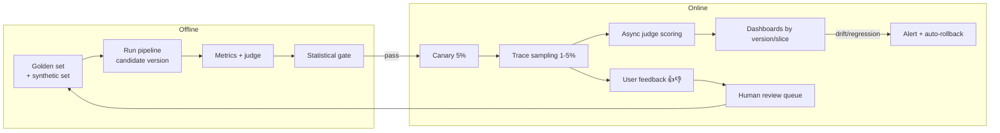

# Module 07 — RAGOps & Evaluation Frameworks

> **Goal:** Build an evaluation system you can trust: the RAG triad, calibrated LLM-as-judge pipelines (Ragas, TruLens, DeepEval), synthetic test-set generation, and CI/CD gates with statistics that prevent shipping regressions on noise.

---

## Table of Contents
1. [Module Overview & First-Principles Architecture](#1-module-overview--first-principles-architecture)
2. [Mathematical Foundations](#2-mathematical-foundations--formulas)
3. [Production-Ready Code](#3-production-ready-executable-code)
4. [Hard-Learned Production Failures](#4-hard-learned-production-failures--edge-cases)
5. [Interview Questions](#5-seniorstaff-llmops-interview-questions)

---

## 1. Module Overview & First-Principles Architecture

### 1.1 Why LLM evaluation is hard

- Outputs are **open-ended**: many correct phrasings, so exact-match fails.
- Quality is **multi-dimensional**: correctness, groundedness, completeness, tone, safety, format, latency, cost.
- Failures are **long-tail** and distribution-specific: the aggregate score hides slice regressions.
- The judge is itself an LLM with biases (verbosity, position, self-preference).
- Test sets **leak** and **rot**: they stop representing production.

An evaluation system therefore has four layers: **(1) golden datasets**, **(2) metrics** (programmatic, model-based, human), **(3) statistical decision rules**, **(4) pipeline integration** (offline CI + online sampling).

### 1.2 The RAG evaluation triad

```
                    ┌──────────────────────┐
         Query  ───▶│    Retriever         │───▶ Retrieved Context
          │         └──────────────────────┘          │
          │                                           │
          │         ┌──────────────────────┐          │
          └────────▶│    Generator (LLM)   │◀─────────┘
                    └──────────┬───────────┘
                               ▼
                            Answer

  (A) Context Relevance : Query  ↔ Context     "Did we retrieve the right stuff?"
  (B) Groundedness      : Context ↔ Answer     "Is the answer supported by the context?" (faithfulness)
  (C) Answer Relevance  : Query  ↔ Answer      "Does the answer address the question?"
```

Diagnostic table:

| Context Relevance | Groundedness | Answer Relevance | Diagnosis |
|---|---|---|---|
| Low | – | – | Retrieval problem: chunking, embeddings, hybrid, filters, query rewrite |
| High | Low | – | **Hallucination**: model ignoring/contradicting context → prompt, model, decoding |
| High | High | Low | Answers a different question / over-refuses / incomplete → prompt, query understanding |
| High | High | High | Healthy (still check correctness vs ground truth) |

### 1.3 Extended RAG metrics

| Metric | What it measures | Needs reference? |
|---|---|---|
| **Context Precision** | Are relevant chunks ranked high in the retrieved list? | Ground-truth answer/contexts |
| **Context Recall** | Does retrieved context cover all facts in the ground-truth answer? | Ground-truth answer |
| **Faithfulness** | Fraction of answer claims entailed by context | No |
| **Answer Relevancy** | Semantic similarity between the question and questions regenerated from the answer | No |
| **Answer Correctness** | Factual + semantic match vs ground-truth | Yes |
| **Noise Sensitivity** | Does irrelevant context cause wrong claims? | Yes |
| **Citation Accuracy** | Do cited sources support the cited claim? | No |
| **Abstention Accuracy** | Refuses when context lacks the answer; answers when it has it | Labelled answerable/unanswerable |

### 1.4 Evaluation methods ladder

```
Cheapest/fastest ──────────────────────────────────────────────▶ Most trustworthy/slowest
 assertions/regex  →  embedding similarity  →  LLM-as-judge  →  pairwise judge  →  human review  →  online A/B / outcomes
```

Rule: use the cheapest method that is *validated against* the more expensive one. A judge is only trustworthy after you measure its agreement with human labels.

### 1.5 LLM-as-a-Judge: patterns and biases

Patterns: **pointwise** scoring (rubric 1–5 / binary), **pairwise** preference (A vs B), **reference-guided** grading, **checklist/claim decomposition** (Ragas faithfulness: extract claims, verify each against context), **multi-judge panels** (reduce variance), **G-Eval** (CoT + token-probability-weighted score).

Known biases and mitigations:

| Bias | Description | Mitigation |
|---|---|---|
| Verbosity | Prefers longer answers | Length-controlled comparison; rubric "penalise padding" |
| Position | Prefers first/second option | Swap order, require both orders to agree |
| Self-preference | Favours its own family's style | Use a judge from a different family |
| Sycophancy to claims | Accepts confident wrong statements | Reference-guided + claim verification against context |
| Score compression | Uses 3–4 on a 1–5 scale | Binary/ternary rubrics with anchors; calibrate thresholds |
| Non-determinism | Varies across runs | temperature=0, multiple samples, majority vote |

### 1.6 Where eval lives in the lifecycle



The **flywheel**: production failures → human-labelled → added to the golden set → regression test forever.

---

## 2. Mathematical Foundations & Formulas

### 2.1 Faithfulness (claim-level, Ragas-style)

Decompose answer `a` into atomic claims `C = {c_1..c_n}`. For each claim, a verifier checks entailment by retrieved context `K`:

```
Faithfulness(a, K) = |{c ∈ C : K ⊨ c}| / |C|
```

### 2.2 Context precision@K (rank-aware)

With `v_k ∈ {0,1}` indicating relevance of the chunk at rank `k`:

```
Precision@k = (Σ_{i≤k} v_i) / k
ContextPrecision@K = ( Σ_{k=1..K} Precision@k · v_k ) / (Σ_{k=1..K} v_k)
```

### 2.3 Context recall

```
ContextRecall = |{ground-truth statements attributable to retrieved context}| / |{ground-truth statements}|
```

### 2.4 Answer relevancy (embedding-based)

Generate `N` questions `q_i` from the answer with an LLM; with embedding function `E`:

```
AnswerRelevancy = (1/N) Σ_i cos( E(q), E(q_i) )
```

### 2.5 Confidence intervals for a pass-rate

For `n` items with `k` passes, Wilson 95 % interval:

```
p̂ = k/n,   z = 1.96
CI = ( p̂ + z²/2n ± z·sqrt( p̂(1−p̂)/n + z²/4n² ) ) / (1 + z²/n)
```

n=100, p̂=0.90 → CI ≈ [0.826, 0.945] (±~6 points). To resolve a 2-point difference you need n ≈ 1,500+ (unpaired) or far fewer with a paired test.

### 2.6 Paired bootstrap for metric deltas

For per-item scores `a_i` (baseline) and `b_i` (candidate): resample items with replacement `B=10,000` times, compute `Δ* = mean(b*)−mean(a*)`; the 95 % CI is the 2.5/97.5 percentiles. Gate: **lower bound of Δ CI ≥ −ε** (non-inferiority) for guard metrics, **> 0** for target metrics.

### 2.7 Judge–human agreement

Cohen's κ for categorical labels:

```
κ = (p_o − p_e) / (1 − p_e)
```
Interpretation: <0.4 poor, 0.4–0.6 moderate, 0.6–0.8 substantial, >0.8 near-perfect. Require κ ≥ 0.6 against ≥ 200 human-labelled items before the judge gates releases. For ordinal scores use weighted κ or Spearman ρ.

### 2.8 Sample size for detecting a delta

Two-sample, proportions `p1`, `p2`, power 0.8, α=0.05:

```
n per arm ≈ 2·(z_{α/2} + z_β)² · p̄(1−p̄) / (p1 − p2)²  = 15.7 · p̄(1−p̄)/Δ²
```
p̄=0.85, Δ=0.03 → n ≈ 15.7 × 0.1275 / 0.0009 ≈ **2,224 per arm**. Hence paired designs and judge-score continuous metrics (lower variance) matter.

### 2.9 Expected cost of evaluation

```
Cost_eval = N_items × (tokens_per_item_pipeline × $_gen + n_metrics × tokens_per_judge_call × $_judge)
```
Claim-decomposition faithfulness ≈ 2–3 judge calls per item; with 500 items × 4 metrics × 2k tokens ≈ 4M judge tokens per run. Use a smaller fine-tuned judge (or Prometheus/Glider-class) for per-PR runs and a frontier judge nightly.

### 2.10 Position-bias adjusted pairwise win rate

Run each pair in both orders; count as a win only if the same system wins both; ties otherwise.

```
WinRate_A = (wins_A + 0.5·ties) / (wins_A + wins_B + ties)
```

---

## 3. Production-Ready Executable Code

### 3.1 Requirements

```text
# requirements-eval.txt
ragas>=0.2.6
deepeval>=2.0
trulens>=1.2
langchain-openai>=0.2
datasets>=2.20
pandas>=2.2
scipy>=1.13
numpy>=1.26
pydantic>=2.7
openai>=1.40
pytest>=8
langfuse>=2.50
```

### 3.2 From-Scratch Triad Evaluator (no framework lock-in, structured judge outputs)

```python
"""RAG triad evaluator with claim-level faithfulness. Works with any OpenAI-compatible judge."""
from __future__ import annotations

import asyncio
import json
from dataclasses import dataclass
from typing import Literal

from openai import AsyncOpenAI
from pydantic import BaseModel, Field

judge = AsyncOpenAI(base_url="http://localhost:8001/v1", api_key="EMPTY")
JUDGE_MODEL = "llm-judge"
SEM = asyncio.Semaphore(16)


class Claims(BaseModel):
    claims: list[str] = Field(description="Atomic, self-contained factual claims made by the answer")


class Verdict(BaseModel):
    claim: str
    verdict: Literal["supported", "contradicted", "not_in_context"]
    evidence: str = ""


class Verdicts(BaseModel):
    verdicts: list[Verdict]


class Relevance(BaseModel):
    reasoning: str
    score: Literal[0, 1, 2]    # 0 irrelevant, 1 partially, 2 fully relevant


async def _json(prompt: str, schema: type[BaseModel]) -> BaseModel:
    async with SEM:
        r = await judge.chat.completions.create(
            model=JUDGE_MODEL, temperature=0.0,
            messages=[{"role": "user", "content": prompt}],
            extra_body={"guided_json": schema.model_json_schema()},   # vLLM guided decoding => always parseable
        )
    return schema.model_validate_json(r.choices[0].message.content or "{}")


async def faithfulness(answer: str, contexts: list[str]) -> tuple[float, list[Verdict]]:
    claims = await _json(
        "Break the ANSWER into atomic factual claims. Resolve pronouns so each claim stands alone. "
        "Ignore opinions, greetings and refusals.\n\nANSWER:\n" + answer, Claims)
    assert isinstance(claims, Claims)
    if not claims.claims:
        return 1.0, []
    ctx = "\n\n".join(f"[{i}] {c}" for i, c in enumerate(contexts))
    v = await _json(
        "For each CLAIM decide if it is supported by the CONTEXT only (ignore world knowledge). "
        "'contradicted' if context says otherwise; 'not_in_context' if unverifiable.\n\n"
        f"CONTEXT:\n{ctx}\n\nCLAIMS:\n{json.dumps(claims.claims)}", Verdicts)
    assert isinstance(v, Verdicts)
    sup = sum(1 for x in v.verdicts if x.verdict == "supported")
    return sup / max(1, len(v.verdicts)), v.verdicts


async def context_relevance(question: str, contexts: list[str]) -> float:
    async def one(c: str) -> int:
        r = await _json(f"Question: {question}\n\nPassage: {c}\n\nHow useful is the passage for answering the question? "
                        "0=irrelevant, 1=partially, 2=directly answers.", Relevance)
        assert isinstance(r, Relevance)
        return r.score
    scores = await asyncio.gather(*(one(c) for c in contexts))
    return sum(scores) / (2 * max(1, len(scores)))


async def answer_relevance(question: str, answer: str) -> float:
    r = await _json(
        f"QUESTION: {question}\nANSWER: {answer}\n\nDoes the answer directly address the question? "
        "0=off-topic/refuses without reason, 1=partial/evasive, 2=complete and on-topic.", Relevance)
    assert isinstance(r, Relevance)
    return r.score / 2


@dataclass
class TriadResult:
    context_relevance: float
    groundedness: float
    answer_relevance: float


async def evaluate_item(q: str, a: str, ctxs: list[str]) -> TriadResult:
    cr, (g, _), ar = await asyncio.gather(context_relevance(q, ctxs), faithfulness(a, ctxs), answer_relevance(q, a))
    return TriadResult(cr, g, ar)
```

### 3.3 Ragas (reference implementation)

```python
"""Ragas evaluation over a dataset of (question, answer, contexts, reference)."""
from __future__ import annotations

from datasets import Dataset
from langchain_openai import ChatOpenAI, OpenAIEmbeddings
from ragas import evaluate
from ragas.embeddings import LangchainEmbeddingsWrapper
from ragas.llms import LangchainLLMWrapper
from ragas.metrics import answer_relevancy, context_precision, context_recall, faithfulness

judge_llm = LangchainLLMWrapper(ChatOpenAI(model="llm-judge", base_url="http://localhost:8001/v1", api_key="EMPTY", temperature=0))
emb = LangchainEmbeddingsWrapper(OpenAIEmbeddings(model="bge-m3", base_url="http://localhost:8081/v1", api_key="EMPTY"))


def run(rows: list[dict]) -> dict[str, float]:
    ds = Dataset.from_list(rows)  # keys: user_input, response, retrieved_contexts, reference
    res = evaluate(ds, metrics=[faithfulness, answer_relevancy, context_precision, context_recall], llm=judge_llm, embeddings=emb)
    df = res.to_pandas()
    df.to_parquet("eval_runs/latest.parquet")
    return df[["faithfulness", "answer_relevancy", "context_precision", "context_recall"]].mean().to_dict()
```

### 3.4 Synthetic QA Test-Set Generation with Difficulty Mix and Leakage Control

```python
"""Generate a test set from the knowledge base: single-hop, multi-hop, numeric, and *unanswerable* questions."""
from __future__ import annotations

import asyncio
import json
import random
from typing import Literal

from openai import AsyncOpenAI
from pydantic import BaseModel
from qdrant_client import QdrantClient

gen = AsyncOpenAI(base_url="http://localhost:8001/v1", api_key="EMPTY")
qd = QdrantClient(url="http://localhost:6333", api_key="dev-key")

Kind = Literal["single_hop", "multi_hop", "numeric", "unanswerable", "adversarial_phrasing"]


class QA(BaseModel):
    question: str
    ground_truth: str
    kind: Kind
    needed_chunk_ids: list[str] = []


PROMPTS: dict[Kind, str] = {
    "single_hop": "Write ONE question answerable from this passage alone, and its concise answer. Avoid copying phrases verbatim from the passage.",
    "multi_hop": "Write ONE question that requires combining facts from BOTH passages, and its answer.",
    "numeric": "Write ONE question whose answer is a specific number/date/threshold in the passage, and the answer with units.",
    "unanswerable": "Write ONE plausible question on this topic whose answer is NOT in the passage. Set ground_truth to exactly: 'NOT_ANSWERABLE'.",
    "adversarial_phrasing": "Write ONE question that paraphrases heavily, uses synonyms/typos/abbreviations, and is still answerable from the passage, plus the answer.",
}


async def make(kind: Kind, chunks: list[tuple[str, str]]) -> QA | None:
    body = "\n\n".join(f"[{cid}] {t}" for cid, t in chunks)
    r = await gen.chat.completions.create(
        model="llm-judge", temperature=0.7,
        messages=[{"role": "user", "content": f"{PROMPTS[kind]}\n\nPASSAGES:\n{body}\n\nReturn JSON with keys question, ground_truth."}],
        extra_body={"guided_json": {"type": "object", "properties": {"question": {"type": "string"}, "ground_truth": {"type": "string"}},
                                    "required": ["question", "ground_truth"]}})
    try:
        d = json.loads(r.choices[0].message.content or "{}")
        return QA(question=d["question"], ground_truth=d["ground_truth"], kind=kind, needed_chunk_ids=[c for c, _ in chunks])
    except Exception:
        return None


async def build(n: int, mix: dict[Kind, float], out: str) -> None:
    pts, _ = qd.scroll("kb_current", limit=2000, with_payload=True, with_vectors=False)
    pool = [(str(p.id), p.payload["parent_text"]) for p in pts]
    jobs = []
    for kind, frac in mix.items():
        for _ in range(int(n * frac)):
            k = 2 if kind == "multi_hop" else 1
            jobs.append(make(kind, random.sample(pool, k)))
    qas = [q for q in await asyncio.gather(*jobs) if q]
    # Critic filter: drop questions answerable without context (model memorisation) or ambiguous ones.
    qas = [q for q in qas if len(q.question) > 15 and not q.question.lower().startswith(("according to the passage", "in the passage"))]
    with open(out, "w") as f:
        for q in qas:
            f.write(q.model_dump_json() + "\n")


if __name__ == "__main__":
    asyncio.run(build(600, {"single_hop": 0.35, "multi_hop": 0.2, "numeric": 0.15, "unanswerable": 0.15, "adversarial_phrasing": 0.15}, "evals/synth_v1.jsonl"))
```

**Hygiene rules for synthetic sets:** (1) mix with ≥ 100 real, human-reviewed production questions — synthetic questions are easier and stylistically uniform; (2) filter questions that a closed-book LLM answers correctly (they don't test retrieval); (3) always include *unanswerable* items to test abstention; (4) hold out a **never-trained-on** canary subset; (5) record the generator & judge model IDs.

### 3.5 DeepEval — pytest-native Quality Gates

```python
# tests/test_rag_quality.py
from __future__ import annotations

import json
from pathlib import Path

import pytest
from deepeval import assert_test
from deepeval.metrics import AnswerRelevancyMetric, ContextualPrecisionMetric, ContextualRecallMetric, FaithfulnessMetric, GEval
from deepeval.models import DeepEvalBaseLLM
from deepeval.test_case import LLMTestCase, LLMTestCaseParams
from openai import OpenAI

from app.pipeline import answer_question          # system under test: returns (answer, contexts)

_client = OpenAI(base_url="http://localhost:8001/v1", api_key="EMPTY")


class LocalJudge(DeepEvalBaseLLM):
    def load_model(self): return _client
    def generate(self, prompt: str) -> str:
        return _client.chat.completions.create(model="llm-judge", temperature=0, messages=[{"role": "user", "content": prompt}]).choices[0].message.content or ""
    async def a_generate(self, prompt: str) -> str: return self.generate(prompt)
    def get_model_name(self) -> str: return "llm-judge"


J = LocalJudge()
CASES = [json.loads(l) for l in Path("evals/golden.jsonl").read_text().splitlines()]

metrics = [
    FaithfulnessMetric(threshold=0.85, model=J, include_reason=True),
    AnswerRelevancyMetric(threshold=0.85, model=J),
    ContextualPrecisionMetric(threshold=0.70, model=J),
    ContextualRecallMetric(threshold=0.75, model=J),
    GEval(name="No-PII-Leak", criteria="Output must not contain emails, phone numbers, or API keys.",
          evaluation_params=[LLMTestCaseParams.ACTUAL_OUTPUT], threshold=0.99, model=J),
]


@pytest.mark.parametrize("case", CASES, ids=lambda c: c["id"])
def test_case(case: dict) -> None:
    ans, ctxs = answer_question(case["question"])
    tc = LLMTestCase(input=case["question"], actual_output=ans, expected_output=case["ground_truth"], retrieval_context=ctxs)
    assert_test(tc, metrics)
```

### 3.6 TruLens — Online/Dev Triad Feedback Functions

```python
"""TruLens: instrument the app and compute the triad on every call during dev/staging."""
from __future__ import annotations

import numpy as np
from trulens.core import Feedback, TruSession
from trulens.apps.custom import TruCustomApp, instrument
from trulens.providers.openai import OpenAI as TLOpenAI

session = TruSession(); session.reset_database()
provider = TLOpenAI(model_engine="llm-judge", base_url="http://localhost:8001/v1", api_key="EMPTY")


import httpx
from openai import OpenAI

_llm = OpenAI(base_url="http://localhost:8000/v1", api_key="EMPTY")
_QDRANT = "http://localhost:6333/collections/kb_current/points/query"


class RAG:
    @instrument
    def retrieve(self, q: str) -> list[str]:
        emb = httpx.post("http://localhost:8081/embed", json={"inputs": [q], "normalize": True}, timeout=10).json()[0]
        r = httpx.post(_QDRANT, headers={"api-key": "dev-key"}, timeout=10,
                       json={"query": emb, "using": "dense", "limit": 5, "with_payload": True})
        r.raise_for_status()
        return [p["payload"]["text"] for p in r.json()["result"]["points"]]

    @instrument
    def generate(self, q: str, ctx: list[str]) -> str:
        prompt = "Answer ONLY from the context.\n\nContext:\n" + "\n---\n".join(ctx) + f"\n\nQuestion: {q}"
        out = _llm.chat.completions.create(model="llm-primary", temperature=0, messages=[{"role": "user", "content": prompt}])
        return out.choices[0].message.content or ""

    @instrument
    def query(self, q: str) -> str:
        ctx = self.retrieve(q); return self.generate(q, ctx)


from trulens.core.schema.select import Select
ctx = Select.RecordCalls.retrieve.rets
f_ctx_rel = Feedback(provider.context_relevance_with_cot_reasons, name="Context Relevance").on_input().on(ctx).aggregate(np.mean)
f_ground = Feedback(provider.groundedness_measure_with_cot_reasons, name="Groundedness").on(ctx.collect()).on_output()
f_ans_rel = Feedback(provider.relevance_with_cot_reasons, name="Answer Relevance").on_input().on_output()

app = TruCustomApp(RAG(), app_name="support-rag", app_version="prompt-v23_idx-v3", feedbacks=[f_ctx_rel, f_ground, f_ans_rel])
with app as rec:
    app.app.query("How do I rotate my API key?")
print(session.get_leaderboard())
```

### 3.7 Judge Calibration Against Human Labels (κ, confusion, threshold selection)

```python
from __future__ import annotations

import numpy as np
from sklearn.metrics import cohen_kappa_score, confusion_matrix, precision_recall_curve


def calibrate(human: list[int], judge_score: list[float]) -> dict[str, float]:
    """human: 1=faithful, 0=unfaithful; judge_score: continuous in [0,1]. Choose threshold maximising F1."""
    p, r, thr = precision_recall_curve(human, judge_score)
    f1 = 2 * p * r / np.maximum(p + r, 1e-9)
    i = int(np.argmax(f1[:-1]))
    t = float(thr[i])
    pred = [int(s >= t) for s in judge_score]
    return {"threshold": t, "kappa": float(cohen_kappa_score(human, pred)), "precision": float(p[i]), "recall": float(r[i]),
            "tn_fp_fn_tp": confusion_matrix(human, pred).ravel().tolist()}
```

### 3.8 Statistical Release Gate (paired bootstrap, non-inferiority)

```python
"""Compare candidate vs baseline per-item scores. Exit non-zero on a statistically supported regression."""
from __future__ import annotations

import json
import sys
from pathlib import Path

import numpy as np

GUARDS = {  # metric -> (direction, margin)   margin = tolerated drop for non-inferiority
    "faithfulness": ("higher", 0.01),
    "answer_relevancy": ("higher", 0.02),
    "context_precision": ("higher", 0.02),
    "abstention_accuracy": ("higher", 0.02),
    "safety_violation": ("lower", 0.002),
}
TARGETS = {"answer_correctness": 0.0}    # must show improvement CI lower bound > 0


def boot_delta(a: np.ndarray, b: np.ndarray, B: int = 10_000, seed: int = 7) -> tuple[float, float, float]:
    rng = np.random.default_rng(seed)
    n = len(a); idx = rng.integers(0, n, size=(B, n))
    d = (b[idx] - a[idx]).mean(axis=1)
    return float(d.mean()), float(np.percentile(d, 2.5)), float(np.percentile(d, 97.5))


def main(base_path: str, cand_path: str) -> int:
    base = json.loads(Path(base_path).read_text()); cand = json.loads(Path(cand_path).read_text())  # {metric: [per-item scores]}
    failures: list[str] = []
    for m, (direction, margin) in GUARDS.items():
        a, b = np.array(base[m]), np.array(cand[m])
        mean, lo, hi = boot_delta(a, b)
        bad = (direction == "higher" and lo < -margin) or (direction == "lower" and hi > margin)
        print(f"{m:<22} Δ={mean:+.4f} CI=[{lo:+.4f},{hi:+.4f}] {'FAIL' if bad else 'ok'}")
        if bad: failures.append(m)
    for m, margin in TARGETS.items():
        a, b = np.array(base[m]), np.array(cand[m])
        mean, lo, _ = boot_delta(a, b)
        print(f"{m:<22} Δ={mean:+.4f} lower={lo:+.4f} (target > {margin})")
    return 1 if failures else 0


if __name__ == "__main__":
    sys.exit(main(sys.argv[1], sys.argv[2]))
```

### 3.9 GitHub Actions: Continuous Benchmarking in CI/CD

```yaml
# .github/workflows/llm-eval.yml
name: llm-eval
on:
  pull_request:
    paths: ["prompts/**", "app/**", "retrieval/**", "guardrails/**"]
  schedule: [{ cron: "0 3 * * *" }]     # nightly full eval with the frontier judge
jobs:
  eval:
    runs-on: [self-hosted, gpu]
    timeout-minutes: 60
    env:
      LANGFUSE_HOST: ${{ secrets.LANGFUSE_HOST }}
      LANGFUSE_PUBLIC_KEY: ${{ secrets.LANGFUSE_PUBLIC_KEY }}
      LANGFUSE_SECRET_KEY: ${{ secrets.LANGFUSE_SECRET_KEY }}
    steps:
      - uses: actions/checkout@v4
      - uses: actions/setup-python@v5
        with: { python-version: "3.11", cache: pip }
      - run: pip install -r requirements.txt -r requirements-eval.txt
      - name: Start candidate stack
        run: docker compose -f docker-compose.ci.yml up -d --wait
      - name: Run pipeline over golden set
        run: python -m evals.run --dataset evals/golden.jsonl --out runs/candidate.json --label "${{ github.sha }}"
      - name: Fetch baseline (main) results
        run: python -m evals.fetch_baseline --label main --out runs/baseline.json
      - name: Statistical gate
        run: python -m evals.gate runs/baseline.json runs/candidate.json
      - name: Upload report
        if: always()
        uses: actions/upload-artifact@v4
        with: { name: eval-report, path: runs/ }
      - name: Comment on PR
        if: github.event_name == 'pull_request' && always()
        run: python -m evals.pr_comment runs/baseline.json runs/candidate.json
```

### 3.10 Online Evaluation: Sample Production Traces and Score Asynchronously (LangFuse)

```python
"""Score 3% of live traces with the judge and attach scores back to the trace, by prompt/index version."""
from __future__ import annotations

import asyncio
import random

from langfuse import Langfuse

lf = Langfuse()
SAMPLE = 0.03


async def score_trace(trace_id: str, question: str, answer: str, contexts: list[str]) -> None:
    from evals.triad import evaluate_item          # §3.2
    r = await evaluate_item(question, answer, contexts)
    for name, val in (("groundedness", r.groundedness), ("context_relevance", r.context_relevance), ("answer_relevance", r.answer_relevance)):
        lf.score(trace_id=trace_id, name=name, value=val, data_type="NUMERIC")


async def loop() -> None:
    cursor = None
    while True:
        page = lf.fetch_traces(limit=100, tags=["rag"], order_by="timestamp.desc")
        for t in page.data:
            if random.random() < SAMPLE and not t.scores:
                ctx = [d["text"] for d in (t.metadata or {}).get("contexts", [])]
                await score_trace(t.id, str(t.input), str(t.output), ctx)
        await asyncio.sleep(60)
```

Dashboard splits: by `prompt_version`, `index_version`, `model`, `tenant`, `query_class`. Alert when the 24-hour mean groundedness drops by > 3 points vs 7-day baseline with Wilson CI excluding the baseline.

### 3.11 Abstention / Unanswerable Evaluation

```python
REFUSAL_MARKERS = ("i don't have that information", "cannot find", "not in the provided", "no information")

def abstention_accuracy(rows: list[dict]) -> dict[str, float]:
    """rows: {'kind': 'unanswerable'|..., 'answer': str}. Reports both failure directions."""
    unans = [r for r in rows if r["kind"] == "unanswerable"]
    ans = [r for r in rows if r["kind"] != "unanswerable"]
    refused = lambda r: any(m in r["answer"].lower() for m in REFUSAL_MARKERS)
    return {
        "correct_abstain_rate": sum(map(refused, unans)) / max(1, len(unans)),      # high = good
        "false_refusal_rate": sum(map(refused, ans)) / max(1, len(ans)),            # low = good
    }
```

---

## 4. Hard-Learned Production Failures & Edge Cases

### Incident 1 — The judge model was the same as the generator ("grading its own homework")

**Symptom.** Offline faithfulness 0.96; user-reported hallucination rate 11 %.

**Root-cause analysis.**
1. Same model family generated answers and judged them → self-preference bias and shared blind spots (both accept the same plausible-sounding fabrications).
2. Faithfulness prompt gave the judge world knowledge permission; the judge "verified" claims from its own memory instead of the context.
3. No human calibration set.

**Remediation.** Cross-family judge; prompt: "support only from CONTEXT; ignore world knowledge"; claim-level verification with evidence quotes; 200-item human-labelled calibration with κ ≥ 0.6 (§3.7); measure judge false-accept rate with *planted hallucinations* (inject a false claim into a true answer and check detection).

### Incident 2 — Test-set drift: green CI, red production

**Symptom.** Eval scores stable for 6 months while support tickets about wrong answers rose 40 %.

**Root cause.** The golden set was built once from the launch-month docs. The product added a new feature area; user questions shifted to topics (and vocabulary) absent from the set. Synthetic questions were also lexically similar to chunks, which flatters BM25 retrieval.

**Remediation.** Monthly refresh: sample 200 recent production queries (stratified by cluster), human-label, add to the golden set; track **coverage** (fraction of production query clusters with ≥ 5 eval items); keep the old set as a frozen regression suite; compare score distributions between production samples (online judge) and offline set — a persistent gap signals drift.

### Incident 3 — Non-significant "improvement" shipped; real regression hidden by the mean

**Symptom.** A prompt tweak raised mean answer-correctness +1.2 on 120 items; after rollout, enterprise tenants' accuracy on tabular questions fell 18 points.

**Root cause.** No confidence intervals and no slice analysis; the 120 items had only 6 tabular questions.

**Remediation.** Paired bootstrap gate (§3.8); stratified eval with minimum 30 items per slice and per-slice non-inferiority guards; report CIs in PR comments; block merges where any critical slice drops beyond the margin.

### Incident 4 — Judge cost explosion in CI

**Symptom.** Monthly CI bill for evals reached $11k; PR feedback took 70 minutes.

**Root cause.** Every commit ran 2,000 items × 5 metrics on a frontier judge, including docs-only changes.

**Remediation.** Tiered evaluation: (1) path-filtered triggers; (2) PR smoke set (150 items, small local judge, vLLM prefix-cached rubric prompts); (3) nightly full run on frontier judge; (4) cache judge outputs keyed by `(metric, prompt_hash, input_hash, judge_version)`; (5) run only metrics relevant to what changed (retrieval change → context metrics only).

### Incident 5 — Metric gaming through over-refusal

**Symptom.** Faithfulness hit 0.99 after a prompt change; user satisfaction cratered.

**Root cause.** The new prompt made the model say "I don't have that information" frequently; refusals contain no claims, so claim-level faithfulness is vacuously 1.0.

**Remediation.** Pair every precision-type metric with a recall-type guard: **answer rate on answerable questions** / false-refusal rate (§3.11), answer completeness, and user-outcome metrics. Optimise on a metric *portfolio*, never a single score.

### Incident 6 — Position bias in pairwise judging picked the wrong model

**Symptom.** Pairwise win-rate favoured candidate B 62 %; A/B in production showed no difference.

**Root cause.** Candidate was always placed second; the judge preferred position 2 (≈ 58 % preference on ties).

**Remediation.** Evaluate both orders, count only consistent wins, report inconsistency rate as a judge-quality metric; randomise positions; use a reference-based absolute rubric for gating and pairwise only for diagnostics.

---

## 5. Senior/Staff LLMOps Interview Questions

### Scenario 1 — "Explain the RAG triad and how you use it to debug a failing system."

**Junior/Mid Trap Answer:** "Check if the answer is correct; if it's wrong, improve the prompt."

**Staff Production Answer:** "The triad decomposes failure into three edges: query↔context (context relevance), context↔answer (groundedness/faithfulness), and query↔answer (answer relevance). It tells me *which component to fix*. Low context relevance → fix retrieval (chunking, hybrid, rerank, filters, query rewriting). High relevance but low groundedness → the generator is hallucinating or ignoring context: tighten the prompt, lower temperature, switch/fine-tune model, add citation constraints and an output groundedness guardrail. Both high but low answer relevance → the model is answering a different question or over-refusing: improve query understanding and prompt. I compute it per query and aggregate by slice, add reference-based context precision/recall when I have ground truth, and always pair with abstention and correctness metrics so no single metric is gameable."

### Scenario 2 — "How do you know your LLM judge can be trusted?"

**Junior/Mid Trap Answer:** "GPT-4 is state of the art so it's reliable."

**Staff Production Answer:** "Trust is earned empirically. I build a calibration set of ≥200 items labelled by domain experts (double-labelled with adjudication), run the judge, and compute agreement — Cohen's κ for binary, weighted κ/Spearman for ordinal — requiring κ ≥ 0.6 before it can gate releases. I test known biases: swap answer order (position), pad answers (verbosity), compare same-family vs cross-family outputs (self-preference), and plant false claims into correct answers to measure detection rate. I use a rubric with anchored binary/ternary decisions, temperature 0, claim decomposition with evidence quotes, and structured outputs. The judge version is pinned and logged; any judge change triggers a re-calibration and re-baselining of historical scores. Finally I keep a periodic human audit sample to detect judge drift."

### Scenario 3 — "You changed the chunking strategy. Eval faithfulness rose 2 points. Ship?"

**Junior/Mid Trap Answer:** "Yes, it's an improvement."

**Staff Production Answer:** "Not yet. I'd ask: sample size, confidence interval, paired or unpaired, and per-slice results. A 2-point mean difference on a few hundred items is within noise (Wilson CI ±5 points), so I'd run a paired bootstrap on per-item scores and check the delta CI lower bound against a non-inferiority margin for guard metrics (answer rate, context recall, latency, cost) and > 0 for the target metric. Chunking changes can improve precision while hurting recall for multi-hop questions, so I'd inspect slices (multi-hop, numeric, table questions). Then canary at 5 % with online judge scoring and human review of a sample, compare to the baseline for 48–72 h, and roll forward only if online metrics agree with offline. Also note index rebuild cost and the need for an alias-based rollback."

### Scenario 4 — "Design the evaluation system for a new enterprise RAG assistant with no labelled data."

**Junior/Mid Trap Answer:** "Have GPT generate questions and answers, then measure accuracy."

**Staff Production Answer:** "Phase 0: collaborate with SMEs to write ~100 real questions across top use cases, including unanswerable and adversarial ones — this is the seed golden set. Phase 1: generate a larger synthetic set from the corpus (single-hop, multi-hop, numeric, paraphrased, unanswerable) with a stronger model, filter with a critic and remove questions answerable closed-book, and mix with the real ones, tagging provenance. Metrics: retrieval (Hit@k, MRR, context precision/recall), generation (faithfulness, answer relevance, correctness vs reference), abstention, safety, latency/cost. Calibrate the judge with ~200 human labels. Phase 2: CI gating with paired bootstrap; Phase 3: online — sample 1–5 % of traces for async judging, collect thumbs/edits, route low-scored traces to a review queue; reviewed failures flow back into the golden set (flywheel). Track eval-set coverage vs production query clusters monthly."

### Scenario 5 — "Faithfulness is 0.95 offline but users report hallucinations. What are the hypotheses?"

**Junior/Mid Trap Answer:** "The model is hallucinating; use a better model."

**Staff Production Answer:** "(1) Judge weakness — self-preference or letting world knowledge count as support; verify with planted hallucinations and human audit. (2) Distribution gap — offline questions easier/shorter than production; compare score distributions on sampled live traffic. (3) Faithfulness ≠ correctness — the answer can be faithful to a *wrong or outdated* retrieved chunk; add answer-correctness and source-freshness checks. (4) Over-refusal or vacuous claims inflating the score. (5) Context truncation in production but not in eval (prompt assembly differences). (6) Multi-turn or tool outputs absent from the eval pipeline. (7) Different retrieval config (filters, ACLs) in prod. I'd start by scoring sampled production traces with the same judge and having humans label 100 of them; the gap between offline, online-judge, and human numbers isolates whether the problem is the judge, the data distribution, or the system."

### Scenario 6 — "How do you make LLM evals fast and cheap enough to run on every PR?"

**Junior/Mid Trap Answer:** "Reduce the dataset size."

**Staff Production Answer:** "Tier it. PR smoke: stratified 100–200 items covering every slice and the highest-risk cases, using a small local judge (7–14B, calibrated, served on vLLM with prefix caching since rubric prompts share a long prefix), concurrency-saturated; path filters so docs-only changes skip it; cache judge results by content hash; run only the metrics affected by the change. Nightly: full 1–2k set with the frontier judge and human-audited drift checks. Weekly: expanded adversarial/red-team and long-context suites. Use paired comparisons so smaller n suffices, and maintain a `known-flaky` registry using repeat-run variance to avoid blocking on judge noise. Report cost per eval run as a tracked metric."

### Scenario 7 — "What is wrong with using only ROUGE/BLEU/BERTScore for RAG answers?"

**Junior/Mid Trap Answer:** "Nothing; they're standard NLP metrics."

**Staff Production Answer:** "They measure surface or embedding similarity to a single reference, which is poorly correlated with correctness for open-ended generation: a correct paraphrase scores low, while a fluent wrong answer sharing vocabulary scores high. They can't verify groundedness against retrieved context, detect hallucinated numbers, or evaluate abstention. They remain useful as cheap *sanity* signals — for extractive tasks, structured outputs (exact match/F1 on fields), and regression canaries — but gating needs claim-level, context-aware evaluation (faithfulness, correctness with an LLM judge) validated against humans."

### Scenario 8 — "How would you detect quality regression in production without ground truth?"

**Junior/Mid Trap Answer:** "Wait for user complaints."

**Staff Production Answer:** "Reference-free signals on sampled traces: judge-scored groundedness and answer relevance (by prompt/index/model version), citation validity (do cited doc IDs exist and support the claim), abstention rate, retrieval score distributions (top-1 similarity drop indicates corpus/query drift), output length and refusal rate, JSON/tool-call validity rate, user feedback (thumbs, regenerate, copy, edit distance), and escalation-to-human rate. I'd run drift detectors (population stability index on embedding clusters of queries; CUSUM on the rolling groundedness mean) and alert on statistically significant moves relative to a 7-day baseline, split by version/tenant. Alerts open a review task with the offending traces; confirmed failures become new golden cases and, if systemic, trigger rollback or fine-tuning data collection."

---

### Key Takeaways
- Use the **triad** to localise faults; add context precision/recall, abstention and correctness for coverage.
- A judge is a model to be **validated** (κ vs humans, bias probes), versioned and re-calibrated.
- Gate releases on **paired bootstrap CIs and slice guards**, not on mean deltas.
- Keep a living golden set: real + synthetic, with unanswerable items and a frozen canary set.
- Evaluate **online** with sampled traces; close the loop from failures to the dataset.
