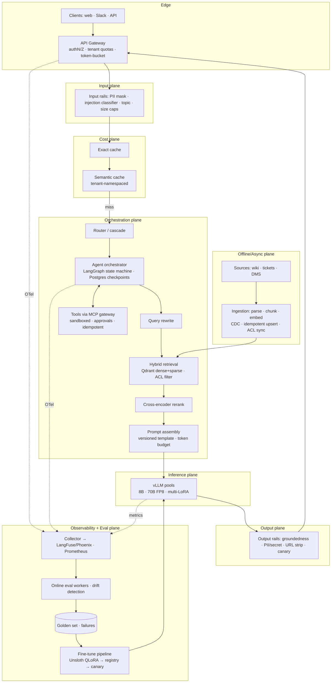
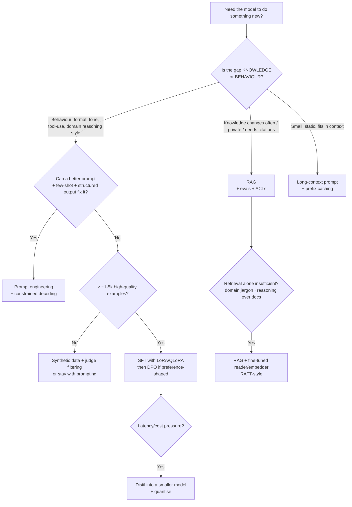
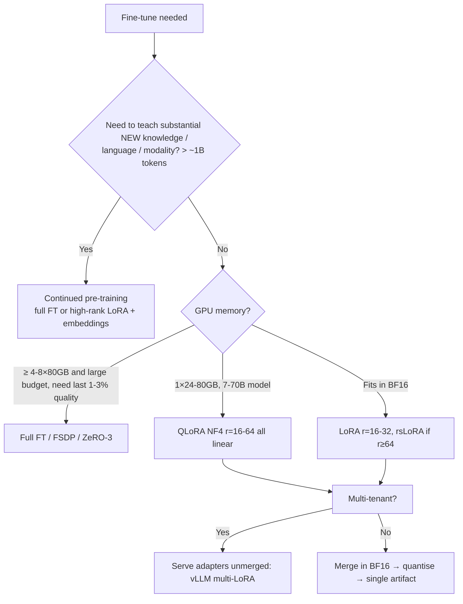
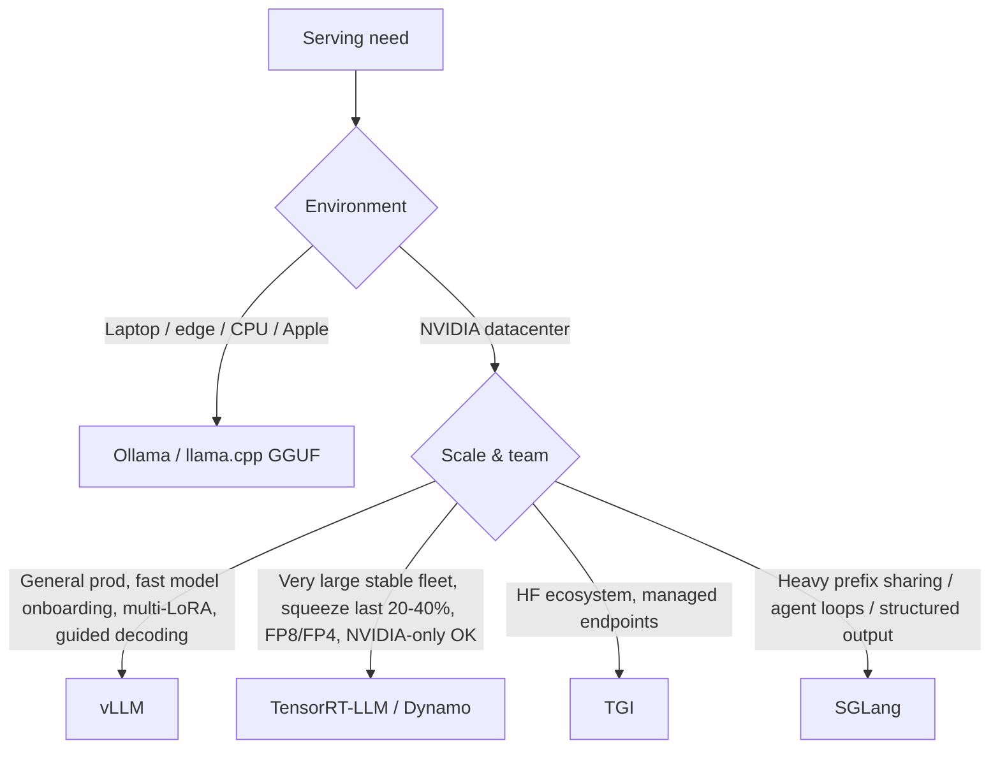

# Module 12 — LLMOps Interview Cheatsheet & System Design

> **Goal:** Convert everything in Modules 01–11 into interview performance. You get a repeatable system-design framework for Senior/Staff loops, decision trees (fine-tune vs RAG, LoRA vs full FT, which engine, which store), "Right vs Wrong" comparisons, back-of-envelope formulas, executable capacity/decision tools, and rapid-fire Q&A with candidate traps and Staff-level answers.

---

## Table of Contents
1. [Module Overview & First-Principles Architecture](#1-module-overview--first-principles-architecture)
2. [Mathematical Foundations (Whiteboard Formulas)](#2-mathematical-foundations--formulas)
3. [Production-Ready Code (Decision & Planning Tools)](#3-production-ready-executable-code)
4. [Hard-Learned Production Failures (Cross-Cutting Postmortems)](#4-hard-learned-production-failures--edge-cases)
5. [Interview Scenarios + Rapid-Fire Q&A](#5-seniorstaff-llmops-interview-questions)

---

## 1. Module Overview & First-Principles Architecture

### 1.1 What Staff-level interviewers actually grade

| Dimension | Weak signal | Strong signal |
|---|---|---|
| **Problem framing** | Jumps to tools ("use vLLM + LangChain") | Clarifies users, SLOs, data sensitivity, scale, budget, failure cost before designing |
| **Quantification** | "It should be fast" | Back-of-envelope: tokens/s, VRAM, QPS→GPUs, $/1M tokens, p95 targets |
| **Trade-offs** | Presents one "best" answer | States alternatives, why chosen, what would change the decision |
| **Failure thinking** | Happy path only | Names top failure modes, detection (metric/alert), mitigation, rollback |
| **Evaluation** | "We'll test it" | Golden sets, judge calibration, CI gates, online monitoring, A/B |
| **Security** | "Add a guardrail" | Threat model, trust boundaries, least privilege, tainted-context handling |
| **Operations** | Ignores day-2 | Versioning, canaries, on-call runbooks, cost attribution, capacity planning |
| **Depth on demand** | Breadth only | Can drill to PagedAttention, HNSW params, KV math when probed |

### 1.2 The 45-minute Staff system-design framework — "CRISP-LM"

```
C  Clarify        (5 min)  users · tasks · scale · latency · accuracy · data/ACL · compliance · budget
R  Requirements   (3 min)  functional + NFR (SLOs) · what is OUT of scope · success metrics
I  Interfaces &   (5 min)  APIs · data flows · diagram: ingress→guardrails→cache→router→orchestrator→
   Architecture             retrieval→LLM serving→output rails→response; async ingestion plane; eval plane
S  Sizing &       (7 min)  QPS, tokens/request, VRAM, GPUs, vector DB memory, $/month — show arithmetic
   Scale
P  Pitfalls &     (10 min) failure modes, security, evaluation strategy, observability, rollout/rollback
   Proof
L  Levers &       (5 min)  cost/latency optimisations, phased roadmap (MVP → v2), build-vs-buy
   Roadmap
M  Metrics &      (5 min)  Q&A, risks recap, what you'd measure first in week 1
   Mop-up
```

Always end with: **"What I'd measure first, and what would make me change this design."**

### 1.3 Master reference architecture — Enterprise RAG / Agentic Assistant



Say it in one breath: **"A request passes authentication and input safety, tries the caches, is routed to the cheapest model that can handle it, retrieves ACL-filtered hybrid results with reranking, is assembled into a versioned, budgeted prompt, generated by a vLLM pool, output-checked, and fully traced; an asynchronous plane keeps the index fresh and an eval plane turns production failures into regression tests and fine-tuning data."**

### 1.4 Architectural decision trees

#### (a) RAG vs Fine-tuning vs Prompting vs Long-context



Rules of thumb:
- **Facts → RAG; skills → fine-tuning.** Fine-tuning is a poor, lossy way to inject changing facts; RAG is a poor way to change style, tool-calling reliability, or latency/cost profile.
- Corpus < ~100–200k tokens and static → **long context + prefix caching** may beat RAG on simplicity.
- Often the answer is **both**: RAG for knowledge + LoRA for format/tool behaviour + small model for cost.

#### (b) LoRA vs QLoRA vs Full fine-tuning



#### (c) Which serving engine?



#### (d) Which vector store?

```
< 5M vectors & already on Postgres & modest QPS ......... pgvector (halfvec + HNSW + iterative scan)
5M–1B, heavy metadata/ACL filters, simple ops .......... Qdrant (filterable HNSW, quantisation, hybrid)
≥1B, GPU indexing, platform team ........................ Milvus (partition key, DiskANN/CAGRA)
No ops capacity ......................................... Pinecone / managed Qdrant
Need BM25 + vectors + analytics in one engine ........... OpenSearch / Elasticsearch
```

#### (e) Quantisation choice

```
Training (QLoRA) .................. bitsandbytes NF4
GPU serving, low batch, latency ... AWQ / GPTQ (W4A16, Marlin kernels)
GPU serving, high batch, H100+ .... FP8 W8A8 (+ FP8 KV cache)
CPU / Apple / edge ................ GGUF Q4_K_M/Q5_K_M with imatrix
< 4 bit or 4-bit loses >3% ........ QAT / QAT-LoRA, or pick a bigger model at 4-bit
```

### 1.5 "Right vs Wrong" — production comparisons

| Topic | ❌ Wrong (common) | ✅ Right (Staff) |
|---|---|---|
| Autoscaling | HPA on CPU/GPU util | KEDA on queue depth + KV-cache %, warm baseline, 1–5 min cold-start aware |
| Prompt security | "Ignore malicious instructions" in system prompt | Trust boundaries, tainted-context policy, least-privilege tools, approvals, output sanitiser |
| JSON output | `json.loads` + try/except | Guided decoding (XGrammar/Outlines) + Pydantic semantic validators + `finish_reason` check |
| Evaluation | Mean score on 50 hand-picked examples | Golden+synthetic sets, calibrated judge (κ≥0.6), paired bootstrap, slice guards, online sampling |
| Retrieval | Top-k dense only | Hybrid + RRF + cross-encoder + parent-child + ACL filter in query path |
| Embedding upgrade | Re-embed new docs with new model | New collection, shadow-eval, alias flip; never mix models |
| Fine-tuning for facts | SFT on the wiki | RAG for facts; SFT for behaviour |
| LoRA merge | Merge into the 4-bit base | Merge in BF16, verify logits, then quantise (or serve adapters unmerged) |
| Latency reporting | Average / per-pod p95 average | Gateway-edge TTFT/ITL histograms, aggregate buckets, burn-rate alerts |
| Cost | $/token headline | $/successful task, utilisation, GPU-second attribution per tenant |
| Cache | Embedding-only key | Namespaced by tenant/model/prompt/index; calibrated τ; validators; safe write-back |
| Agent retries | Retry the tool on failure | Idempotency keys + checkpointed decide/execute split |
| HITL | "Ask model to confirm" | Code-enforced `interrupt()`, persisted, expiring, args-hash bound |
| Rollouts | Replace model in place | Bundle manifest (model+prompt+index+guardrails), canary, eval-gated promotion, instant rollback by label/alias |
| Spot GPUs | Single type/AZ | Diversified pools, on-demand floor, drain on notice, degradation ladder |
| Logging | Log all prompts forever | Collector-side redaction, tail sampling, short retention, RBAC |

### 1.6 Cheatsheet numbers to memorise

| Quantity | Value |
|---|---|
| Bytes/param | FP32 4 · BF16 2 · FP8/INT8 1 · INT4 ≈0.5–0.53 |
| Training memory (Adam mixed precision) | ≈ 16 B/param (+ activations + logits) |
| QLoRA 7B | ≈ 8–10 GB; 70B ≈ 40–48 GB |
| KV cache / token (Llama-3-8B, GQA 8 KV heads, BF16) | 128 KiB (L=32, 2·32·8·128·2) |
| KV cache / token (Llama-3-70B) | 320 KiB |
| H100 SXM | 80 GB HBM3, 3.35 TB/s, ~989 BF16 TFLOPs, ridge ≈ 295 FLOP/B |
| A100 80GB | 2.0 TB/s, 312 BF16 TFLOPs |
| Decode ITL floor (8B BF16 on H100) | ≈ 16 GB/(0.7×3.35 TB/s) ≈ 7 ms |
| Prefill 8B on H100 | ≈ 40–60k tok/s |
| Human reading speed | ≈ 5–8 tok/s (ITL ≤ 100–150 ms is fine for chat) |
| RRF constant | k = 60 |
| HNSW defaults | M=16, ef_construct=128–200, ef=64–128 |
| Chunking | children 128–256 tok, parents 700–1000 tok, overlap 10–20% |
| Judge agreement bar | Cohen's κ ≥ 0.6 on ≥200 labelled items |
| Pass-rate noise | n=100 → ±~6 pts (Wilson 95%) |
| Compounding reliability | 0.95¹⁰ ≈ 60%; 0.99¹⁰ ≈ 90% |
| Fast burn alert | burn ≥ 14.4 (1h & 5m) |
| Queueing | wait ∝ ρ/(1−ρ); target ρ ≤ 0.7 interactive |
| Spot discount | 50–90% (interruptions 30s–2min notice) |

---

## 2. Mathematical Foundations & Formulas

### 2.1 Five-minute capacity plan (whiteboard template)

```
Inputs:   RPS_peak, S_in (prompt tokens), S_out, p_cache (semantic cache hit), f_prefix (prefix-cached fraction)
Effective RPS             λ = RPS_peak × (1 − p_cache)
Prefill tok/s needed      P = λ × S_in × (1 − f_prefix)
Decode tok/s needed       D = λ × S_out
GPUs (prefill)            N_p = P / (prefill_tps_per_GPU × η)
GPUs (decode)             N_d = D / (decode_tps_per_GPU_at_SLO × η)         η ≈ 0.6–0.7 headroom factor
GPUs total                N = ceil(N_p + N_d) × (1 + redundancy)             redundancy ≈ 0.2–0.5 (N+k)
Concurrency (Little)      L = λ × E2E_mean
KV check                  L × avg_ctx × kv_bytes_per_token ≤ pool per GPU × N   (else add GPUs / shrink ctx / FP8 KV)
Monthly $                 N × $/hr × 730 × (1 − spot_discount × spot_share)
$/1M output tokens        = N × $/hr / (D_avg × 3600) × 1e6
```

**Worked example — Enterprise assistant: 150 RPS peak, 6k prompt, 350 output, 25% cache hit, 50% prefix cached, 8B model FP8 on H100:**

```
λ = 150 × 0.75 = 112.5
P = 112.5 × 6000 × 0.5 = 337,500 tok/s → /(50,000×0.65) = 10.4 GPUs
D = 112.5 × 350 = 39,375 tok/s → /(5,000×0.65) = 12.1 GPUs
N = ceil(22.5) × 1.3 = 30 H100
KV check: E2E≈4 s → L=450 concurrent; ctx≈6.4k × 128KiB(≈64KiB FP8)= ~0.4 GiB/seq → 180 GiB total over 30 GPUs ✔ (6 GiB/GPU)
$ = 30 × 3 × 730 = $65.7k/mo on-demand; with 50% spot mix at -60% ⇒ ≈ $46k/mo
→ Levers: rerank to 3k context (−25% prefill GPUs), disaggregate prefill/decode, route 60% to smaller model.
```

### 2.2 Tokens/second per GPU quick estimate

```
Decode (memory-bound):  TPS_sys ≈ B_eff / (W/BW_eff + KV_read/BW_eff)       B_eff = avg concurrent seqs
Prefill (compute-bound): TPS_prefill ≈ η_c × P_flops / (2 × N_params)
```
H100, 8B BF16: prefill ≈ 0.5 × 989e12 / 16e9 ≈ 31k tok/s (FP8 ≈ 2× → 60k); decode at B=64 ≈ 64/ (9 ms) ≈ 7k tok/s.

### 2.3 Quality-cost Pareto

For a set of configurations `c_i` with quality `Q_i` and cost `C_i`, choose the cheapest config satisfying `Q_i ≥ Q_min` (CI lower bound), or maximise `Q − λC`. Present as a Pareto chart; never recommend a dominated config.

### 2.4 Reliability budget for a pipeline

If stages have availabilities `a_i` in series: `A = Π a_i`. Five stages at 99.9 % → 99.5 % (3.6 h/month downtime). Redundancy per stage, graceful degradation (skip reranker, serve cached/smaller model) raises *effective* availability — `A_eff = 1 − Π(1 − a_path)` over fallback paths.

### 2.5 Retrieval–generation error decomposition

```
P(correct) ≈ P(retrieve relevant) × P(use it faithfully | retrieved) + P(no retrieval needed) × P(model knows)
```
Improving one factor only helps if the other isn't the bottleneck — compute both via the triad (Module 07) before investing.

### 2.6 When fine-tuning pays off (rough ROI)

```
Savings/month ≈ Δcost_per_request × requests − (training + eval + maintenance amortised)
Break-even requests ≈ FixedCost / (Δcost_per_request)
```
Example: distilling a 70B → 8B fine-tune saves $0.004/request; fixed cost $12k (data + runs + eval + 3 months maintenance) ⇒ break-even 3M requests. Include the risk cost of quality regressions.

### 2.7 Experiment sizing quick table

| Baseline pass rate | Min detectable Δ | n per arm (α=.05, power .8) |
|---|---|---|
| 0.80 | 5 pts | ≈ 500 |
| 0.85 | 3 pts | ≈ 2,200 |
| 0.90 | 2 pts | ≈ 5,700 |
| (paired design) | — | often 3–10× fewer |

---

## 3. Production-Ready Executable Code

### 3.1 Interactive CLI: "Fine-tune vs RAG vs Prompt" Decision Helper

```python
#!/usr/bin/env python3
"""Encodes the decision tree in §1.4(a). Useful in design reviews: answer the questions, get a justified recommendation."""
from __future__ import annotations

import argparse
from dataclasses import dataclass, field


@dataclass
class Situation:
    knowledge_changes_often: bool
    needs_citations: bool
    private_or_acl_data: bool
    corpus_tokens: int
    behaviour_gap: bool                 # format/tone/tool-use/reasoning style gap
    prompt_fix_insufficient: bool
    labelled_examples: int
    latency_or_cost_pressure: bool
    multi_tenant_customisation: bool
    notes: list[str] = field(default_factory=list)


def recommend(s: Situation) -> list[str]:
    recs: list[str] = []
    why: list[str] = []
    knowledge_need = s.knowledge_changes_often or s.needs_citations or s.private_or_acl_data
    if knowledge_need:
        recs.append("RAG (hybrid retrieval + rerank + ACL filtering)")
        why.append("Facts that change, need citations or are access-controlled belong in retrieval, not weights.")
    elif s.corpus_tokens and s.corpus_tokens <= 150_000:
        recs.append("Long-context prompt with prefix caching")
        why.append("Small static corpus fits in context; avoids retrieval complexity.")
    if s.behaviour_gap:
        if not s.prompt_fix_insufficient:
            recs.append("Prompt engineering + few-shot + constrained decoding (JSON schema/grammar)")
            why.append("Try the cheapest lever first; measure on a golden set.")
        elif s.labelled_examples >= 1000:
            recs.append("SFT with LoRA/QLoRA (r=16–64, all linear layers); DPO if preference-shaped")
            why.append("Behaviour/skill gaps respond to fine-tuning; enough data exists.")
        else:
            recs.append("Generate synthetic data (Evol-Instruct/Self-Instruct) with judge filtering, then LoRA")
            why.append("Fewer than ~1k examples: grow and curate data before training.")
    if s.latency_or_cost_pressure:
        recs.append("Distil/fine-tune a smaller model, quantise (FP8/AWQ), add routing + semantic cache")
        why.append("Cost/latency is a model-size and utilisation problem, not a knowledge problem.")
    if s.multi_tenant_customisation:
        recs.append("Per-tenant LoRA adapters served via vLLM multi-LoRA")
        why.append("One base in memory, many small adapters: near-single-model cost.")
    if not recs:
        recs.append("Baseline: strong prompt + evaluation set; revisit after measuring failures")
        why.append("No clear gap identified; measure first.")
    return [f"• {r}" for r in recs] + ["", "Why:"] + [f"  - {w}" for w in why]


def main() -> None:
    p = argparse.ArgumentParser()
    for f in ("knowledge-changes-often", "needs-citations", "private-or-acl-data", "behaviour-gap", "prompt-fix-insufficient",
              "latency-or-cost-pressure", "multi-tenant-customisation"):
        p.add_argument(f"--{f}", action="store_true")
    p.add_argument("--corpus-tokens", type=int, default=0)
    p.add_argument("--labelled-examples", type=int, default=0)
    a = p.parse_args()
    s = Situation(a.knowledge_changes_often, a.needs_citations, a.private_or_acl_data, a.corpus_tokens, a.behaviour_gap,
                  a.prompt_fix_insufficient, a.labelled_examples, a.latency_or_cost_pressure, a.multi_tenant_customisation)
    print("\n".join(recommend(s)))


if __name__ == "__main__":
    main()
```

```bash
python decide.py --knowledge-changes-often --needs-citations --behaviour-gap --prompt-fix-insufficient --labelled-examples 3000 --latency-or-cost-pressure
```

### 3.2 End-to-End Capacity & Cost Planner (implements §2.1)

```python
#!/usr/bin/env python3
"""Whiteboard capacity plan as code. Prints GPUs, concurrency, KV check and monthly cost for a workload."""
from __future__ import annotations

import argparse
import math
from dataclasses import dataclass


@dataclass(frozen=True)
class Gpu:
    name: str
    hbm_gib: float
    usd_hr: float
    prefill_tps: float          # tokens/s for the chosen model/precision
    decode_tps_slo: float       # sustained output tokens/s at target ITL


GPUS = {
    "h100-8b-fp8": Gpu("H100 80GB (8B FP8)", 80, 3.0, 60_000, 5_000),
    "h100-70b-fp8-tp4": Gpu("4×H100 (70B FP8) as one unit", 320, 12.0, 9_000, 1_600),
    "l4-8b-awq": Gpu("L4 24GB (8B AWQ)", 24, 0.80, 7_000, 700),
}


@dataclass(frozen=True)
class Plan:
    gpus: int
    prefill_gpus: float
    decode_gpus: float
    concurrency: float
    kv_gib_needed: float
    kv_gib_available: float
    monthly_usd: float
    usd_per_m_out: float


def plan(rps: float, s_in: int, s_out: int, gpu: Gpu, *, cache_hit: float = 0.0, prefix_frac: float = 0.0, eta: float = 0.65,
         redundancy: float = 0.3, e2e_s: float = 4.0, kv_bytes_tok: int = 131_072, weights_gib: float = 15.0,
         spot_share: float = 0.0, spot_discount: float = 0.6) -> Plan:
    lam = rps * (1 - cache_hit)
    prefill_need = lam * s_in * (1 - prefix_frac)
    decode_need = lam * s_out
    n_p = prefill_need / (gpu.prefill_tps * eta)
    n_d = decode_need / (gpu.decode_tps_slo * eta)
    n = math.ceil(math.ceil(n_p + n_d) * (1 + redundancy))
    conc = lam * e2e_s
    kv_needed = conc * (s_in + s_out) * kv_bytes_tok / 2**30
    kv_avail = n * (gpu.hbm_gib * 0.9 - weights_gib - 3)
    price_factor = 1 - spot_share * spot_discount
    monthly = n * gpu.usd_hr * 730 * price_factor
    out_per_month = decode_need * 3600 * 730
    return Plan(n, n_p, n_d, conc, kv_needed, kv_avail, monthly, monthly / (out_per_month / 1e6) if out_per_month else float("inf"))


def main() -> None:
    ap = argparse.ArgumentParser()
    ap.add_argument("--rps", type=float, required=True)
    ap.add_argument("--s-in", type=int, required=True)
    ap.add_argument("--s-out", type=int, required=True)
    ap.add_argument("--gpu", choices=GPUS, default="h100-8b-fp8")
    ap.add_argument("--cache-hit", type=float, default=0.0)
    ap.add_argument("--prefix-frac", type=float, default=0.0)
    ap.add_argument("--spot-share", type=float, default=0.0)
    a = ap.parse_args()
    g = GPUS[a.gpu]
    p = plan(a.rps, a.s_in, a.s_out, g, cache_hit=a.cache_hit, prefix_frac=a.prefix_frac, spot_share=a.spot_share)
    print(f"{g.name}\n  prefill GPUs {p.prefill_gpus:.1f} | decode GPUs {p.decode_gpus:.1f} | total (with headroom+redundancy) {p.gpus}")
    print(f"  concurrency {p.concurrency:.0f} | KV needed {p.kv_gib_needed:.0f} GiB vs available {p.kv_gib_available:.0f} GiB "
          f"-> {'OK' if p.kv_gib_needed <= p.kv_gib_available else 'KV-LIMITED: add GPUs / FP8 KV / shorter ctx'}")
    print(f"  monthly ${p.monthly_usd:,.0f} | ${p.usd_per_m_out:.2f} per 1M output tokens (all-in, incl. prefill)")


if __name__ == "__main__":
    main()
```

```bash
python capacity.py --rps 150 --s-in 6000 --s-out 350 --cache-hit 0.25 --prefix-frac 0.5 --spot-share 0.5
```

### 3.3 Release Manifest Linter (the bundle must be complete and gated)

```python
"""CI check: every production release declares model+prompt+index+guardrail versions and eval gates (Module 01 §3.4)."""
from __future__ import annotations

import sys
from pathlib import Path

import yaml

REQUIRED = {
    "spec.model.base": str, "spec.model.revision": str, "spec.prompts.name": str, "spec.prompts.version": int,
    "spec.retrieval.index_alias": str, "spec.retrieval.embedding_model": str, "spec.guardrails.config": str,
    "spec.gates.offline_eval": dict, "spec.gates.load_test": dict, "spec.rollout.steps": list,
}


def get(d: dict, path: str):
    cur = d
    for p in path.split("."):
        if not isinstance(cur, dict) or p not in cur:
            return None
        cur = cur[p]
    return cur


def lint(doc: dict) -> list[str]:
    errs = []
    for path, typ in REQUIRED.items():
        v = get(doc, path)
        if v is None:
            errs.append(f"missing {path}")
        elif not isinstance(v, typ):
            errs.append(f"{path} must be {typ.__name__}")
    rev = get(doc, "spec.model.revision") or ""
    if rev in ("main", "latest") or len(str(rev)) < 7:
        errs.append("model.revision must be a pinned commit hash, not a floating ref")
    if "faithfulness" not in (get(doc, "spec.gates.offline_eval") or {}):
        errs.append("offline_eval gate must include faithfulness")
    if "oom_events" not in (get(doc, "spec.gates.load_test") or {}):
        errs.append("load_test gate must assert oom_events == 0")
    if 100 not in (get(doc, "spec.rollout.steps") or []):
        errs.append("rollout.steps must end at 100")
    return errs


if __name__ == "__main__":
    bad = False
    for f in sys.argv[1:]:
        e = lint(yaml.safe_load(Path(f).read_text()))
        for m in e:
            print(f"{f}: {m}")
        bad |= bool(e)
    sys.exit(1 if bad else 0)
```

### 3.4 Docker Compose Quick-Start for Mock Interviews / Demos (CPU-friendly small stack)

```yaml
# docker-compose.demo.yml — run a miniature end-to-end stack on a laptop for design discussions
services:
  ollama:
    image: ollama/ollama:latest
    ports: ["11434:11434"]
    volumes: ["ollama:/root/.ollama"]
  qdrant:
    image: qdrant/qdrant:v1.12.4
    ports: ["6333:6333"]
  redis:
    image: redis/redis-stack-server:latest
    ports: ["6379:6379"]
volumes: { ollama: {} }
```

```bash
docker compose -f docker-compose.demo.yml up -d
docker compose exec ollama ollama pull llama3.2:3b && docker compose exec ollama ollama pull nomic-embed-text
```

### 3.5 Staff-level Design Doc Template (copy into your notes)

```markdown
# Design: <System>

## 1. Context & Goals
Users, jobs-to-be-done, success metrics (task success, deflection, CSAT), non-goals.

## 2. Requirements
| NFR | Target |
|---|---|
| Availability | 99.9% |
| TTFT p95 / ITL p95 | ≤ 0.7 s / ≤ 60 ms |
| Groundedness (offline gate) | ≥ 0.88, CI-lower-bound |
| Safety | ASR ≤ 2% on red-team set; PII leak = 0 |
| Cost | ≤ $X per resolved task |
| Data | residency, retention, tenant isolation |

## 3. Architecture (diagram) and data flows
## 4. Sizing & cost (show arithmetic)
## 5. Evaluation plan (golden set, judge calibration, gates, online sampling)
## 6. Security threat model (assets, trust boundaries, abuse cases, controls)
## 7. Observability & SLOs (golden signals, burn-rate alerts, dashboards)
## 8. Rollout (canary %, auto-rollback conditions, feature flags), Rollback (labels/aliases)
## 9. Failure modes & mitigations (table), Runbooks
## 10. Alternatives considered (why not X)
## 11. Phases: MVP → v2 → v3, open questions, risks
```

---

## 4. Hard-Learned Production Failures & Edge Cases

These are cross-cutting postmortems that link multiple modules. Study them as *stories you can tell* in behavioural/technical-leadership rounds.

### Incident 1 — "Everything was green" launch that failed in week one

**Timeline.** Launch Monday. By Wednesday: support tickets about wrong answers (+30 %), p99 latency 25 s for some tenants, one tenant saw another's snippet.

**Root causes (multi-factor).**
1. Eval set built from sanitized FAQ questions (Module 07) → real traffic had long, messy queries; groundedness online 0.74 vs offline 0.92.
2. Load test used 512-token prompts; production RAG prompts averaged 6k tokens (Module 01/05) → KV exhaustion + preemption thrash for heavy tenants.
3. ACL filtering done in app code after retrieval (Module 06) → a stale ACL cache leaked a chunk.
4. No per-tenant dashboards (Module 10) → noticed via tickets.

**Remediation sequence.** Freeze rollout (flag), roll back to previous bundle via aliases (1 minute), purge semantic cache entries without tenant namespace, ship ACL filter into the vector query path, rerun load tests with production prompt distribution, build online-eval sampling, relaunch via canary with auto-rollback on burn-rate.

**Lesson.** Launch readiness = eval on *production-shaped* data + load test on *production-shaped* traffic + security review of data paths + tenant-sliced observability.

### Incident 2 — Fine-tuned model "worked" but erased safety behaviour

**Symptom.** After a LoRA SFT on support transcripts (Module 04), red-team ASR rose from 1 % to 14 %.

**Root cause.** Training data contained agents accommodating policy-violating requests; no safety data in the mix; rank 128, 5 epochs; the release gate only had task metrics.

**Remediation.** Mix 10–20 % safety/refusal data; lower rank/LR/epochs; add red-team ASR + over-refusal metrics to the gate; merge with weight λ<1; keep the guardrail layer independent of model alignment (defence in depth, Module 08).

### Incident 3 — Cost optimisation caused a quality incident

**Symptom.** After enabling the router + semantic cache + INT4 quantization in one release, CSAT fell 5 points; no single change could be blamed.

**Root cause.** Three simultaneous changes confounded diagnosis; offline evals averaged away slice regressions (long-context, numeric).

**Remediation.** One cost lever per release behind flags, each with its own non-inferiority gate and canary; maintain a "quality budget" ledger (how much regression each optimisation is allowed to spend); ablate in staging with traffic replay.

### Incident 4 — Agent with tool access exfiltrated data via a poisoned ticket

**Symptom.** An internal agent emailed a customer list to an external address after summarising a ticket containing hidden instructions.

**Root cause.** Lethal trifecta (private data + untrusted content + external send) with a model-decided send tool (Module 08/09).

**Remediation.** Split quarantined summariser from privileged planner; send-email tool requires recipient allow-list + human approval; taint tracking; output DLP; red-team corpus added to CI.

### Incident 5 — GPU fleet bill doubled during a model upgrade

**Symptom.** Upgrading from an 8B to a 14B model doubled spend but quality gains were marginal.

**Root cause.** No cost-quality Pareto analysis; the bigger model also had a larger KV footprint (MHA vs GQA) → lower concurrency per GPU than expected; batching settings not retuned.

**Remediation.** Evaluate candidates on quality, TTFT/ITL at SLO concurrency, and $/successful task; retune `max-num-seqs`/chunk size per model; consider LoRA/distillation to the smaller model; rollback by bundle.

---

## 5. Senior/Staff LLMOps Interview Questions

### Part A — Full system-design scenarios

#### Scenario A1 — "Design an enterprise RAG assistant for 50,000 employees over 20M documents, with per-document access control."

**Junior/Mid Trap Answer:** "Chunk the documents, embed them with OpenAI, store in Pinecone, retrieve top-5, send to GPT-4. Add a system prompt saying not to reveal confidential information."

**Staff Production Answer:**
*Clarify:* peak concurrency (say 2k users, 40 RPS), latency (TTFT p95 ≤ 1 s, streaming), accuracy bar (cited, grounded), data classes (HR/legal restricted), residency, source systems (SharePoint, Confluence, Drive, Jira), freshness SLA (≤ 15 min).
*Architecture:* gateway with SSO (OIDC) → input rails (PII/injection) → semantic cache **namespaced by user-group fingerprint** (or disabled for restricted corpora) → query rewrite → **hybrid retrieval in Qdrant** (dense bge-m3 + sparse, RRF) with **ACL filtering inside the vector query** from the user's current group claims (`acl_groups` payload index) → cross-encoder rerank (top-50→8) → parent-child expansion → versioned prompt with spotlighting and citations → vLLM (8B for routine Q&A, 70B-FP8 for complex via router) → output rails (groundedness, PII, URL strip) → stream. Ingestion plane: connectors with CDC → queue → parse (layout-aware) → contextual chunking → embed → idempotent upsert + delete-by-doc; **separate ACL-sync pipeline** from IdP/DMS events + nightly reconciliation; embeddings versioned via alias.
*Sizing:* 20M docs × ~10 chunks = 200M vectors × 1024-d → int8 scalar quantisation in RAM ≈ 230 GB + originals on NVMe; ~8 Qdrant nodes ×2 replicas, sharded by tenant/hash. LLM: 40 RPS × 5k prompt tokens × 0.5 prefix-cached → ~100k tok/s prefill ≈ 3–4 H100 (8B FP8), decode 40×300 = 12k tok/s ≈ 3 H100 → ~8–10 GPUs with headroom/redundancy, autoscaled on queue/KV.
*Security:* ACL at query time, trust tiers for corpora, ingestion injection scan, tool-free quarantined path (answering only), canary tokens, audit logs, red-team in CI.
*Evaluation:* golden set (200 SME + synthetic incl. unanswerable and permission-boundary tests: "user A must never retrieve doc B"), triad + abstention metrics, judge κ≥0.6, paired-bootstrap gate, online 3 % sampling, thumbs.
*Observability/SLOs:* OTel traces with prompt/index versions, burn-rate alerts on TTFT, per-tenant cost, freshness lag SLI.
*Rollout:* shadow → 5 % canary → 100 % with alias-based rollback.
*Trade-offs/what changes the design:* if ACLs are extremely dynamic/fine-grained, add a post-retrieval authorization re-check against the source of truth for top-k; if data can't leave the VPC, self-host embeddings/reranker/LLM.

#### Scenario A2 — "Design an agentic customer-support assistant that can look up orders and issue refunds."

**Junior/Mid Trap Answer:** "Use LangChain's agent with tools for lookup_order and issue_refund; tell the model to ask the user to confirm before refunds."

**Staff Production Answer:** "I'd implement a **LangGraph state machine** with typed state and Postgres checkpoints, not a free-form ReAct loop. Nodes: classify → retrieve policy (RAG) → plan → tool-call → **validate** (Pydantic, extra=forbid) → **authorise** (policy engine: scopes, amount thresholds, taint) → **interrupt for approval** when refund > $50 (persisted; reviewer identity from SSO; approval bound to args hash + order version, expires in 24 h) → execute with **idempotency key** → observe → respond. Tools are exposed via an **MCP gateway** with pinned schemas, `propose_refund` rather than `execute_refund`, sandboxed network egress, and per-tool timeouts/circuit breakers. Guardrails: injection scan on customer messages and order notes; spotlighted untrusted text; output PII and canary rails. Budgets: 12 steps, 60k tokens, loop-signature detector → escalate to a human with transcript. Evaluation: trajectory-level evals (right tool, right args, no forbidden tool, policy compliance) on a scenario suite incl. injection cases; per-node success rates to attack the compounding-reliability problem (0.95¹⁰≈60 %). Cost: 8B for classification/extraction, 70B only for planning/final answer; prefix-cache the policy prompt. Failure modes: double refunds (idempotency), stale approvals (state version), concurrent turns (thread lock), tool schema drift (contract tests)."

#### Scenario A3 — "Design the LLM platform for 30 internal teams (shared inference, governance, cost control)."

**Junior/Mid Trap Answer:** "Give each team its own GPU cluster and let them deploy what they want."

**Staff Production Answer:** "A **shared platform** with a paved road: (1) **LLM gateway** (LiteLLM/Envoy-based) providing a single OpenAI-compatible API, authN/Z, per-team quotas (token buckets), model aliases (`chat-small`, `chat-large`) mapping to current versions, fallbacks across providers/pools, request logging with redaction, semantic cache (namespaced), and guardrail hooks. (2) **Inference pools** on Kubernetes: vLLM deployments per model class with KEDA autoscaling on queue/KV, interactive vs batch pools (spot for batch), multi-LoRA for team-specific adapters, FP8/AWQ defaults. (3) **Model registry & release process** (bundle manifests, eval gates, canary). (4) **Prompt registry + eval service** (LangFuse/golden sets/judge-as-a-service with calibrated judges). (5) **Vector DB as a service** with collections per team, quotas, and ACL conventions. (6) **Observability**: OTel standard, per-team dashboards, cost chargeback by GPU-seconds (showback first, chargeback later). (7) **Governance**: model approval list, data classification → routing rules (restricted data only to self-hosted), security baseline and red-team requirements. Metrics for the platform itself: adoption, p95 TTFT per tier, cost per 1M tokens, % traffic on approved models, incident MTTR. Build vs buy: buy gateway/observability components where mature; build the policy glue."

#### Scenario A4 — "A product team wants real-time voice assistant latency (<800 ms to first audio). Design the LLM part."

**Junior/Mid Trap Answer:** "Use the biggest model for the best answers and stream the output."

**Staff Production Answer:** "Voice budgets are brutal: ASR endpointing (~150–300 ms) + LLM TTFT + first sentence generation + TTS first chunk (~100–200 ms) ⇒ the LLM gets ~200–300 ms to first sentence. Choices: a small (3–8B) FP8/AWQ model on dedicated, **low-utilisation** (ρ≤0.5) GPUs with TP=1, prefix-cached persona/system prompt, short prompts (summarised memory), **speculative decoding** (n-gram or EAGLE) because batch is small, chunked prefill, and sentence-level streaming to TTS (flush at punctuation). Co-locate services in one region/AZ, keep persistent connections (gRPC/WebSocket), pre-warm and avoid cold starts. Route hard questions to a bigger model asynchronously with a filler utterance (\"let me check\"). Guardrails must be streaming and light (regex/small classifier on partial output). Measure TTFT p95/p99 and 'time to first audio' end-to-end with synthetic calls; autoscale on concurrency with a generous warm pool."

### Part B — Rapid-fire technical Q&A (candidate trap → Staff response)

> Format: **Q** / ❌ Trap / ✅ Staff.

**B1. Q: "Why is LLM decode memory-bound?"**
❌ "Because the models are big." ✅ "At decode each step streams all weights (and the KV cache) from HBM to do ~2 FLOPs/param — arithmetic intensity ≈ batch size, far below the ~295 FLOP/B ridge point of an H100, so bandwidth sets speed. Hence batching, weight quantisation, GQA and KV compression help ITL."

**B2. Q: "How does PagedAttention work?"**
❌ "A faster attention kernel." ✅ "OS-style paging of the KV cache into fixed blocks with a block table, eliminating fragmentation (60–80 % waste before), enabling copy-on-write sharing, prefix caching and cheap preemption, so many more sequences fit in a batch."

**B3. Q: "Continuous batching vs static batching?"**
❌ "Continuous batching has larger batches." ✅ "Static waits for a full batch and runs until the longest finishes. Continuous (iteration-level) batching re-forms the batch every decode step, admitting new requests and releasing finished ones, raising utilisation 5–20× and lowering tail latency."

**B4. Q: "What is chunked prefill for?"**
❌ "To handle long prompts." ✅ "To prevent head-of-line blocking: split a long prefill into chunks batched with ongoing decodes, so ITL stays smooth and activation memory is bounded, at slight TTFT cost for the long prompt."

**B5. Q: "LoRA rank — higher is better?"**
❌ "Yes, more capacity." ✅ "Diminishing returns; all-linear targeting matters more. With standard scaling α/r high ranks need rsLoRA (α/√r). Use r=16–64, tune LR, watch forgetting."

**B6. Q: "QLoRA — what's quantised during training?"**
❌ "The whole model including adapters." ✅ "The frozen base is NF4 with double quantisation; adapters and activations are BF16; gradients flow through dequantised base weights; paged optimisers absorb memory spikes."

**B7. Q: "AWQ vs GPTQ?"**
❌ "Same thing." ✅ "GPTQ minimises layer reconstruction error with Hessian-guided rounding/compensation; AWQ scales salient channels (by activation magnitude) before quantising, no backprop, usually better accuracy at 4-bit and faster to produce. Both W4A16; both served with Marlin kernels."

**B8. Q: "FP8 vs INT4 for H100 serving?"**
❌ "INT4 is smaller so always better." ✅ "INT4 weight-only wins for low-batch bandwidth-bound decode; FP8 W8A8 uses native tensor cores and wins at higher batch with less quality loss. Benchmark at target concurrency."

**B9. Q: "KV cache size for Llama-3-70B at 8k context, batch 16?"**
❌ "Roughly the model size." ✅ "2·L·n_kv·d_h·bytes = 2·80·8·128·2 = 320 KiB/token → ×8192×16 ≈ 40 GiB (20 GiB in FP8)."

**B10. Q: "Hybrid search — why and how?"**
❌ "Because dense is better." ✅ "Dense misses exact identifiers; BM25 misses semantics. Run both, fuse with RRF (k=60) — score-free — then cross-encoder rerank."

**B11. Q: "HNSW M/ef?"**
❌ "Set them high." ✅ "M = graph degree (memory/build), ef_construct = build beam, ef = query beam. Sweep ef vs exact ground truth for recall@k–latency; scalar quantisation + rescoring cuts RAM 4×."

**B12. Q: "Embedding model change?"**
❌ "Re-embed new docs only." ✅ "Spaces are incompatible: new collection, backfill, shadow eval, alias flip."

**B13. Q: "What is the RAG triad?"**
❌ "Retrieve, augment, generate." ✅ "Context relevance, groundedness (faithfulness), answer relevance — localise failures to retrieval, generation or understanding."

**B14. Q: "Can I trust LLM-as-judge?"**
❌ "GPT-4 is accurate." ✅ "Calibrate to ≥200 human labels (κ≥0.6), mitigate position/verbosity/self-preference bias, use claim-level verification, pin versions, re-calibrate on change."

**B15. Q: "How do you stop prompt injection?"**
❌ "Tell the model to ignore it." ✅ "Contain: trust zones, quarantined LLM for untrusted content, least-privilege tools, taint tracking, approvals, output sanitisation; classifiers reduce probability but aren't boundaries."

**B16. Q: "NeMo Guardrails vs Guardrails AI?"**
❌ "Same." ✅ "NeMo: programmable dialog/flow rails (Colang) incl. input/retrieval/output/execution rails; Guardrails AI: validator framework for structured/semantic output checks with reask/fix/filter policies. Often combined; plus a safety classifier like Llama Guard."

**B17. Q: "How do you make tool calls reliable?"**
❌ "Better prompt." ✅ "Strict schemas, guided decoding, Pydantic validation with model-readable errors and bounded retries, aliases for drift, contract tests, idempotency keys, timeouts/circuit breakers."

**B18. Q: "What is MCP?"**
❌ "A plugin system for ChatGPT." ✅ "Open JSON-RPC protocol: hosts/clients/servers exposing tools, resources, prompts over stdio or Streamable HTTP with OAuth; major risks are tool poisoning and rug pulls — pin definitions, trust tiers, approvals."

**B19. Q: "TTFT vs ITL vs TPS?"**
❌ "All latency." ✅ "TTFT = queue+retrieval+prefill (responsiveness); ITL = decode step latency (smoothness); TPS_user = 1/ITL; TPS_system = throughput; E2E = TTFT+(N−1)ITL; goodput = requests meeting all SLOs."

**B20. Q: "Autoscale signal for vLLM?"**
❌ "GPU util." ✅ "Queue depth/waiting requests, KV-cache usage, TTFT burn rate; account for 1–5 min cold starts."

**B21. Q: "Semantic cache risks?"**
❌ "Stale answers." ✅ "Cross-tenant leakage, false hits on negation/numbers, poisoning, PII — mitigate with namespacing, calibrated τ + validators, guards, safe write-back, TTL/tag invalidation."

**B22. Q: "TP vs PP?"**
❌ "Both split the model." ✅ "TP splits each layer (all-reduces per layer; needs NVLink; reduces latency); PP splits layers into stages (p2p; works across nodes; adds latency/bubbles). TP in-node, PP cross-node, replicas for scale."

**B23. Q: "Spot GPUs for inference?"**
❌ "Risky, avoid." ✅ "50–90 % cheaper; use diversified pools, on-demand floor, interruption-aware drain, fast cold start, degradation ladder; spot for batch/burst; checkpoint for training."

**B24. Q: "When to fine-tune vs RAG?"**
❌ "Fine-tune to teach the model our data." ✅ "Facts/changing/private → RAG; behaviour/format/tool-use/style/latency → fine-tune (LoRA); often both."

**B25. Q: "LoRA vs full FT?"**
❌ "Full FT is always better." ✅ "'LoRA learns less and forgets less': LoRA suffices for behaviour adaptation and is far cheaper, multi-tenant friendly; full FT/continued pre-training for large knowledge/language shifts with ample compute."

**B26. Q: "Merging LoRA into a quantised base?"**
❌ "Fine, just merge." ✅ "Deltas are smaller than the 4-bit step; merge in BF16 then quantise, or serve unmerged."

**B27. Q: "Why do agents fail on long tasks?"**
❌ "Models aren't smart enough." ✅ "Compounding error p^n, context growth/rot, tool errors, lack of state/recovery; fix with fewer LLM decisions, validation, checkpoints, summarisation and evals per node."

**B28. Q: "Dedup at scale?"**
❌ "Hash and compare." ✅ "Exact hash → MinHash-LSH (b,r tuned to threshold) → connected components; cap templated clusters; report cluster sizes."

**B29. Q: "Dataset contamination?"**
❌ "Unlikely." ✅ "13-gram overlap decontamination vs eval sets, time-split evals, private canary sets."

**B30. Q: "How do you roll back an LLM release?"**
❌ "Redeploy the old model." ✅ "Bundle versioning: flip prompt label/index alias instantly; blue/green model pool; auto-rollback on burn rate or eval drop."

**B31. Q: "What do you log?"**
❌ "Everything." ✅ "Traces with metadata, token/cost/latency; payloads sampled & redacted at the collector; short retention; RBAC."

**B32. Q: "Prefix caching — what breaks it?"**
❌ "Nothing." ✅ "Any change in early tokens: timestamps/IDs at the top, reordered few-shots, per-request noise; layout stable→volatile; monitor hit rate."

**B33. Q: "Structured output guarantee?"**
❌ "JSON mode." ✅ "Guided decoding (XGrammar/Outlines/GBNF) for validity, Pydantic for semantics, reasoning field first, `finish_reason` check."

**B34. Q: "Why does p95 TTFT explode at 85 % load?"**
❌ "Unclear." ✅ "Queueing nonlinearity ρ/(1−ρ); true bottleneck is KV or scheduler budget; fix capacity, admission control, priorities; target ρ≤0.7."

**B35. Q: "Estimate $/1M tokens self-hosted?"**
❌ "Price of API." ✅ "(GPU $/hr × n)/(TPS × 3600 × utilisation) × 1e6; utilisation dominates; include prefill and headroom."

### Part C — Behavioural/leadership prompts for Staff loops (brief frameworks)

| Prompt | What to demonstrate | Skeleton answer |
|---|---|---|
| "Tell me about a time you prevented/handled an LLM production incident." | Systematic debugging, blast-radius control, prevention | Situation → detection signal → mitigation (rollback by alias) → root cause (multi-factor) → permanent fix (gate/alert/test) → org learning (postmortem, runbook) |
| "How do you decide build vs buy?" | Strategic trade-offs | Differentiation, data sensitivity, utilisation break-even, team capacity, lock-in & exit strategy |
| "How do you influence teams to adopt evals?" | Leadership w/o authority | Make eval the paved road: templates, CI integration, shared judge service, showback dashboards, celebrate caught regressions |
| "Prioritising when everything is on fire." | Judgement | Risk = likelihood × impact; protect users/data first, then SLOs, then cost; communicate cadence |

### Part D — The last 10 minutes of any design round (checklist)

1. **Metrics I'd watch in week one** (TTFT/ITL p95, KV %, queue, groundedness, refusal, cost/task).
2. **Top 3 risks** and their mitigations.
3. **What would change my design** (e.g., data residency, 10× traffic, strict TTFT).
4. **Phased plan**: MVP (managed API + simple RAG + eval harness) → v2 (self-host, routing, cache) → v3 (fine-tune/distil, disaggregation).
5. **Rollback story** in one sentence.

---

### Final Key Takeaways
- Quantify first (VRAM, tokens/s, GPUs, $), then design; state assumptions and show arithmetic.
- Compound system > model: caches, routing, retrieval, guardrails, orchestration, eval, observability.
- Facts → RAG, behaviour → fine-tune; quantise before sharding; TP in-node, PP across nodes; utilisation drives cost.
- Every claim needs a *metric*, a *gate*, and a *rollback*.
- Interview answer = **trade-off + number + failure mode + how you'd detect it**.
