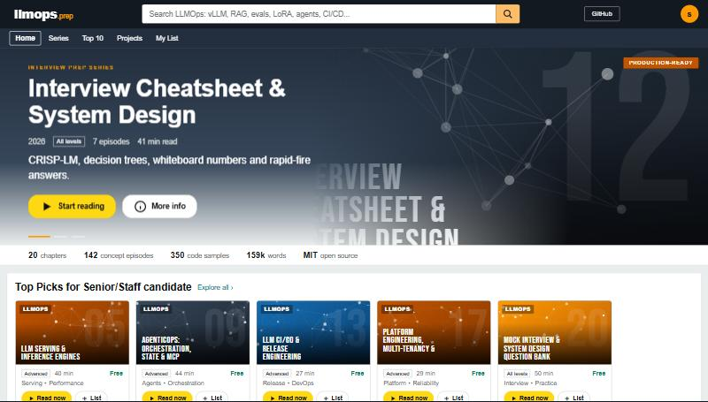
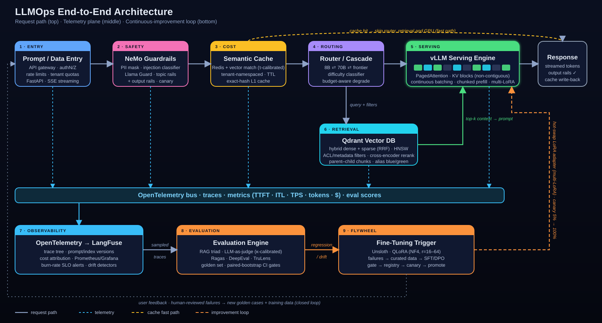
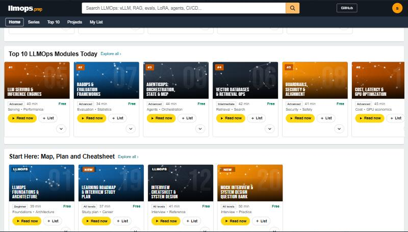
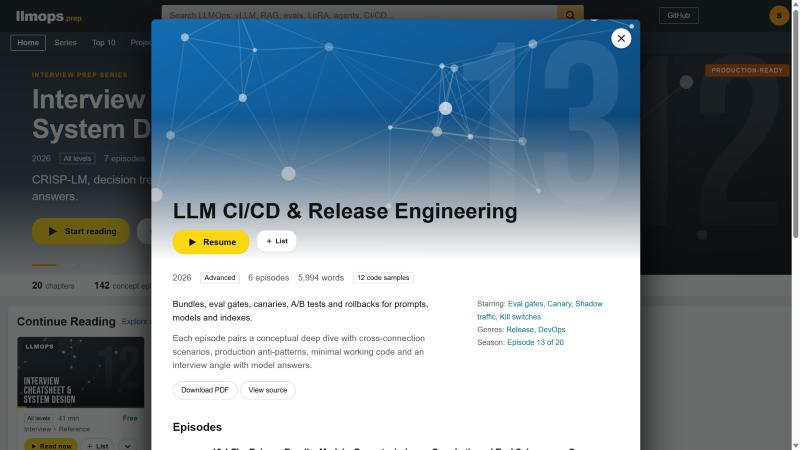
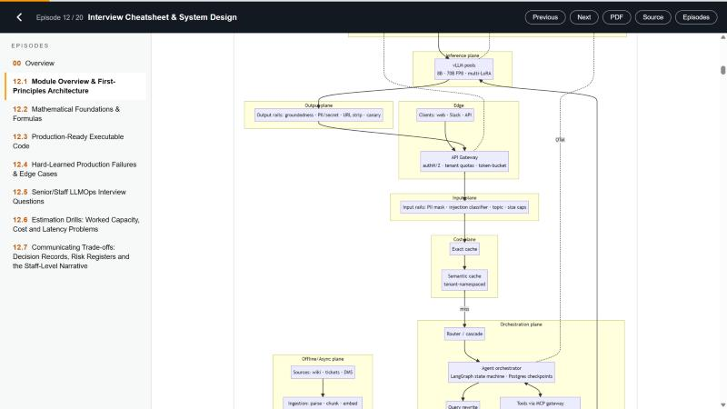
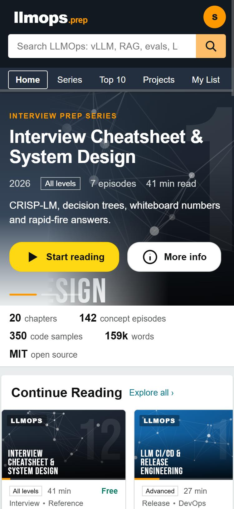
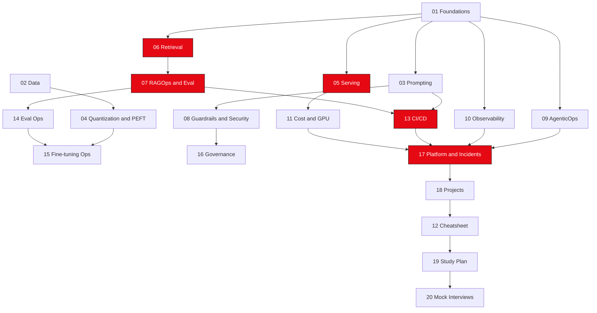

<div align="center">

<a href="https://llmops-interview-preparation.vercel.app"></a>

# LLMOps Interview Preparation

### A zero-to-hero, production-grade LLMOps curriculum — 20 modules, 142 concept episodes, 350 code blocks, staff-level interview scenarios

[](https://llmops-interview-preparation.vercel.app)
[](LICENSE)


`vLLM` · `TensorRT-LLM` · `HF TGI` · `Ollama` · `Qdrant` · `Milvus` · `pgvector` · `LangFuse` · `OpenTelemetry` · `NeMo Guardrails` · `Guardrails AI` · `MCP` · `LangGraph` · `Unsloth` · `QLoRA` · `FastAPI` · `Ray` · `Docker` · `Kubernetes`



*One system map for the whole course: the request path (top), the telemetry plane (middle) and the continuous-improvement flywheel (bottom).*

</div>

---

## The storefront-style site

The whole course is also a zero-dependency web app (`site/`, plain HTML/CSS/JS): modules are **catalogue items** on shelves, sections are **episodes**, and revision feels like browsing a store (everything is free). The styling takes cues from a familiar navy-and-orange e-commerce layout: a wide search bar, a category strip, shelf carousels, a "best sellers" Top 10, and a detail page per module. **[Open the live site](https://llmops-interview-preparation.vercel.app)**.

<table>
<tr>
<td width="50%"><br><sub><b>Shelves and Top 10</b>: role-based "Top Picks" and a numbered Top 10, with Read now / List buttons on every card.</sub></td>
<td width="50%"><br><sub><b>Detail page</b>: tools, genres, and an episode list for every section.</sub></td>
</tr>
<tr>
<td width="50%"><br><sub><b>Reader</b>: light theme, episode sidebar, progress, highlighted code, and live-rendered Mermaid diagrams.</sub></td>
<td width="50%" align="center"><br><sub><b>Mobile</b>: responsive, no horizontal scrolling.</sub></td>
</tr>
</table>

| Feature | What it does |
|---|---|
| Interview profiles | "Interview in 72 hours", "Senior/Staff loop", "Platform engineer", "Career switcher" reorder the recommendations |
| Reader with resume | Remembers where you stopped in each module; a "Continue Reading" row appears |
| My List and search | Save modules; search titles, tools and all 142 episode titles (`/` focuses search) |
| Deep links | `#/read/5/5.3` opens Module 05 section 3; every episode has a stable link |
| Private | Progress lives only in your browser's `localStorage`; no accounts, no analytics |

> The visual style is an homage to e-commerce storefronts. It uses no copied logos, ratings, reviews or prices, and this project is not affiliated with or endorsed by Amazon.

---

## What this is

Every module is a self-contained chapter that follows the same five-part structure, so you can study (and revise) predictably:

1. **Module overview & first-principles architecture** — theory with Mermaid / ASCII topology diagrams.
2. **Mathematical foundations & formulas** — VRAM, KV cache, roofline, quantization error, queueing, statistics.
3. **Production-ready code** — typed Python, Dockerfiles, Compose, Kubernetes / Helm, vLLM launch scripts.
4. **Hard-learned production failures** — incident-style case studies with step-by-step root-cause analysis and remediation code.
5. **Senior/Staff interview scenarios** — each with the *Junior/Mid trap answer* and the *Staff production answer*.

**Modules 13-20 and the extension sections (numbered `N.6` and up in modules 01-12)** use a five-part *concept* format: **Conceptual Deep Dive**, **Cross-Connection Scenarios**, **Production Anti-Patterns**, **Minimal Working Code** (two runnable blocks) and **Interview Angle** (questions with concise model answers that state a trade-off and a measurable check).

All content and code are original, written from first principles. Version pins in the snippets are illustrative — **always check the current release of a library or engine before copying a flag or API**, as vLLM, LangGraph, the MCP SDK, Ragas and similar projects move quickly.

---

## Curriculum

| # | Module | Target tools | Key concepts | Interview focus |
|---|---|---|---|---|
| 01 | [LLMOps Foundations & Architecture](chapters/01_llmops_foundations_architecture.md) | PyTorch, vLLM, Kubernetes | MLOps vs LLMOps, lifecycle, prefill vs decode, roofline, **VRAM math** (weights, KV cache, activations, optimizer states) | "Will 70B fit on one GPU?", fleet sizing, memory- vs compute-bound reasoning |
| 02 | [Data Engineering & Synthetic Data](chapters/02_data_engineering_synthetic_data_curation.md) | datasketch, FastText, Presidio, Ray, DVC | MinHash-LSH dedup, quality filters, PII masking, decontamination, Self-Instruct, Evol-Instruct, UltraFeedback-style pairs, tokenizer extension | Dedup at 50M docs, judge bias, contamination, teacher-licence risk |
| 03 | [Prompt Engineering, Versioning & Structured Output](chapters/03_prompt_engineering_versioning_management.md) | Jinja2, Pydantic, Instructor, Outlines, GBNF, LangFuse | Prompt registry, dynamic context assembly, prefix-cache layout, JSON-schema enforcement, guided decoding | Prompt rollback, JSON vs function calling vs constrained decoding, SSTI |
| 04 | [Quantization, Compression & PEFT](chapters/04_model_quantization_compression_peft.md) | AutoAWQ, llm-compressor, bitsandbytes, GGUF, Unsloth, PEFT, Mergekit | PTQ vs QAT, AWQ/GPTQ/FP8/NF4/GGUF, LoRA/QLoRA/DoRA/rsLoRA, adapter merging, TIES/DARE/SLERP | AWQ vs GPTQ vs NF4, merge-then-quantize pitfalls, LoRA vs full FT |
| 05 | [LLM Serving & Inference Engines](chapters/05_llm_serving_inference_engines.md) | vLLM, TensorRT-LLM, TGI, Ollama, KEDA | **PagedAttention**, continuous batching, chunked prefill, speculative decoding, multi-LoRA, TP/PP, disaggregation | Engine selection, p99 ITL spikes, autoscaling signals, KV exhaustion |
| 06 | [Vector Databases & Retrieval Ops](chapters/06_vector_databases_retrieval_ops.md) | Qdrant, Milvus, Pinecone, pgvector, TEI | HNSW tuning, hybrid BM25 + dense with RRF, cross-encoder reranking, parent-child chunking, filtered ANN at scale | DB selection at 200M chunks, filtered recall, freshness & ACLs |
| 07 | [RAGOps & Evaluation](chapters/07_ragops_evaluation_frameworks.md) | Ragas, TruLens, DeepEval, GitHub Actions | RAG triad, claim-level faithfulness, judge calibration (κ), synthetic test sets, paired-bootstrap gates | "Can you trust the judge?", eval cost, metric gaming |
| 08 | [Guardrails, Security & Alignment](chapters/08_guardrails_security_alignment.md) | NeMo Guardrails, Guardrails AI, Llama Guard, Presidio, gVisor | Direct/indirect injection, exfiltration, lethal trifecta, instruction hierarchy, canaries, tool sandboxing | Injection defence design, guardrail latency, red-team CI |
| 09 | [AgenticOps: Orchestration, State & MCP](chapters/09_agenticops_orchestration_state.md) | LangGraph, LlamaIndex Workflows, MCP (FastMCP), Postgres | State machines, checkpoints, HITL interrupt/resume, MCP servers & hosts, idempotency, loop breakers, schema drift | Agent reliability maths, double-refund incident, MCP tool poisoning |
| 10 | [Monitoring, Observability & Tracing](chapters/10_monitoring_observability_tracing.md) | OpenTelemetry, LangFuse, Arize Phoenix, Prometheus, Grafana | TTFT / ITL / TPS, GenAI semantic conventions, SLO burn-rate alerts, cost attribution, hallucination-drift detection | "Mean latency is fine but users complain", cardinality, PII in traces |
| 11 | [Cost, Latency & GPU Optimization](chapters/11_cost_latency_gpu_optimization.md) | Redis Stack, Karpenter, Modal, RunPod, AWS Bedrock | Semantic cache, model cascading, spot management, TP vs PP, serverless break-even, unit economics | "Cut the bill 60%", cache leaks, router quality, spot reclaim |
| 12 | [Interview Cheatsheet & System Design](chapters/12_llmops_interview_cheatsheet_system_design.md) | All of the above | CRISP-LM design framework, decision trees (RAG vs fine-tune, LoRA vs full FT, engines, stores), Right-vs-Wrong table, 35 rapid-fire Q&As | Enterprise RAG / agent design, capacity planning, behavioural prompts |

| 13 | [LLM CI/CD & Release Engineering](chapters/13_llm_cicd_release_engineering.md) | Eval gates, registries, GitOps | Release bundle as one unit, CI cost control, shadow/canary/blue-green, provider upgrades, A/B tests and sequential decisions, kill switches | "How do you ship a prompt change safely?", deprecation playbook |
| 14 | [Evaluation Operations & the Data Flywheel](chapters/14_evaluation_operations_data_flywheel.md) | Golden sets, judges, Krippendorff alpha | Eval set lifecycle, judge operations, online-offline gap, cluster bootstrap, multiple-comparison control, trace-to-dataset flywheel | "Offline says better, online says worse" |
| 15 | [Fine-Tuning & Alignment Operations](chapters/15_finetuning_alignment_operations.md) | SFT, DPO, GRPO | When to tune, data and label ops, preference and reward pipelines, adapter lifecycle, regression and safety checks | Fine-tune vs RAG vs prompt, reward hacking |
| 16 | [Governance, Compliance & Responsible AI](chapters/16_governance_compliance_responsible_ai.md) | NIST AI RMF, EU AI Act, model cards | Risk tiers, control mapping, audit evidence, privacy and retention, responsible-use review | "What evidence would an auditor want?" |
| 17 | [Platform Engineering, Multi-Tenancy & Incident Response](chapters/17_platform_engineering_multitenancy_incident_response.md) | Gateway, fair queueing, GPU Kubernetes | Tenant isolation and quotas, fair scheduling, cost attribution, runbooks, incident command and postmortems | Noisy neighbour, quota design, LLM incident drill |
| 18 | [Production Projects & Labs Blueprint](chapters/18_production_projects_labs_blueprint.md) | RAG service, capacity report, durable agent | Six end-to-end builds with acceptance criteria and evidence to show | Portfolio and take-home preparation |
| 19 | [Learning Roadmap & Interview Study Plan](chapters/19_learning_roadmap_interview_study_plan.md) | Rubrics, spaced repetition, papers | Level rubrics, study cadence, glossary, annotated reading list (titles, authors, years) | Self-assessment |
| 20 | [Mock Interview & System Design Question Bank](chapters/20_mock_interview_system_design_question_bank.md) | RAG design, voice agent, question bank | Worked system designs, estimation drills, 60-row question bank | Mock loops |

**Suggested reading order:** 01 → 05 → 06 → 07 → 03 → 04 → 08 → 09 → 10 → 11 → 13 → 14 → 02 → 15 → 16 → 17 → 18 → 12 → 19 → 20. (Serving and retrieval first because most interview questions hinge on them; data curation later because it is the most specialised.)

---

## Study paths

### 3-Day Crash Course (interview in the next week)

| Day | Focus | Do this |
|---|---|---|
| **1** | Memory & serving fundamentals | Read **01 §1–2** and **05 §1–2**. Run the VRAM calculator (`01 §3.1`) on three models. Re-derive KV-cache size for Llama-3-8B and 70B on paper. Answer the 01 and 05 interview scenarios aloud. |
| **2** | RAG end to end | Skim **06** (hybrid search, HNSW, filters) and **07** (triad, judge calibration, paired tests). Draw the retrieval funnel from memory. Do the 07 interview scenarios. |
| **3** | Safety, cost, and the design round | Read **08 §1** (trust zones, lethal trifecta), **11 §1–2**, then all of **12**. Do two timed 45-minute design runs using CRISP-LM; memorise the numbers table in 12 §1.6. |

### 7-Day Deep Dive

| Day | Modules | Hands-on |
|---|---|---|
| 1 | 01, 05 (first half) | Launch the Compose stack; benchmark with the load generator in `05 §3.9` |
| 2 | 05 (second half), 04 | Quantize a small model with AWQ; compare perplexity |
| 3 | 06, 07 | Build a Qdrant collection + hybrid query; run Ragas on 20 items |
| 4 | 03, 08 | Add a prompt registry and an output sanitiser; run the red-team test |
| 5 | 09, 10 | Build the LangGraph agent with an interrupt; add OTel traces to LangFuse |
| 6 | 11, 02 | Implement the semantic cache + router; run the dedup script |
| 7 | 12 | Two full mock design interviews + rapid-fire Q&A, recorded and self-reviewed |

### 14-Day Staff Mastermind

| Days | Theme | Output |
|---|---|---|
| 1–2 | Foundations & memory | Personal one-page "numbers sheet" (VRAM, KV, $/1M tokens) validated with the calculators |
| 3–4 | Serving internals | Written explanation of PagedAttention, continuous batching and chunked prefill in your own words; a benchmark report with TTFT/ITL/goodput curves |
| 5–6 | Retrieval & evaluation | A golden set (≥100 items), calibrated judge (κ report), and a paired-bootstrap CI gate in CI |
| 7–8 | Quantization & PEFT | QLoRA run with Unsloth, merge-in-BF16 verification, AWQ/FP8 comparison table |
| 9 | Security | Threat model for an agent with tools; red-team corpus (≥30 attacks); ASR/FPR report |
| 10 | AgenticOps | Durable agent with HITL + idempotency; chaos-test a mid-run restart |
| 11 | Observability | SLO definitions, burn-rate alerts, cost attribution dashboard |
| 12 | Cost & GPU economics | Break-even analysis (dedicated vs serverless vs API) for a realistic workload |
| 13 | Data & synthetic generation | Dedup + quality filter + decontamination pipeline; preference-pair generation with judge hygiene |
| 14 | Capstone | Three mock Staff design interviews (enterprise RAG, agentic support, multi-tenant platform) with written design docs using the 12 §3.5 template |

---

## Learning paths



---

## Hands-on local environment

A single `docker-compose.yml` brings up **vLLM + Qdrant + Redis Stack (semantic-cache vector index) + LangFuse v3** (with its Postgres, ClickHouse and MinIO dependencies). The same file is committed at the repo root.

**Prerequisites:** Docker 24+, Docker Compose v2 and — for vLLM — an NVIDIA GPU with the NVIDIA Container Toolkit. No GPU? Use `--profile cpu` to run Ollama as an OpenAI-compatible stand-in on port 11434.

```bash
cp .env.example .env
# edit .env: set the secrets. Generate the LangFuse keys with:  openssl rand -hex 32
docker compose up -d                  # GPU host: full stack, one command
# docker compose --profile cpu up -d  # no GPU: Ollama on :11434 in place of vLLM
docker compose ps
```

| Service | URL | Purpose |
|---|---|---|
| vLLM | http://localhost:8000/v1 | OpenAI-compatible inference (PagedAttention, prefix caching, chunked prefill) |
| Qdrant | http://localhost:6333/dashboard | Vector DB (dense + sparse hybrid, payload filters) |
| Redis Stack | `localhost:6379` · UI http://localhost:8001 | Semantic cache (RediSearch HNSW) and LangFuse queue |
| LangFuse | http://localhost:3000 | Traces, prompts, scores, cost |

Smoke test:

```bash
curl -s http://localhost:8000/v1/chat/completions \
  -H "Authorization: Bearer ${VLLM_API_KEY:-dev-key}" -H 'Content-Type: application/json' \
  -d '{"model":"llm-primary","messages":[{"role":"user","content":"Explain PagedAttention in one sentence."}],"max_tokens":60}'
```

<details>
<summary><b>docker-compose.yml</b> (click to expand — identical to the committed file)</summary>

```yaml
# Local LLMOps stack: vLLM + Qdrant + Redis Stack + LangFuse (v3)
#
#   cp .env.example .env            # then edit the secrets
#   docker compose up -d            # GPU machine: everything incl. vLLM
#   docker compose --profile cpu up -d   # no GPU: Ollama stands in for vLLM (OpenAI-compatible on :11434)
#
# Endpoints
#   vLLM (OpenAI API)  http://localhost:8000/v1
#   Qdrant             http://localhost:6333/dashboard
#   Redis Stack        localhost:6379   (RedisInsight UI on http://localhost:8001)
#   LangFuse           http://localhost:3000
name: llmops

x-langfuse-env: &langfuse-env
  DATABASE_URL: postgresql://langfuse:${POSTGRES_PASSWORD:-langfuse}@postgres:5432/langfuse
  NEXTAUTH_URL: http://localhost:3000
  NEXTAUTH_SECRET: ${LANGFUSE_NEXTAUTH_SECRET:?set LANGFUSE_NEXTAUTH_SECRET in .env}
  SALT: ${LANGFUSE_SALT:?set LANGFUSE_SALT in .env}
  ENCRYPTION_KEY: ${LANGFUSE_ENCRYPTION_KEY:?set LANGFUSE_ENCRYPTION_KEY (64 hex chars) in .env}
  CLICKHOUSE_URL: http://clickhouse:8123
  CLICKHOUSE_MIGRATION_URL: clickhouse://clickhouse:9000
  CLICKHOUSE_USER: clickhouse
  CLICKHOUSE_PASSWORD: ${CLICKHOUSE_PASSWORD:-clickhouse}
  CLICKHOUSE_CLUSTER_ENABLED: "false"
  REDIS_HOST: redis
  REDIS_PORT: "6379"
  REDIS_AUTH: ${REDIS_PASSWORD:-redispass}
  LANGFUSE_S3_EVENT_UPLOAD_BUCKET: langfuse
  LANGFUSE_S3_EVENT_UPLOAD_REGION: auto
  LANGFUSE_S3_EVENT_UPLOAD_ENDPOINT: http://minio:9000
  LANGFUSE_S3_EVENT_UPLOAD_ACCESS_KEY_ID: minio
  LANGFUSE_S3_EVENT_UPLOAD_SECRET_ACCESS_KEY: ${MINIO_PASSWORD:-miniosecret}
  LANGFUSE_S3_EVENT_UPLOAD_FORCE_PATH_STYLE: "true"
  TELEMETRY_ENABLED: "false"

services:
  # ---------------------------------------------------------------- serving
  vllm:
    image: vllm/vllm-openai:v0.10.1
    runtime: nvidia
    ipc: host
    environment:
      HUGGING_FACE_HUB_TOKEN: ${HF_TOKEN:-}
      VLLM_API_KEY: ${VLLM_API_KEY:-dev-key}
    command: >
      --model ${LLM_MODEL:-Qwen/Qwen2.5-1.5B-Instruct}
      --served-model-name llm-primary
      --max-model-len 8192
      --gpu-memory-utilization 0.85
      --max-num-seqs 64
      --enable-prefix-caching
      --enable-chunked-prefill
      --api-key ${VLLM_API_KEY:-dev-key}
    volumes: ["hf-cache:/root/.cache/huggingface"]
    ports: ["8000:8000"]
    deploy:
      resources:
        reservations:
          devices: [{ driver: nvidia, count: 1, capabilities: [gpu] }]
    healthcheck:
      test: ["CMD", "curl", "-f", "http://localhost:8000/health"]
      interval: 15s
      timeout: 5s
      retries: 40
      start_period: 120s
    restart: unless-stopped

  ollama:                       # CPU/dev fallback; enabled with `--profile cpu`
    profiles: ["cpu"]
    image: ollama/ollama:latest
    ports: ["11434:11434"]
    volumes: ["ollama:/root/.ollama"]

  # ------------------------------------------------------------- retrieval
  qdrant:
    image: qdrant/qdrant:v1.12.4
    ports: ["6333:6333", "6334:6334"]
    environment:
      QDRANT__SERVICE__API_KEY: ${QDRANT_API_KEY:-dev-key}
    volumes: ["qdrant-data:/qdrant/storage"]
    ulimits: { nofile: { soft: 65535, hard: 65535 } }
    healthcheck:
      test: ["CMD-SHELL", "bash -c ':> /dev/tcp/127.0.0.1/6333' || exit 1"]
      interval: 10s
      retries: 10
    restart: unless-stopped

  # ----------------------------- semantic cache + LangFuse queue (one Redis)
  redis:
    image: redis/redis-stack:latest          # RediSearch vector index for the semantic cache
    environment:
      REDIS_ARGS: "--requirepass ${REDIS_PASSWORD:-redispass} --appendonly yes"
    ports: ["6379:6379", "8001:8001"]
    volumes: ["redis-data:/data"]
    healthcheck:
      test: ["CMD-SHELL", "redis-cli -a ${REDIS_PASSWORD:-redispass} ping | grep PONG"]
      interval: 10s
      retries: 10
    restart: unless-stopped

  # ----------------------------------------------------------- observability
  langfuse-web:
    image: langfuse/langfuse:3
    depends_on:
      postgres: { condition: service_healthy }
      clickhouse: { condition: service_healthy }
      redis: { condition: service_healthy }
      minio: { condition: service_healthy }
    ports: ["3000:3000"]
    environment:
      <<: *langfuse-env
      LANGFUSE_INIT_ORG_ID: llmops
      LANGFUSE_INIT_PROJECT_ID: llmops-local
      LANGFUSE_INIT_PROJECT_PUBLIC_KEY: ${LANGFUSE_PUBLIC_KEY:-pk-lf-local}
      LANGFUSE_INIT_PROJECT_SECRET_KEY: ${LANGFUSE_SECRET_KEY:-sk-lf-local}
      LANGFUSE_INIT_USER_EMAIL: ${LANGFUSE_ADMIN_EMAIL:-admin@example.com}
      LANGFUSE_INIT_USER_PASSWORD: ${LANGFUSE_ADMIN_PASSWORD:?set LANGFUSE_ADMIN_PASSWORD in .env}
    restart: unless-stopped

  langfuse-worker:
    image: langfuse/langfuse-worker:3
    depends_on:
      postgres: { condition: service_healthy }
      clickhouse: { condition: service_healthy }
      redis: { condition: service_healthy }
      minio: { condition: service_healthy }
    environment: *langfuse-env
    restart: unless-stopped

  postgres:
    image: postgres:16
    environment:
      POSTGRES_USER: langfuse
      POSTGRES_PASSWORD: ${POSTGRES_PASSWORD:-langfuse}
      POSTGRES_DB: langfuse
    volumes: ["postgres-data:/var/lib/postgresql/data"]
    healthcheck:
      test: ["CMD-SHELL", "pg_isready -U langfuse"]
      interval: 5s
      retries: 10
    restart: unless-stopped

  clickhouse:
    image: clickhouse/clickhouse-server:24.8
    environment:
      CLICKHOUSE_USER: clickhouse
      CLICKHOUSE_PASSWORD: ${CLICKHOUSE_PASSWORD:-clickhouse}
    volumes: ["clickhouse-data:/var/lib/clickhouse"]
    healthcheck:
      test: ["CMD-SHELL", "wget -qO- http://localhost:8123/ping || exit 1"]
      interval: 5s
      retries: 20
    restart: unless-stopped

  minio:
    image: minio/minio
    entrypoint: sh
    command: -c 'mkdir -p /data/langfuse && minio server /data --address ":9000" --console-address ":9001"'
    environment:
      MINIO_ROOT_USER: minio
      MINIO_ROOT_PASSWORD: ${MINIO_PASSWORD:-miniosecret}
    volumes: ["minio-data:/data"]
    healthcheck:
      test: ["CMD", "mc", "ready", "local"]
      interval: 5s
      retries: 10
    restart: unless-stopped

volumes:
  hf-cache:
  ollama:
  qdrant-data:
  redis-data:
  postgres-data:
  clickhouse-data:
  minio-data:
```

</details>

> The values in `.env.example` are placeholders for local development only. The compose file refuses to start until the LangFuse secrets and admin password are set, so you cannot accidentally run with empty keys.

---

## Quality and verification

This edition was produced with a **plan, write, audit** loop: a lead agent audited the repo against a total LLMOps concept map, writer agents produced the new material from precise outlines, and a fixer corrected defects found in the original chapters.

| Check | How | Result |
|---|---|---|
| Structure | `scripts/audit.py`: every `N.M` section has the five parts and a code block; required concepts present | 0 issues |
| Python syntax | every ```python block parsed with `ast` | 0 errors |
| Runtime | stdlib/numpy sections executed in a clean directory (`scripts/check_snippets.py`) | 83 sections ran, 0 failed, 15 skipped (third-party) |
| Cross-references | `scripts/check_xrefs.py` validates "Module NN section X.Y" and "section N.M" links (checker sensitivity verified with planted errors) | 861 checked, 0 broken |
| PDFs | one per module from the Markdown source | 20 / 20 |

**Honest limits** (details in [`CROSSCHECK.md`](CROSSCHECK.md)):

- The original-chapter audit sampled heavily rather than reading every line; the issue list is not exhaustive.
- Third-party-library snippets (vLLM, LangGraph, TRL, MCP SDK and similar) are syntax-checked but not executed, and flags drift between versions.
- `docker-compose.yml`: the vLLM service now relies on `deploy.devices` for GPU access (the legacy `runtime: nvidia` line was removed). This is untested on a GPU host; revert if your Compose version ignores it. Image tags marked "pin in production" are intentionally left floating for local use.
- Prices, benchmark ranks, regulation details and spec versions are perishable and are marked "verify against current docs".
- The audit is structural; it cannot prove an explanation is correct.

---

## Contributing

Corrections, outdated claims and missing edge cases are welcome. Edit the module in `chapters/NN_*.md`, or add a new section as `extensions/NNc.md` and run `python scripts/merge_extensions.py`. Keep the five-part format for numbered sections, then run:

```bash
pip install -r requirements.txt
python scripts/audit.py && python scripts/check_xrefs.py && python scripts/check_snippets.py
python scripts/build_pdfs.py && python scripts/build_site_data.py
```

---

## Repository layout

```
llmops-interview-preparation/
├── README.md
├── CROSSCHECK.md           # audit report: what changed, what is still missing
├── docker-compose.yml      # local stack: vLLM, Qdrant, Redis Stack, LangFuse
├── .env.example
├── chapters/               # modules 01-20 (Markdown, source of truth)
├── extensions/             # expansion sections (merged into chapters)
├── pdfs/                   # one PDF per module
├── scripts/                # audit, xref check, snippet runner, PDF + site builders
├── site/                   # the streaming-style web app (deployed on Vercel)
├── docs/screenshots/       # images used in this README
├── assets/
│   └── llmops_end_to_end_architecture.svg
└── LICENSE
```

## How to use the code

- Snippets are meant to be **copied into a project**, not run from the repo root; each module names the files and `requirements-*.txt` it assumes.
- Throughput and latency numbers (tokens/s, ms) are **order-of-magnitude planning figures** derived from first-principles formulas. Benchmark on your own hardware and traffic before committing to a design.
- Incident write-ups are composites illustrating common failure patterns; they are teaching tools, not accounts of specific companies.
- Security snippets are defensive references. Test them in your own environment before relying on them.

## License

[MIT](LICENSE)
