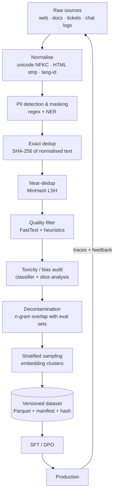

# Module 02 — Data Engineering, Synthetic Data & Curation

> **Goal:** Build the data flywheel that feeds SFT/DPO: deduplicate at scale with MinHash-LSH, filter quality with a FastText classifier, mask PII, generate synthetic instruction and preference data from teacher models, and extend tokenizers safely.

---

## Table of Contents
1. [Module Overview & First-Principles Architecture](#1-module-overview--first-principles-architecture)
2. [Mathematical Foundations](#2-mathematical-foundations--formulas)
3. [Production-Ready Code](#3-production-ready-executable-code)
4. [Hard-Learned Production Failures](#4-hard-learned-production-failures--edge-cases)
5. [Interview Questions](#5-seniorstaff-llmops-interview-questions)

---

## 1. Module Overview & First-Principles Architecture

### 1.1 Why data work dominates

For fine-tuning, a few thousand **high-quality, diverse, deduplicated** examples routinely beat hundreds of thousands of noisy ones (LIMA, Phi-style "textbook" data, and countless internal results). The levers, in order of ROI:

1. **Remove harm:** duplicates, test-set leakage, PII, toxic content, broken formatting.
2. **Raise average quality:** classifier-based filtering, rubric scoring with a judge model.
3. **Raise diversity:** clustering + stratified sampling, Evol-Instruct complexity ladders.
4. **Match the deployment distribution:** use real (anonymised) production traces as seeds.

### 1.2 End-to-end curation pipeline



### 1.3 Synthetic data: why and when

Synthetic generation uses a stronger **teacher** model to produce training data for a smaller **student**. It is appropriate when:
- labelled domain data is scarce or sensitive,
- you need coverage of rare edge cases (long-tail intents, adversarial inputs),
- you need **preference pairs** (chosen/rejected) which humans rarely produce at scale.

Risks: *model collapse* (training on your own outputs loses tails), *teacher license restrictions* (check ToS before distilling from a proprietary API), *style monoculture*, and *benchmark contamination*. Mitigate with seed diversity, filtering, mixing with real data (≥ 30–50 % real is a common floor), and decontamination.

### 1.4 Three canonical frameworks

| Framework | Idea | Output |
|---|---|---|
| **Self-Instruct** | Bootstrap from ~175 seed tasks; the model proposes new instructions, then inputs/outputs; filter by ROUGE-L similarity < 0.7 to existing pool | Instruction/response pairs |
| **Evol-Instruct** | Iteratively *rewrite* an instruction to be harder: add constraints, deepen, concretise, increase reasoning steps, complicate input; eliminate failed evolutions | Complexity-graded instructions |
| **UltraFeedback-style** | For each prompt sample *k* completions from diverse models; a strong judge scores each on rubrics (helpfulness, honesty, instruction-following, truthfulness); pick best as *chosen*, a lower-scored (or random non-best) as *rejected* | Preference pairs for DPO/RM |

### 1.5 Tokenizer considerations

- A tokenizer with poor coverage of your domain (medical codes, Hindi, source code in a niche language) inflates **token counts** → higher cost, shorter effective context, worse quality.
- **Fertility** = tokens per word (or per char). English on Llama-3 ≈ 1.3; some Indic scripts with older tokenizers exceed 5–8.
- Vocabulary expansion: train a new BPE on the domain corpus, **merge** the new tokens into the base vocabulary, resize embeddings, initialise new embeddings as the **mean of their sub-token embeddings under the old tokenizer**, then continue pre-training/SFT with embeddings (and LM head) trainable.

---

## 2. Mathematical Foundations & Formulas

### 2.1 Jaccard similarity and MinHash

For shingle sets `A, B`:

```
J(A,B) = |A ∩ B| / |A ∪ B|
```

A MinHash signature uses `k` hash functions `h_i`; `minhash_i(A) = min_{x∈A} h_i(x)`. Key property:

```
Pr[ minhash_i(A) = minhash_i(B) ] = J(A,B)
```

so the fraction of matching signature positions is an unbiased estimator of `J` with standard error `sqrt(J(1-J)/k)`. With `k=128`, near `J=0.8` the error is ≈ 0.035.

### 2.2 LSH banding

Split the `k`-length signature into `b` bands of `r` rows (`k = b·r`). Two documents become candidates if *any* band matches exactly:

```
P(candidate | J) = 1 − (1 − J^r)^b
```

The S-curve's steepest point (threshold) ≈ `(1/b)^{1/r}`.

| k | b | r | threshold ≈ | P(cand) at J=0.8 | P(cand) at J=0.5 |
|---|---|---|---|---|---|
| 128 | 16 | 8 | 0.71 | 0.97 | 0.06 |
| 128 | 32 | 4 | 0.42 | 1.00 | 0.87 |
| 256 | 9 | 29 | 0.93 | 0.004 | ~0 |

Choose `b, r` to place the threshold near your target duplicate Jaccard (commonly 0.7–0.85 on 5-word shingles).

### 2.3 Expected collisions at scale

Corpus of `n` docs; if a fraction `f` has near-duplicates in clusters of mean size `c`, you retain `n·(1 − f + f/c)` docs. Reporting dedup as "% removed" without cluster-size context is misleading — always report cluster size distribution.

### 2.4 FastText quality classifier

Linear model over averaged n-gram embeddings: `ŷ = softmax(W · (1/|x|) Σ E[g_i])`. Train with positives = trusted high-quality text (curated docs, reference answers), negatives = random crawl. Report **precision@threshold** on a human-labelled set; choose threshold to hit target retention (e.g., keep top 30–50%).

### 2.5 Perplexity filtering

`PPL(x) = exp(−(1/T) Σ log p(x_t | x_<t))`. Very high PPL ⇒ gibberish; very low PPL ⇒ boilerplate/repetition. Keep a band, e.g., 10th–80th percentile of a reference LM.

### 2.6 Self-Instruct similarity filter

Reject a new instruction `x` if `max_{y∈pool} ROUGE-L(x,y) ≥ 0.7`. Embedding-based variant: reject if `max cos(e(x), e(y)) ≥ τ` with `τ≈0.9`.

### 2.7 Preference data and the DPO loss

Given prompt `x`, chosen `y_w`, rejected `y_l`, reference policy `π_ref`:

```
L_DPO = − E[ log σ( β · ( log π_θ(y_w|x)/π_ref(y_w|x) − log π_θ(y_l|x)/π_ref(y_l|x) ) ) ]
```

Preference *margin* quality matters: pairs with near-equal scores add noise. Typical filter: keep pairs with judge score gap ≥ 1.0 on a 1–10 scale.

### 2.8 Tokenizer fertility and cost

```
cost_ratio = fertility_old / fertility_new
effective_context_gain = S × (fertility_old / fertility_new)
```

If expansion lowers fertility from 4.8 → 2.1 on a language, you get 2.3× more text per context window and 2.3× lower cost/latency for that language.

### 2.9 Decontamination overlap

For eval item `e` and training doc `d` with n-gram sets `G_n(·)` (n=13 is conventional):

```
contaminated(d, e) ⟺ |G_13(d) ∩ G_13(e)| / |G_13(e)| ≥ 0.5
```

---

## 3. Production-Ready Executable Code

### 3.1 Requirements

```text
# requirements-data.txt
datasketch==1.6.5
fasttext-wheel==0.9.2
pandas>=2.2
pyarrow>=16
presidio-analyzer>=2.2
presidio-anonymizer>=2.2
spacy>=3.7
pydantic>=2.7
openai>=1.40          # also used for any OpenAI-compatible server (vLLM)
tenacity>=8.3
rouge-score>=0.1.2
tokenizers>=0.19
transformers>=4.44
tqdm
```

### 3.2 Normalisation + Exact + MinHash-LSH Deduplication

```python
"""Near-duplicate removal with MinHash LSH.

Run:  python dedup.py --in data/raw.parquet --out data/dedup.parquet --threshold 0.8
"""
from __future__ import annotations

import argparse
import hashlib
import re
import unicodedata
from dataclasses import dataclass
from typing import Iterable, Iterator

import pandas as pd
from datasketch import MinHash, MinHashLSH
from tqdm import tqdm

_WS = re.compile(r"\s+")


def normalise(text: str) -> str:
    """NFKC, lowercase, collapse whitespace; stable across trivial formatting changes."""
    text = unicodedata.normalize("NFKC", text).lower()
    return _WS.sub(" ", text).strip()


def shingles(text: str, n: int = 5) -> Iterator[str]:
    """Word n-gram shingles."""
    toks = text.split(" ")
    if len(toks) < n:
        yield " ".join(toks)
        return
    for i in range(len(toks) - n + 1):
        yield " ".join(toks[i : i + n])


def signature(text: str, num_perm: int = 128, n: int = 5) -> MinHash:
    """Compute a MinHash signature for a normalised document."""
    m = MinHash(num_perm=num_perm)
    for s in shingles(text, n):
        m.update(s.encode("utf-8"))
    return m


@dataclass
class DedupStats:
    total: int = 0
    exact_removed: int = 0
    near_removed: int = 0

    def report(self) -> str:
        kept = self.total - self.exact_removed - self.near_removed
        return (
            f"total={self.total} exact_removed={self.exact_removed} "
            f"near_removed={self.near_removed} kept={kept}"
        )


def dedup(texts: Iterable[str], threshold: float = 0.8, num_perm: int = 128) -> tuple[list[int], DedupStats]:
    """Return indices of documents to keep (first occurrence wins)."""
    stats = DedupStats()
    seen_hashes: set[str] = set()
    lsh = MinHashLSH(threshold=threshold, num_perm=num_perm)
    keep: list[int] = []
    for i, raw in enumerate(tqdm(texts, desc="dedup")):
        stats.total += 1
        norm = normalise(raw)
        if not norm:
            continue
        h = hashlib.sha256(norm.encode()).hexdigest()
        if h in seen_hashes:
            stats.exact_removed += 1
            continue
        seen_hashes.add(h)
        sig = signature(norm, num_perm)
        if lsh.query(sig):
            stats.near_removed += 1
            continue
        lsh.insert(str(i), sig)
        keep.append(i)
    return keep, stats


def main() -> None:
    ap = argparse.ArgumentParser()
    ap.add_argument("--in", dest="inp", required=True)
    ap.add_argument("--out", required=True)
    ap.add_argument("--col", default="text")
    ap.add_argument("--threshold", type=float, default=0.8)
    args = ap.parse_args()

    df = pd.read_parquet(args.inp)
    keep, stats = dedup(df[args.col].tolist(), args.threshold)
    df.iloc[keep].to_parquet(args.out, index=False)
    print(stats.report())


if __name__ == "__main__":
    main()
```

**Scaling note:** `datasketch` in a single process handles ~10–50M docs with Redis-backed LSH storage (`MinHashLSH(storage_config={"type":"redis",...})`). Above that use Spark/Ray: compute signatures in parallel, band-hash, `groupBy(band_id)` → connected components (union-find) → keep one per component.

### 3.3 Distributed Variant with Ray (band-hash + union-find)

```python
"""Distributed MinHash dedup using Ray Data. Signatures -> band keys -> connected components."""
from __future__ import annotations

import hashlib
from collections import defaultdict
from typing import Any

import numpy as np
import ray

NUM_PERM = 128
BANDS = 16
ROWS = NUM_PERM // BANDS
_PRIME = (1 << 61) - 1
_RNG = np.random.RandomState(42)
_A = _RNG.randint(1, _PRIME, NUM_PERM, dtype=np.uint64)
_B = _RNG.randint(0, _PRIME, NUM_PERM, dtype=np.uint64)


def _sig(text: str) -> np.ndarray:
    toks = text.lower().split()
    grams = {" ".join(toks[i : i + 5]) for i in range(max(1, len(toks) - 4))}
    hv = np.array(
        [int.from_bytes(hashlib.blake2b(g.encode(), digest_size=8).digest(), "little") for g in grams],
        dtype=np.uint64,
    )
    # (a*h + b) mod prime, min per permutation
    perm = (np.outer(hv % _PRIME, _A) + _B) % _PRIME
    return perm.min(axis=0)


def add_bands(batch: dict[str, Any]) -> dict[str, Any]:
    out_ids, out_keys = [], []
    for doc_id, text in zip(batch["id"], batch["text"]):
        s = _sig(text)
        for b in range(BANDS):
            key = hashlib.md5(s[b * ROWS : (b + 1) * ROWS].tobytes()).hexdigest() + f":{b}"
            out_ids.append(doc_id)
            out_keys.append(key)
    return {"id": np.array(out_ids), "band_key": np.array(out_keys)}


class UnionFind:
    def __init__(self) -> None:
        self.p: dict[str, str] = {}

    def find(self, x: str) -> str:
        self.p.setdefault(x, x)
        while self.p[x] != x:
            self.p[x] = self.p[self.p[x]]
            x = self.p[x]
        return x

    def union(self, a: str, b: str) -> None:
        ra, rb = self.find(a), self.find(b)
        if ra != rb:
            self.p[rb] = ra


def run(path_in: str, path_out: str) -> None:
    ray.init(ignore_reinit_error=True)
    ds = ray.data.read_parquet(path_in)  # columns: id, text
    bands = ds.map_batches(add_bands, batch_format="numpy")
    groups: dict[str, list[str]] = defaultdict(list)
    for row in bands.iter_rows():
        groups[row["band_key"]].append(row["id"])
    uf = UnionFind()
    for ids in groups.values():
        for other in ids[1:]:
            uf.union(ids[0], other)
    all_ids = {r["id"] for r in ds.select_columns(["id"]).iter_rows()}
    keep = {i for i in all_ids if uf.find(i) == i}
    ds.filter(lambda r: r["id"] in keep).write_parquet(path_out)


if __name__ == "__main__":
    run("data/raw/", "data/dedup/")
```

### 3.4 FastText Quality Classifier (train + score + threshold)

```python
"""Train a FastText quality classifier and filter a corpus.

Positives: curated/high-quality text. Negatives: random unfiltered crawl.
"""
from __future__ import annotations

import random
from pathlib import Path

import fasttext
import pandas as pd

LABEL_POS, LABEL_NEG = "__label__hq", "__label__lq"


def write_training_file(pos: list[str], neg: list[str], path: Path) -> None:
    rows = [(LABEL_POS, t) for t in pos] + [(LABEL_NEG, t) for t in neg]
    random.Random(7).shuffle(rows)
    with path.open("w", encoding="utf-8") as f:
        for label, text in rows:
            f.write(f"{label} {' '.join(text.split())[:5000]}\n")


def train(train_path: Path, model_path: Path) -> fasttext.FastText._FastText:
    model = fasttext.train_supervised(
        input=str(train_path), lr=0.1, epoch=8, wordNgrams=2, dim=100, minCount=3, loss="softmax", thread=8
    )
    model.save_model(str(model_path))
    return model


def score(model: fasttext.FastText._FastText, texts: list[str]) -> list[float]:
    """P(high-quality) for each text."""
    out: list[float] = []
    for t in texts:
        labels, probs = model.predict(" ".join(t.split())[:5000], k=2)
        d = dict(zip(labels, probs))
        out.append(float(d.get(LABEL_POS, 0.0)))
    return out


def filter_top_fraction(df: pd.DataFrame, col: str, keep_fraction: float, model: fasttext.FastText._FastText) -> pd.DataFrame:
    df = df.copy()
    df["q"] = score(model, df[col].tolist())
    cutoff = df["q"].quantile(1 - keep_fraction)
    return df[df["q"] >= cutoff].drop(columns="q")
```

Heuristic pre-filters (apply *before* the classifier; they are cheap):

```python
import re

def heuristic_ok(text: str) -> bool:
    words = text.split()
    n = len(words)
    if not (30 <= n <= 100_000):
        return False
    mean_wlen = sum(len(w) for w in words) / n
    if not (3 <= mean_wlen <= 10):
        return False
    alpha = sum(c.isalpha() for c in text) / max(1, len(text))
    if alpha < 0.6:
        return False
    lines = text.splitlines()
    if lines and sum(l.strip().endswith(("...", "…")) for l in lines) / len(lines) > 0.3:
        return False
    if len(set(words)) / n < 0.2:  # highly repetitive
        return False
    if re.search(r"lorem ipsum|click here to subscribe", text, re.I):
        return False
    return True
```

### 3.5 PII Detection and Masking (Presidio + custom recognisers)

```python
"""Reversible-by-design PII masking: replace with typed placeholders, never store the mapping in the dataset."""
from __future__ import annotations

from presidio_analyzer import AnalyzerEngine, Pattern, PatternRecognizer
from presidio_anonymizer import AnonymizerEngine
from presidio_anonymizer.entities import OperatorConfig

_analyzer = AnalyzerEngine()
_analyzer.registry.add_recognizer(
    PatternRecognizer(
        supported_entity="API_KEY",
        patterns=[
            Pattern("sk-key", r"\bsk-[A-Za-z0-9]{20,}\b", 0.9),
            Pattern("aws-akid", r"\bAKIA[0-9A-Z]{16}\b", 0.95),
            Pattern("gh-pat", r"\bghp_[A-Za-z0-9]{36}\b", 0.95),
        ],
    )
)
_anonymizer = AnonymizerEngine()

ENTITIES = [
    "PERSON", "EMAIL_ADDRESS", "PHONE_NUMBER", "CREDIT_CARD", "IBAN_CODE",
    "IP_ADDRESS", "US_SSN", "API_KEY", "LOCATION",
]

OPERATORS = {e: OperatorConfig("replace", {"new_value": f"<{e}>"}) for e in ENTITIES}


def mask_pii(text: str, min_score: float = 0.5) -> tuple[str, int]:
    """Return (masked_text, num_entities_masked)."""
    results = _analyzer.analyze(text=text, entities=ENTITIES, language="en", score_threshold=min_score)
    if not results:
        return text, 0
    masked = _anonymizer.anonymize(text=text, analyzer_results=results, operators=OPERATORS)
    return masked.text, len(results)


if __name__ == "__main__":
    sample = "Contact Jane Doe at jane.doe@acme.com or +1 415-555-0100. Key: sk-abcdefghijklmnopqrstuvwxyz1234"
    print(mask_pii(sample))
```

**Policy:** run PII masking **before** dedup and synthetic generation (so PII never reaches a third-party teacher API), and again on model outputs in production (Module 08). Track `pii_entities_per_1k_docs` as a pipeline metric.

### 3.6 Bias / Slice Audit

```python
"""Measure representation and quality-score disparity across slices (language, region, dialect, topic)."""
import pandas as pd

def slice_report(df: pd.DataFrame, slice_col: str, score_col: str = "q") -> pd.DataFrame:
    g = df.groupby(slice_col)[score_col]
    out = pd.DataFrame({"n": g.size(), "share": g.size() / len(df), "mean_q": g.mean(), "p10_q": g.quantile(0.1)})
    out["retention_if_cut_0.5"] = df.assign(k=df[score_col] >= 0.5).groupby(slice_col)["k"].mean()
    return out.sort_values("share", ascending=False)
```

If one slice's retention under the quality threshold is far below the mean, your classifier encodes a *style* bias (e.g., dropping African-American English or non-native English). Remedies: add slice-specific positives, use per-slice thresholds, or reweight.

### 3.7 Self-Instruct with a Local Teacher (vLLM OpenAI-compatible)

```python
"""Self-Instruct bootstrap with ROUGE-L dedup. Works against any OpenAI-compatible server."""
from __future__ import annotations

import json
import random
from pathlib import Path

from openai import OpenAI
from pydantic import BaseModel, Field, ValidationError
from rouge_score import rouge_scorer
from tenacity import retry, stop_after_attempt, wait_exponential

client = OpenAI(base_url="http://localhost:8000/v1", api_key="EMPTY")
TEACHER = "llm-teacher"
scorer = rouge_scorer.RougeScorer(["rougeL"], use_stemmer=False)


class Task(BaseModel):
    instruction: str = Field(min_length=10, max_length=400)
    input: str = ""
    output: str = Field(min_length=1)


PROMPT = """You are generating diverse tasks for training an assistant for {domain}.
Here are example tasks:
{examples}

Write {k} NEW, diverse tasks (different verbs, formats, difficulty). Return strict JSON:
{{"tasks":[{{"instruction":"...","input":"...","output":"..."}}]}}"""


@retry(stop=stop_after_attempt(4), wait=wait_exponential(min=1, max=20))
def propose(examples: list[Task], domain: str, k: int = 5) -> list[Task]:
    ex = "\n".join(f"- {json.dumps(e.model_dump())}" for e in examples)
    r = client.chat.completions.create(
        model=TEACHER,
        messages=[{"role": "user", "content": PROMPT.format(domain=domain, examples=ex, k=k)}],
        temperature=1.0,
        top_p=0.95,
        response_format={"type": "json_object"},
    )
    data = json.loads(r.choices[0].message.content or "{}")
    out: list[Task] = []
    for t in data.get("tasks", []):
        try:
            out.append(Task.model_validate(t))
        except ValidationError:
            continue
    return out


def novel(candidate: Task, pool: list[Task], thr: float = 0.7) -> bool:
    return all(scorer.score(p.instruction, candidate.instruction)["rougeL"].fmeasure < thr for p in pool)


def run(seed_path: Path, out_path: Path, domain: str, target: int = 2000) -> None:
    pool = [Task.model_validate_json(l) for l in seed_path.read_text().splitlines() if l.strip()]
    while len(pool) < target:
        shots = random.sample(pool, k=min(6, len(pool)))
        for c in propose(shots, domain):
            if novel(c, pool):
                pool.append(c)
        if len(pool) % 100 == 0:
            print("pool:", len(pool))
    out_path.write_text("\n".join(t.model_dump_json() for t in pool))
```

### 3.8 Evol-Instruct (depth and breadth evolutions with failure elimination)

```python
"""Evol-Instruct: evolve instructions to higher complexity and drop failed evolutions."""
from __future__ import annotations

import random

from openai import OpenAI

client = OpenAI(base_url="http://localhost:8000/v1", api_key="EMPTY")

DEPTH_OPS = {
    "constraints": "Add one extra constraint or requirement to the instruction.",
    "deepen": "Make the question require deeper, more specific investigation.",
    "concretize": "Replace general concepts with specific, concrete ones.",
    "reasoning": "Rewrite so that it explicitly requires multi-step reasoning.",
    "complicate_input": "Add a realistic complicated input (table, code, JSON) the answer must use.",
}
BREADTH_OP = "Create a brand-new instruction in the same domain but on a rarer topic, similar length and difficulty."

TEMPLATE = """I want you to act as a prompt rewriter.
{op}
Keep it answerable and under 80 added words. Do not mention "rewritten prompt".

#Given Prompt#:
{inst}

#Rewritten Prompt#:"""


def evolve_once(inst: str, model: str = "llm-teacher") -> tuple[str, str]:
    kind = random.choice([*DEPTH_OPS, "breadth"])
    op = BREADTH_OP if kind == "breadth" else DEPTH_OPS[kind]
    r = client.chat.completions.create(
        model=model, messages=[{"role": "user", "content": TEMPLATE.format(op=op, inst=inst)}], temperature=0.8
    )
    return kind, (r.choices[0].message.content or "").strip()


def is_failed(orig: str, new: str) -> bool:
    """Elimination rules from the Evol-Instruct paper, adapted."""
    if not new or new == orig:
        return True
    if len(new) < 0.7 * len(orig) or len(new) > 6 * len(orig):
        return True
    low = new.lower()
    if any(p in low for p in ("sorry", "as an ai", "i cannot", "rewritten prompt", "given prompt")):
        return True
    return False


def evolve(inst: str, rounds: int = 3) -> list[tuple[int, str, str]]:
    history: list[tuple[int, str, str]] = []
    cur = inst
    for r in range(1, rounds + 1):
        kind, new = evolve_once(cur)
        if is_failed(cur, new):
            break
        history.append((r, kind, new))
        cur = new
    return history
```

### 3.9 UltraFeedback-style Preference Pair Generation

```python
"""Sample k completions from a model pool, score with a judge across rubrics, emit DPO pairs."""
from __future__ import annotations

import json
import statistics
from concurrent.futures import ThreadPoolExecutor

from openai import OpenAI
from pydantic import BaseModel, Field

gen = OpenAI(base_url="http://localhost:8000/v1", api_key="EMPTY")
judge = OpenAI(base_url="http://localhost:8001/v1", api_key="EMPTY")

POLICIES = [("llm-small", 0.7), ("llm-small", 1.1), ("llm-mid", 0.7), ("llm-teacher", 0.5)]

RUBRIC = """Score the RESPONSE to the INSTRUCTION from 1-10 on each dimension:
helpfulness, honesty (no fabricated facts), instruction_following, truthfulness.
Think step by step in "rationale", then output JSON:
{"rationale":"...","helpfulness":n,"honesty":n,"instruction_following":n,"truthfulness":n}

INSTRUCTION:
{inst}

RESPONSE:
{resp}"""


class Scores(BaseModel):
    rationale: str
    helpfulness: int = Field(ge=1, le=10)
    honesty: int = Field(ge=1, le=10)
    instruction_following: int = Field(ge=1, le=10)
    truthfulness: int = Field(ge=1, le=10)

    @property
    def overall(self) -> float:
        return statistics.mean([self.helpfulness, self.honesty, self.instruction_following, self.truthfulness])


def sample(inst: str, model: str, temp: float) -> str:
    r = gen.chat.completions.create(model=model, messages=[{"role": "user", "content": inst}], temperature=temp, max_tokens=1024)
    return r.choices[0].message.content or ""


def grade(inst: str, resp: str) -> Scores | None:
    r = judge.chat.completions.create(
        model="llm-judge",
        messages=[{"role": "user", "content": RUBRIC.format(inst=inst, resp=resp)}],
        temperature=0.0,
        response_format={"type": "json_object"},
    )
    try:
        return Scores.model_validate_json(r.choices[0].message.content or "")
    except Exception:
        return None


def make_pair(inst: str, min_gap: float = 1.0) -> dict[str, object] | None:
    with ThreadPoolExecutor(8) as ex:
        resps = list(ex.map(lambda p: sample(inst, *p), POLICIES))
        scores = list(ex.map(lambda r: grade(inst, r), resps))
    scored = [(s.overall, r) for s, r in zip(scores, resps) if s is not None]
    if len(scored) < 2:
        return None
    scored.sort(key=lambda t: t[0], reverse=True)
    best, worst = scored[0], scored[-1]
    if best[0] - worst[0] < min_gap:
        return None  # ambiguous pair -> noisy DPO signal
    return {"prompt": inst, "chosen": best[1], "rejected": worst[1], "gap": best[0] - worst[0]}
```

**Judge hygiene:** (1) use a judge from a different family than any generator to reduce self-preference bias; (2) randomise response order if scoring pairwise; (3) calibrate the judge against ~200 human labels and report Cohen's κ; (4) penalise length (length-controlled win-rate) because judges favour verbosity.

### 3.10 Decontamination Against Evaluation Sets

```python
from __future__ import annotations

def ngrams(text: str, n: int = 13) -> set[str]:
    toks = text.lower().split()
    return {" ".join(toks[i : i + n]) for i in range(max(0, len(toks) - n + 1))}

def build_eval_index(eval_texts: list[str], n: int = 13) -> set[str]:
    idx: set[str] = set()
    for t in eval_texts:
        idx |= ngrams(t, n)
    return idx

def is_contaminated(doc: str, eval_index: set[str], n: int = 13, frac: float = 0.05) -> bool:
    g = ngrams(doc, n)
    return bool(g) and len(g & eval_index) / len(g) >= frac
```

### 3.11 Tokenizer Extension (domain vocabulary + safe embedding init)

```python
"""Add domain tokens to a base tokenizer and initialise new embeddings from sub-token means."""
from __future__ import annotations

import torch
from tokenizers import ByteLevelBPETokenizer
from transformers import AutoModelForCausalLM, AutoTokenizer

BASE = "meta-llama/Llama-3.1-8B"


def train_domain_vocab(files: list[str], vocab_size: int = 8000) -> list[str]:
    bpe = ByteLevelBPETokenizer()
    bpe.train(files=files, vocab_size=vocab_size, min_frequency=20, special_tokens=[])
    return list(bpe.get_vocab().keys())


def extend(base_tok: AutoTokenizer, model: AutoModelForCausalLM, new_tokens: list[str]) -> int:
    """Add tokens not already present; init embeddings as mean of old sub-token embeddings."""
    existing = set(base_tok.get_vocab())
    fresh = [t for t in new_tokens if t not in existing and len(t) > 2]
    old_emb = model.get_input_embeddings().weight.data.clone()
    old_head = model.get_output_embeddings().weight.data.clone()
    old_n = old_emb.shape[0]

    # Record decomposition under the OLD tokenizer before adding.
    decomp = {t: base_tok(t, add_special_tokens=False)["input_ids"] for t in fresh}
    base_tok.add_tokens(fresh)
    model.resize_token_embeddings(len(base_tok), mean_resizing=False)

    with torch.no_grad():
        for t in fresh:
            new_id = base_tok.convert_tokens_to_ids(t)
            ids = [i for i in decomp[t] if i < old_n]
            if not ids:
                continue
            model.get_input_embeddings().weight[new_id] = old_emb[ids].mean(0)
            model.get_output_embeddings().weight[new_id] = old_head[ids].mean(0)
    return len(fresh)


def fertility(tok: AutoTokenizer, texts: list[str]) -> float:
    tokens = sum(len(tok(t, add_special_tokens=False)["input_ids"]) for t in texts)
    words = sum(len(t.split()) for t in texts)
    return tokens / max(1, words)
```

**After extension:** train with `embed_tokens` and `lm_head` in `modules_to_save` (PEFT) or unfrozen, with a short warm-up stage that trains *only* new embeddings (LR ~1e-3) before full SFT — otherwise random-ish rows destabilise early loss.

### 3.12 Dataset Versioning and Manifest

```python
from __future__ import annotations

import hashlib
import json
from datetime import datetime, timezone
from pathlib import Path


def sha256_file(p: Path) -> str:
    h = hashlib.sha256()
    with p.open("rb") as f:
        for chunk in iter(lambda: f.read(1 << 20), b""):
            h.update(chunk)
    return h.hexdigest()


def write_manifest(shards: list[Path], out: Path, params: dict[str, object], parent: str | None) -> None:
    manifest = {
        "created": datetime.now(timezone.utc).isoformat(),
        "parent": parent,
        "params": params,  # dedup threshold, classifier version, pii policy, teacher model ids
        "shards": [{"path": str(s), "sha256": sha256_file(s), "bytes": s.stat().st_size} for s in shards],
    }
    out.write_text(json.dumps(manifest, indent=2))
```

### 3.13 Orchestration: DVC pipeline

```yaml
# dvc.yaml
stages:
  pii:
    cmd: python pii_mask.py --in data/raw --out data/pii
    deps: [pii_mask.py, data/raw]
    outs: [data/pii]
  dedup:
    cmd: python dedup.py --in data/pii.parquet --out data/dedup.parquet --threshold 0.8
    deps: [dedup.py, data/pii.parquet]
    outs: [data/dedup.parquet]
    params: [dedup.threshold]
  quality:
    cmd: python quality_filter.py --in data/dedup.parquet --out data/hq.parquet
    deps: [quality_filter.py, data/dedup.parquet, models/fasttext_quality.bin]
    outs: [data/hq.parquet]
    metrics: [metrics/quality.json]
  decontaminate:
    cmd: python decontam.py --in data/hq.parquet --evals evals/ --out data/final.parquet
    deps: [decontam.py, data/hq.parquet, evals]
    outs: [data/final.parquet]
```

---

## 4. Hard-Learned Production Failures & Edge Cases

### Incident 1 — Benchmark contamination made a bad model look great

**Symptom.** The new fine-tune scored +14 points on the internal QA eval but users saw no improvement; later A/B showed a regression.

**Root-cause analysis.**
1. The eval set had been built from last year's support tickets.
2. The SFT corpus was built from *all* historical tickets, including those same tickets.
3. No decontamination step existed; the model memorised answers.

**Remediation.** Add the decontamination stage (§3.10) as a *blocking* pipeline stage; freeze eval sets with date cutoffs (train strictly before, eval strictly after); keep a private "canary" eval never exported to any training job; report `contamination_rate` in the dataset manifest.

### Incident 2 — PII leaked to a third-party teacher API

**Symptom.** Security review found customer emails in synthetic data prompts logged by an external LLM provider.

**Root cause.** Seeds were drawn from raw production chats; PII masking ran *after* generation (on outputs) to save compute.

**Remediation.**
```python
def safe_seed(text: str) -> str | None:
    masked, n = mask_pii(text)
    if n > 5:            # very PII-dense -> discard entirely
        return None
    return masked        # only masked seeds may be sent to any external endpoint
```
Enforce at the *network* layer too: only the egress proxy of the data-gen job can reach teacher endpoints, and it runs a PII regex deny-filter on request bodies. Prefer a self-hosted teacher (vLLM + Llama-3.1-70B) for sensitive domains.

### Incident 3 — Dedup removed legitimate templated data

**Symptom.** After aggressive dedup (threshold 0.6), the model lost the ability to produce many structured formats (invoices, SQL).

**Root cause.** Templated documents share most shingles but differ in a few critical fields; they are near-duplicates by Jaccard yet carry distinct semantic/structural supervision.

**Remediation.** (1) Raise the threshold (0.8–0.85) for templated domains; (2) dedup on *content fields* after stripping the template; (3) cap rather than delete — keep up to `k=5` members per cluster chosen to maximise field diversity; (4) keep per-source dedup stats and review the top-20 largest clusters manually.

```python
def cap_cluster(members: list[int], k: int, diversity_key) -> list[int]:
    seen, out = set(), []
    for m in members:
        key = diversity_key(m)
        if key not in seen:
            seen.add(key); out.append(m)
        if len(out) == k: break
    return out
```

### Incident 4 — Judge bias produced a verbose, sycophantic model

**Symptom.** After DPO on synthetic preferences, responses became 2× longer and agreed with incorrect user claims.

**Root cause.** The judge preferred longer, agreeable answers; pairs were never length-controlled; no sycophancy probes.

**Remediation.** Length-normalised scoring, add adversarial "user is wrong" prompts where the *chosen* answer politely corrects, filter pairs where `len(chosen) / len(rejected) > 1.8` unless the judge gap is large, and add a sycophancy regression test to the release gate.

### Incident 5 — Tokenizer extension broke chat template tokens

**Symptom.** Expanded vocabulary shifted IDs of existing special tokens in a downstream system (token ID hard-coded in a stop-sequence list).

**Root cause.** New tokens were inserted before reserved tokens through a rebuilt tokenizer file rather than appended.

**Remediation.** Only *append* tokens; assert in CI that `tok.convert_tokens_to_ids(t)` is unchanged for the entire original vocab.

---

## 5. Senior/Staff LLMOps Interview Questions

### Scenario 1 — "You have 50M scraped documents. Design the dedup stage."

**Junior/Mid Trap Answer:** "Hash each document and drop identical hashes; maybe pairwise compare with cosine similarity."

**Staff Production Answer:** "Exact-hash catches only byte-identical copies; web data is dominated by *near* duplicates (boilerplate, syndicated articles). Pairwise is O(n²) — 1.25×10¹⁵ comparisons — infeasible. I'd normalise (NFKC, lowercase, whitespace), exact-dedup via SHA-256, then MinHash with 128 permutations on 5-word shingles and LSH banding (b=16, r=8 gives threshold ≈0.71; I'd tune b,r from the S-curve for a 0.8 target). At 50M docs I'd run on Ray/Spark: compute signatures in parallel, emit (band_key, doc_id), group by band_key, union-find to build connected components, keep one representative per component (prefer highest quality score). I'd also dedupe at paragraph level for boilerplate, and cap rather than delete templated clusters. I'd report cluster-size distribution, not just % removed, and spot-check the largest clusters."

### Scenario 2 — "How do you filter low-quality data without hand-labelling millions of docs?"

**Junior/Mid Trap Answer:** "Use an LLM to score every document 1–10 and keep high scores."

**Staff Production Answer:** "Scoring 50M docs with a 70B judge is cost-prohibitive and slow. I'd use a funnel: cheap heuristics first (length, symbol ratio, repetition, language-ID), then a FastText classifier trained on weak labels — positives from trusted corpora and judge-labelled samples, negatives from raw crawl — which scores ~100k docs/sec per CPU node. The LLM judge labels only a few thousand samples to train and calibrate the classifier and to audit slices. I'd validate threshold selection with a human-labelled set (precision at the chosen retention), run a slice audit to ensure the classifier isn't penalising dialects or non-native writing, and re-train periodically as the target distribution shifts."

### Scenario 3 — "Your SFT model scores great on the eval but poorly in production. First hypotheses?"

**Junior/Mid Trap Answer:** "The model is overfitting; add more data or lower the learning rate."

**Staff Production Answer:** "Before touching hyper-parameters I'd check for *eval–train contamination* (13-gram overlap between training data and eval set) and *distribution mismatch* (eval built from curated prompts vs. messy production prompts: typos, multi-turn context, long RAG contexts). I'd sample production traces, compute embedding-space distance to the eval set, and build a shadow eval from anonymised live prompts with human or calibrated-judge grading. I'd also compare prompt format: the chat template or system prompt used at serve time may differ from training. Only after those would I consider overfitting, using train/val loss curves and checking catastrophic forgetting on general benchmarks."

### Scenario 4 — "Can we train a student on GPT-4-class outputs? What could go wrong?"

**Junior/Mid Trap Answer:** "Yes, it's cheap and works well; just generate a lot of data."

**Staff Production Answer:** "Technically effective, but I'd gate it on four risks. (1) **Licensing:** many proprietary API terms forbid using outputs to train competing models — legal sign-off or use an open-weights teacher with a permissive licence. (2) **Privacy:** only PII-masked seeds may leave the boundary. (3) **Quality collapse:** pure synthetic data loses tails and amplifies teacher errors; I'd mix ≥30–50% real data, filter by judge score and execution/verifier checks (unit tests for code, calculators for math), and measure diversity (embedding-cluster entropy). (4) **Eval validity:** teacher-generated data can leak benchmark answers; decontaminate. Where possible I'd use rejection sampling with verifiable rewards rather than trusting the judge."

### Scenario 5 — "Design preference-data generation for DPO."

**Junior/Mid Trap Answer:** "Generate two answers per prompt, ask GPT-4 which is better, train DPO."

**Staff Production Answer:** "Two samples from the same model at the same temperature yield tiny quality differences — a noisy signal. I'd sample 4–8 completions from a *diverse policy pool* (different sizes/temperatures), score each on separate rubrics (helpfulness, honesty, instruction-following, truthfulness) with a judge from a different family than any generator to limit self-preference, use temperature 0 and rationale-then-score prompts, and form pairs from best vs. a lower-scoring response with a minimum margin (≥1 point on a 10-point scale). I'd apply length-controlled filtering, include adversarial/sycophancy prompts, calibrate the judge against ~200 human labels (κ), and monitor KL to the reference during DPO. Then evaluate with a held-out human-verified preference set, not the judge that built the data."

### Scenario 6 — "When would you extend the tokenizer vs. just fine-tune?"

**Junior/Mid Trap Answer:** "Always extend the vocabulary for a new domain; it helps the model learn."

**Staff Production Answer:** "Measure first: compute fertility on a domain sample. If tokens/word is within ~20% of English, extension isn't worth the risk — it needs embedding re-learning, continued pre-training on billions of tokens for good quality, and it breaks compatibility with existing adapters and serving tooling. If a language or notation (Indic scripts, chemical SMILES, a niche DSL) has fertility 3–5× higher, the cost, latency, and effective-context penalty is large and extension can pay for itself. If I extend: append-only tokens, initialise new embeddings from mean of old sub-token embeddings, train embeddings/LM-head first, then SFT, and run regression tests that old token IDs are unchanged."

### Scenario 7 — "PII shows up in model outputs even though training data was masked. Why?"

**Junior/Mid Trap Answer:** "The masking regex must have missed some; improve the regex."

**Staff Production Answer:** "Several independent causes: (1) the *base model* was pre-trained on web data containing PII — masking my fine-tuning set doesn't remove that; (2) RAG/context injection brings raw PII into the prompt at runtime; (3) tool outputs; (4) the user supplies it. So data masking is necessary but not sufficient. I'd add defence in depth: NER+regex masking in the data pipeline, runtime input/output PII guardrails (Presidio or NeMo's sensitive-data rails), index-time masking for retrieval corpora, access-control filters on retrieval so users only see documents they're entitled to, and memorisation probes (prefix extraction tests) in the release gate. Also canary strings in training data to detect verbatim regurgitation."

### Scenario 8 — "Dataset v7 gives worse results than v6. How do you debug?"

**Junior/Mid Trap Answer:** "Revert to v6 and train longer."

**Staff Production Answer:** "Because datasets are versioned with manifests, I diff v6→v7: which sources, thresholds, classifier version, and teacher models changed; row counts per source and per slice; length and topic distributions. I run ablations — train small, fast LoRA runs adding each changed component back to v6 — and evaluate on slice-level metrics instead of one aggregate. Common culprits: a classifier retrain that shifted the retained style, a looser dedup that reintroduced duplicates (memorisation), a new synthetic source with a verbose bias, or accidental inclusion of eval data. I also check label/format drift (chat template differences) with a diff tool on rendered samples. The result drives a fix to the pipeline, not just a rollback."

---

### Key Takeaways
- Order matters: **PII → exact dedup → near dedup → quality → decontamination → sampling.**
- MinHash `b, r` define an S-curve; tune it to your target similarity.
- Synthetic data is powerful but needs diversity enforcement, verifiers, a calibrated cross-family judge, and decontamination.
- Version datasets like code: manifest, hashes, parameters, parent.
- Measure tokenizer **fertility** before deciding to extend the vocabulary.
## 2.6 Data Pipelines as Production Systems: Orchestration, Lineage and Data Contracts

### Conceptual Deep Dive
LLM data work (corpus building, synthetic generation, indexing, annotation exports) is a production system with SLAs, not a notebook. Choose **batch** ingestion when freshness is measured in hours and reprocessing must be reproducible; choose **streaming** when documents must become searchable in seconds (support tickets, chat). Orchestrators such as Airflow, Dagster, Prefect and Argo Workflows are real examples; compare them by the properties that matter, not by brand: idempotent tasks, partitioned backfills, retries with backoff, dependency visibility and observability of every run.

A **data contract** is an executable agreement between producer and consumer: schema, freshness SLA, null-rate bounds, length percentiles, language mix and a PII-scan result. A contract failure blocks the downstream training or indexing job. This helps LLM pipelines more than classic ML because the failure is silent: a tokeniser happily consumes a corpus whose language mix shifted or whose boilerplate doubled, and the model simply gets worse. Quality tests in the Great Expectations / Pandera style act as gates: fail loudly, **quarantine** bad partitions with a reason code and a count, and never silently drop.

**Lineage** records dataset to processing code version to parameters to model or index release. Extend the manifest in Module 02 section 3.12 so a bad dataset can be traced to every artefact built from it, and so a stale artefact is detectable when an upstream hash changes (the code below). Store corpora as Parquet under a table format such as Delta, Iceberg or Hudi to get versioned, time-travel-able snapshots, incremental processing and a persistent dedup state (Module 02 dedup content is not repeated here).

Make reprocessing cheap: partition by date or source, key work by a content hash and cache stage outputs, so that changing a filter reruns only the affected partitions. If a filter change costs a full rebuild, nobody will dare to fix quality bugs.

| Property | Question to ask the orchestrator |
|---|---|
| Idempotent task | does a retry duplicate output? |
| Partitioned backfill | can I rerun last Tuesday only? |
| Lineage hooks | can I list consumers of this dataset? |
| Alerting | does a quarantine count page anyone? |

Edge cases. Late-arriving or re-published documents need idempotent upserts keyed by content hash plus a stable document id, so a correction replaces rather than duplicates. A backfill that changes the tokeniser or chunker must version everything downstream and ship via index alias swaps (Module 06), never in-place mutation.

### Cross-Connection Scenarios
- Dedup, PII and the dataset manifest: Module 02 section 3.12 (legacy).
- Alias swaps for rebuilt indexes: Module 06 and 13.6.
- Parser quality as an upstream contract input: 2.7.
- Release bundle referencing corpus snapshots: 13.1.

### Production Anti-Patterns
- Notebook-driven one-off pipelines with no re-run path: the corpus cannot be rebuilt or audited after the author leaves.
- Dropping failed records silently: the corpus distribution shifts and no alert fires.
- One giant unpartitioned job: every fix forces a full rerun, so fixes are postponed.

### Minimal Working Code
The first block validates a list of records against a contract and returns per-rule numbers.

```python
def validate(records, contract):
    n = len(records)
    rep = {}
    for f in contract["required"]:
        nulls = sum(1 for r in records if not r.get(f))
        rep[f"null_rate:{f}"] = (nulls / n, nulls / n <= contract["max_null_rate"])
    lens = sorted(len(r.get("text", "")) for r in records)
    p50, p95 = lens[int(0.5 * (n - 1))], lens[int(0.95 * (n - 1))]
    lo, hi = contract["len_p50_bounds"]
    rep["len_p50"] = (p50, lo <= p50 <= hi)
    rep["len_p95"] = (p95, p95 <= contract["len_p95_max"])
    share = sum(1 for r in records if r.get("lang") in contract["langs"]) / n
    rep["lang_share"] = (share, share >= contract["min_lang_share"])
    return all(ok for _, ok in rep.values()), rep

contract = {"required": ["text", "lang"], "max_null_rate": 0.05, "len_p50_bounds": (20, 400),
            "len_p95_max": 2000, "langs": {"en", "de"}, "min_lang_share": 0.9}
good = [{"text": "x" * (50 + i), "lang": "en"} for i in range(100)]
bad = good[:60] + [{"text": "", "lang": "zz"} for _ in range(40)]
print(validate(good, contract)[0], validate(bad, contract)[0])
assert validate(good, contract)[0] and not validate(bad, contract)[0]
```

The second block builds a lineage manifest from hashed inputs, parameters and code version, and detects stale downstream artefacts.

```python
import hashlib
import json

def h(obj) -> str:
    return hashlib.sha256(json.dumps(obj, sort_keys=True).encode()).hexdigest()[:12]

def node(name, inputs, params, code_version, parents=()):
    return {"name": name, "inputs": h(inputs), "params": h(params), "code": code_version,
            "parents": list(parents)}

def node_id(n, graph):
    parent_ids = [node_id(graph[p], graph) for p in n["parents"]]
    return h([n["inputs"], n["params"], n["code"], parent_ids])

def stale(graph, recorded):
    return [k for k, n in graph.items() if recorded.get(k) != node_id(n, graph)]

g = {"raw": node("raw", ["s3://a"], {}, "v1"),
     "clean": node("clean", [], {"min_len": 20}, "v3", ["raw"]),
     "index": node("index", [], {"chunk": 512}, "v2", ["clean"])}
recorded = {k: node_id(n, g) for k, n in g.items()}
print(stale(g, recorded))
g["clean"]["params"] = h({"min_len": 40})      # filter changed
print(stale(g, recorded))
assert stale(g, recorded) == ["clean", "index"]
```

### Interview Angle
**Q:** A nightly ingestion job silently dropped 30% of documents for a week. How do you detect it next time and what is the incident follow-up? **A:** Add a contract with row-count and null-rate bounds against a trailing-window baseline, plus a quarantine counter that pages above a threshold. Trade-off: some false pages versus silent drift. Follow-up: backfill the affected partitions, list artefacts built from them via lineage and rebuild those. Check: a replayed fault is caught within one run.

**Q:** How do you make a corpus rebuild reproducible and auditable? **A:** Pin inputs by snapshot or content hash, record code version and parameters in a manifest, make tasks idempotent and partitioned. Two runs from the same manifest should produce identical hashes; verify this in CI on a small sample. Cost: storage for snapshots and discipline on non-deterministic steps (seeded sampling, fixed model versions for LLM-based filters).

**Q:** Where do contracts help LLM pipelines more than classic ML? **A:** Failures are semantic and silent: language mix, boilerplate, truncation and PII do not break schemas but degrade models and leak data. Contracts make these measurable gates. Trade-off: thresholds need maintenance; set them from a baseline window and review after each legitimate source change.

## 2.7 Documents and Multimodal Data: Parsing, OCR, Layout, Audio and Images

### Conceptual Deep Dive
**Parsing quality caps RAG quality**: garbage text in produces confident garbage out. Separate the input types, because each needs a different path: born-digital PDFs (text layer present), scanned PDFs (images only), HTML, office files, slides, spreadsheets, images, audio and video. Detect the type per page, not per file; a single PDF often mixes text pages and scanned inserts.

**Layout analysis** recovers structure: reading order for multi-column pages, header and footer removal, tables to markdown or HTML, lists, footnotes and figure captions. Captioning figures with a vision-language model (VLM) adds searchable text but adds cost and a hallucination risk; label such text as machine-generated and keep the original image reference.

**OCR** has two families: classic engines (fast, cheap, per-character confidence, language packs, weak on handwriting and complex layout) and VLM-based parsing (better at layout and tables, costlier, can invent text). Route by confidence: run the cheap path first and send low-confidence pages to the costlier one. Handwriting and low-resolution scans usually need the costlier path or human review.

**Audio**: ASR with word timestamps, diarisation (who spoke), domain vocabulary or biasing lists, and WER as the metric. Meeting transcripts and call recordings need consent flags carried in metadata (Module 08 privacy section 8.7).

**Provenance** must survive ingestion: file id, page, bounding box, timestamp. Without it, citations cannot point to a page or time offset and access-control filters cannot be applied at retrieval. Evaluate parsers like models: normalised edit distance for text, cell-level F1 for tables, on a labelled sample of 30-50 pages per document type drawn from the real corpus, not from vendor demos.

| Input | Typical failure | Metric |
|---|---|---|
| Scanned PDF | OCR digit errors | char error rate, per-field accuracy |
| Table | merged cells, row shifts | cell F1 |
| Multi-column page | wrong reading order | edit distance on ordered text |
| Audio | proper-noun errors | WER |

Edge cases. Tables spanning pages need row merging with repeated-header detection; rotated pages need orientation detection; mixed-language documents need per-region language packs; password-protected files should be routed to a failure queue, not skipped. Images can contain PII or prompt-injection text (white-on-white text, instructions in a screenshot): treat extracted text as untrusted data, apply the same PII scan and injection screening as for typed text (Module 08).

### Cross-Connection Scenarios
- Contracts and quarantine for parse failures: 2.6.
- Chunking that respects tables and sections: Module 06.
- Citation correctness depends on provenance: Module 07 (faithfulness checks).
- Injection through documents: Module 08.

### Production Anti-Patterns
- Choosing a parser on a demo document: the real corpus has scans, tables and rotations the demo lacked.
- Flattening tables to whitespace text and asking numeric questions: row and column alignment is lost and the model guesses.
- Dropping page and offset metadata: citations and per-document access control become impossible.

### Minimal Working Code
The first block computes normalised Levenshtein similarity and a table cell-level F1.

```python
from collections import Counter

def lev(a: str, b: str) -> int:
    prev = list(range(len(b) + 1))
    for i, ca in enumerate(a, 1):
        cur = [i]
        for j, cb in enumerate(b, 1):
            cur.append(min(prev[j] + 1, cur[j - 1] + 1, prev[j - 1] + (ca != cb)))
        prev = cur
    return prev[-1]

def text_sim(a: str, b: str) -> float:
    return 1 - lev(a, b) / max(len(a), len(b), 1)

def cell_f1(pred, gold):
    P = Counter((i, j, c.strip().lower()) for i, r in enumerate(pred) for j, c in enumerate(r))
    G = Counter((i, j, c.strip().lower()) for i, r in enumerate(gold) for j, c in enumerate(r))
    tp = sum((P & G).values())
    p, r = tp / max(sum(P.values()), 1), tp / max(sum(G.values()), 1)
    return 2 * p * r / (p + r) if p + r else 0.0

gold = [["item", "qty"], ["bolt", "10"], ["nut", "20"]]
pred = [["item", "qty"], ["bolt", "1O"], ["nut", "20"]]     # OCR read 0 as O
print(round(text_sim("invoice 2024", "invoice 2O24"), 3), round(cell_f1(pred, gold), 3))
assert abs(cell_f1(pred, gold) - 5 / 6) < 1e-9
```

The second block removes repeated headers and footers, de-hyphenates and normalises whitespace, with a unit test.

```python
import re
from collections import Counter

def clean_pages(pages, repeat_frac=0.6):
    def key(line):
        return re.sub(r"\d+", "#", line.strip())
    counts = Counter(k for p in pages for k in {key(l) for l in p.splitlines() if l.strip()})
    limit = repeat_frac * len(pages)
    kept = []
    for p in pages:
        lines = [l for l in p.splitlines() if l.strip() and counts[key(l)] <= limit]
        kept.append("\n".join(lines))
    text = "\n".join(kept)
    text = re.sub(r"(\w+)-\n(\w+)", r"\1\2", text)      # de-hyphenate line breaks
    return re.sub(r"[ \t]+", " ", text).strip()

bodies = ["Revenue rose with infor-\nmation was  stable.", "Costs fell.", "Margins held.",
          "Cash was ample.", "Outlook is steady."]
pages = [f"ACME Annual Report\n{b}\nPage {i}" for i, b in enumerate(bodies, 1)]
out = clean_pages(pages)
print(out.splitlines()[0])
assert "ACME" not in out and "Page" not in out
assert "information was stable" in out.replace("\n", " ")
```

### Interview Angle
**Q:** Answers over scanned financial PDFs are wrong in a few cells. How do you localise whether parsing, chunking or generation is at fault? **A:** Take failing questions, find the gold cell in the source page, then check three stages in order: parsed table versus gold (cell F1), whether the retrieved chunk contains the correct cell, and whether the model read it correctly given that chunk. The first failing stage owns the bug. Trade-off: labelling effort versus guessing; 30-50 pages per type is usually enough to show the dominant failure.

**Q:** How do you pick between a classic OCR pipeline and a VLM parser? **A:** Evaluate both on the same labelled sample for accuracy, cost per page and latency. Classic OCR wins on clean text at volume; a VLM wins on complex layouts and tables but costs more and can hallucinate. Usually route: cheap path first, escalate low-confidence pages. Check the escalation rate and the end-task accuracy, not parser scores alone.

**Q:** What metadata must survive ingestion? **A:** Source document id and version, page, bounding box or offset, timestamp for audio, parser name and version, ACL or tenant tags, consent flags and a content hash. These enable citations, access-control filtering at retrieval, deletion requests and re-parsing. Check by sampling answers and confirming each citation resolves to the exact page region.
