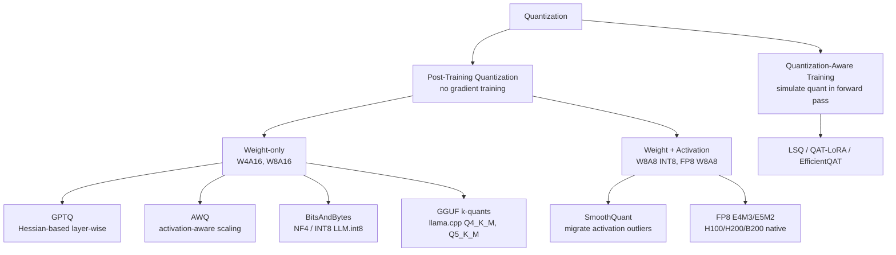

# Module 04 — Model Quantization, Compression & PEFT

> **Goal:** Know exactly what each quantization format does to memory, speed and accuracy; be able to quantize a model with AWQ/GPTQ/GGUF/BitsAndBytes/FP8; fine-tune with LoRA/QLoRA/DoRA/rsLoRA via Unsloth or PEFT; merge adapters safely; and explain the trade-offs under interview pressure.

---

## Table of Contents
1. [Module Overview & First-Principles Architecture](#1-module-overview--first-principles-architecture)
2. [Mathematical Foundations](#2-mathematical-foundations--formulas)
3. [Production-Ready Code](#3-production-ready-executable-code)
4. [Hard-Learned Production Failures](#4-hard-learned-production-failures--edge-cases)
5. [Interview Questions](#5-seniorstaff-llmops-interview-questions)

---

## 1. Module Overview & First-Principles Architecture

### 1.1 Why quantize?

Decode is memory-bandwidth-bound (Module 01). Every byte removed from the weights read per step cuts ITL roughly proportionally, and every byte saved raises the number of KV-cache pages (concurrency). Quantization is therefore both a **cost** and a **latency** lever.

### 1.2 Taxonomy



| Format | Bits | Needs calibration | Best for | Serving engines | Typical quality loss (8B) |
|---|---|---|---|---|---|
| BF16 | 16 | no | Reference | all | 0 |
| FP8 (E4M3) W8A8 | 8 | light (scales) | H100/L40S throughput | vLLM, TRT-LLM, TGI | < 0.5 % |
| INT8 SmoothQuant | 8 | yes | A100, Ampere INT8 TCs | TRT-LLM, vLLM | ≈ 0.5–1 % |
| AWQ (W4A16) | 4 | yes (~128–512 samples) | GPU serving, best accuracy at 4-bit | vLLM, TGI, TRT-LLM | ≈ 1–2 % |
| GPTQ (W4A16/W3) | 4 / 3 / 8 | yes (~128 samples) | Mature ecosystem, Marlin kernels | vLLM, TGI | ≈ 1–3 % |
| bitsandbytes NF4 | 4 | no (data-free) | **Training** (QLoRA); prototyping | transformers, (vLLM limited) | ≈ 1–3 % |
| GGUF Q4_K_M | ~4.8 | optional imatrix | CPU / Apple Silicon / edge / Ollama | llama.cpp, Ollama | ≈ 1–2 % |
| GGUF Q8_0 | 8.5 | no | Near-lossless CPU | llama.cpp, Ollama | < 0.3 % |

### 1.3 PTQ vs QAT

- **PTQ** takes a trained model and quantizes it using a small calibration set: minutes to hours, no training infrastructure. Dominant for LLMs ≥ 7B.
- **QAT** inserts fake-quant ops during (continued) training so weights adapt to rounding. Substantially better below 4 bits (INT3, INT2, ternary), but needs real training compute and data. Hybrid recipes (QAT-LoRA, EfficientQAT, "LLM-QAT") fine-tune with fake quantization on a small budget.

Decision rule: **4-bit and above → PTQ (AWQ/GPTQ)**; **≤ 3-bit or when 4-bit loses > 3 % on your task → consider QAT/QAT-LoRA** or choose a bigger model at 4-bit instead.

### 1.4 How each method works (intuitions)

- **GPTQ:** quantize weights one column at a time; after rounding a column, update the *remaining* columns to compensate for the error using the inverse Hessian of the layer's reconstruction loss `||WX − ŴX||²`. Cost ≈ minutes for 7B on one GPU.
- **AWQ:** observation that ~1 % of weight channels ("salient", identified by large *activation* magnitude) dominate error. Instead of keeping them in FP16 (mixed precision is slow), AWQ scales salient channels **up** before quantization (and scales activations down correspondingly) so their relative rounding error is smaller. Hardware-friendly, no backprop.
- **SmoothQuant / W8A8:** activations have large outlier channels that make INT8 activation quantization hard; SmoothQuant migrates difficulty to weights via per-channel scaling `s_j = max|X_j|^α / max|W_j|^{1−α}`.
- **bitsandbytes NF4:** 4-bit *NormalFloat* — quantile levels optimal for normally distributed weights; block-wise (64 values) absmax scaling; **double quantization** quantizes the scales to 8-bit (≈0.37 bits/param saved).
- **GGUF k-quants:** super-blocks (256 values) of sub-blocks (e.g., 32) with per-sub-block scales/mins quantized to 6 bits; `imatrix` (importance matrix from calibration data) steers rounding toward important weights.
- **FP8:** floating-point 8-bit (E4M3 for weights/activations, E5M2 for gradients). Native tensor-core support on Hopper/Ada/Blackwell; per-tensor or per-channel scales; also used for the KV cache.

### 1.5 PEFT: where LoRA fits

Full fine-tuning updates all `N` parameters: optimizer states dominate memory (Module 01: 16 B/param). LoRA freezes `W₀` and learns a low-rank update `ΔW = (α/r)·B·A`, `B ∈ ℝ^{d×r}`, `A ∈ ℝ^{r×k}`, `r ≪ min(d,k)`.

```
        x ──┬──────────── W0 (frozen, possibly NF4) ───────┐
            │                                              (+)──▶ h
            └─▶ A (r×k, init N(0,σ²)) ─▶ B (d×r, init 0) ──┘   × (α/r)
```

Because `B` is initialised to zero, training starts exactly at the base model.

Variants:

| Method | Change | When to use |
|---|---|---|
| **LoRA** | Low-rank ΔW on chosen linear layers | Default |
| **QLoRA** | LoRA over a 4-bit NF4 frozen base + paged optimizers + double quant | Single-GPU fine-tune of 7–70B |
| **rsLoRA** | Scale `α/√r` instead of `α/r` | Rank ≥ 64 (stabilises learning; lets higher ranks help) |
| **DoRA** | Decompose `W = m · V/‖V‖`; train magnitude `m` + LoRA on direction | Closer to full-FT quality at low rank; ~10–30 % slower |
| **LoRA+** | Larger LR for `B` than `A` (ratio ≈ 16) | Faster convergence |
| **PiSSA / OLoRA** | Initialise adapter from principal singular vectors | Faster convergence, better with quantized base (LoftQ-like) |
| **AdaLoRA** | Adaptive rank allocation by singular-value importance | Parameter budget constraints |
| **IA³ / Prefix / Prompt tuning** | Learned scaling vectors / virtual tokens | Extremely small footprints; weaker |

### 1.6 Merging and fusing adapters

- **Merge into base:** `W = W₀ + (α/r)BA` → zero-latency, single artifact; but you lose hot-swapping, and merging onto a *quantized* base requires dequantize → merge → re-quantize (some rounding loss).
- **Serve unmerged (multi-LoRA):** vLLM/LoRAX/S-LoRA load many adapters on one base; per-request `lora_request`. Ideal for multi-tenant (Module 05).
- **Merge several adapters/models (Mergekit):** *linear/Task Arithmetic* (`W₀ + Σ λᵢ τᵢ`), *TIES* (trim small deltas, elect sign, merge agreeing), *DARE* (random drop + rescale), *SLERP* (spherical interpolation between two models), *Model Stock*. Merging is training-free but needs evaluation; interference between tasks is common.
- **Adapter fusion (AdapterFusion / composition):** learn attention over several adapters' outputs per input; or use PEFT `add_weighted_adapter` with `combination_type` in {`linear`, `cat`, `svd`, `ties`, `dare_ties`}.

---

## 2. Mathematical Foundations & Formulas

### 2.1 Uniform affine quantization

For `b` bits, real range `[α_min, α_max]`:

```
s  = (α_max − α_min) / (2^b − 1)
z  = round(−α_min / s)
q  = clamp(round(w / s) + z, 0, 2^b − 1)
ŵ  = s · (q − z)
```

Symmetric variant: `z = 0`, `s = max|w| / (2^{b−1} − 1)`.

Rounding error is uniform in `[−s/2, s/2]` → `MSE = s²/12`. For Gaussian weights with std `σ` and clipping at `kσ`, there is an MSE-optimal clipping `k*` (≈ 2.5σ at 4 bits, 3.5σ at 8 bits) — which is why *clipping search* is part of AWQ/GPTQ implementations.

### 2.2 Effective bits per weight (group quantization)

```
bpw = b + (bits_scale + bits_zero) / group_size
```

INT4, group 128, FP16 scale + INT4 zero: `4 + (16+4)/128 = 4.16 bpw`.
NF4 block 64, 8-bit scale (double quant: scale-of-scales per 256 blocks FP32): `4 + 8/64 + 32/(64·256) ≈ 4.127 bpw`.
GGUF `Q4_K_M`: ≈ 4.83 bpw (mix of Q4_K and Q6_K for sensitive tensors).

Model size in bytes: `size = N · bpw / 8`.

### 2.3 GPTQ objective and update

Layer-wise: `argmin_{Ŵ} ||WX − ŴX||²_F`. With Hessian `H = 2XXᵀ`, quantizing weight `w_q` in a row and compensating the others:

```
δ_F = − (w_q − quant(w_q)) / [H_F⁻¹]_{qq} · (H_F⁻¹)_{:,q}
```

Cholesky of `H⁻¹` is precomputed; with dampening `H ← H + λI`, `λ = 0.01·mean(diag(H))`.

### 2.4 AWQ scaling

For input channel `j`, choose scale `s_j = (mean|X_j|)^α` (`α ∈ [0,1]` grid-searched per layer). Replace `y = Wx` by `y = (W·diag(s)) · (diag(s)⁻¹ x)`; quantize `W·diag(s)`. Search objective: `min_s ||Q(W·diag(s))·diag(s)⁻¹X − WX||`.

### 2.5 Perplexity delta as the first sanity metric

```
PPL = exp( −(1/T) Σ_t log p(x_t | x_<t) )          ΔPPL = PPL_quant − PPL_fp16
```

Rule-of-thumb for 7–8B at 4-bit: `ΔPPL ≤ 0.15–0.3` on WikiText-2/C4 is healthy; `> 0.5` means bad calibration/outliers. **PPL is necessary, not sufficient**: also run task evals (MMLU, GSM8K, long-context needle, JSON conformance, your own golden set), because quantization hurts *reasoning, math and code* disproportionately.

### 2.6 LoRA parameter count and memory

For a weight `d×k`: trainable `r(d+k)`. For Llama-3-8B with `r=16` on all 7 linear projections: ≈ 42 M trainable (0.5 %).

Optimizer memory (Adam, FP32 states): `trainable × (4 master + 4 m + 4 v + 2 grad) ≈ 14 B/param`.

### 2.7 LoRA scaling factor

`ΔW x = (α/r) B A x`. With standard LoRA, increasing `r` at constant `α` *reduces* per-direction gain (1/r), so higher ranks underperform — rsLoRA fixes the scaling: `γ_r = α/√r` keeps gradient magnitude stable as r grows.

### 2.8 DoRA formulation

```
W' = m · (W₀ + BA) / ‖W₀ + BA‖_c      (‖·‖_c: column-wise norm, m ∈ ℝ^{1×k} learnable)
```

### 2.9 Speedup model for weight-only quantization

Decode time per step ≈ bytes_moved / BW. For 8B BF16 (16 GB) → 4-bit (≈4.3 GB):

```
ideal speedup = 16 / 4.3 ≈ 3.7×    realised ≈ 2.2–3× (dequant overhead, KV reads, non-quantized layers)
```

At large batch sizes (compute-bound) W4A16 gives *little or negative* benefit because dequantization adds ALU work; FP8 W8A8 uses native low-precision tensor cores and wins there.

### 2.10 Model Merging formulas

```
Task vector: τ_i = W_i − W₀
Task Arithmetic: W = W₀ + Σ λ_i τ_i
TIES: trim(τ_i, top-k%) → elect sign by Σ magnitudes → average only agreeing entries
DARE: τ̃ = (m ⊙ τ) / (1−p),  m ~ Bernoulli(1−p)
SLERP: slerp(p,q;t) = sin((1−t)Ω)/sinΩ · p + sin(tΩ)/sinΩ · q,  Ω = arccos(p·q/‖p‖‖q‖)
```

---

## 3. Production-Ready Executable Code

### 3.1 Requirements

```text
# requirements-quant.txt
torch>=2.4
transformers>=4.45
accelerate>=0.34
bitsandbytes>=0.43
peft>=0.12
trl>=0.10
datasets>=2.20
autoawq>=0.2.6
auto-gptq>=0.7.1
llmcompressor>=0.3
optimum>=1.21
unsloth        # install per https://github.com/unslothai/unsloth for your CUDA version
mergekit>=0.0.5
lm-eval>=0.4.3
sentencepiece
```

### 3.2 AWQ Quantization (AutoAWQ) with Representative Calibration

```python
"""Quantize a model to INT4-AWQ and save a vLLM-loadable checkpoint."""
from __future__ import annotations

import argparse
import json
import random
from pathlib import Path

from awq import AutoAWQForCausalLM
from datasets import load_dataset
from transformers import AutoTokenizer


def build_calibration(tok: AutoTokenizer, n: int, max_len: int, extra_jsonl: Path | None) -> list[str]:
    """Mix generic text with domain prompts: calibration must look like production traffic."""
    texts: list[str] = []
    ds = load_dataset("allenai/c4", "en", split="validation", streaming=True)
    for i, ex in enumerate(ds):
        if len(texts) >= n // 2:
            break
        texts.append(ex["text"][: max_len * 4])
    if extra_jsonl and extra_jsonl.exists():
        rows = [json.loads(l)["text"] for l in extra_jsonl.read_text().splitlines()]
        random.Random(0).shuffle(rows)
        texts += rows[: n - len(texts)]
    return texts


def main() -> None:
    ap = argparse.ArgumentParser()
    ap.add_argument("--model", required=True)
    ap.add_argument("--out", required=True)
    ap.add_argument("--n-calib", type=int, default=256)
    ap.add_argument("--max-len", type=int, default=2048)
    ap.add_argument("--domain-jsonl", type=Path, default=None)
    args = ap.parse_args()

    tok = AutoTokenizer.from_pretrained(args.model, trust_remote_code=False)
    model = AutoAWQForCausalLM.from_pretrained(args.model, low_cpu_mem_usage=True, use_cache=False)
    quant_config = {"zero_point": True, "q_group_size": 128, "w_bit": 4, "version": "GEMM"}
    calib = build_calibration(tok, args.n_calib, args.max_len, args.domain_jsonl)
    model.quantize(tok, quant_config=quant_config, calib_data=calib, max_calib_seq_len=args.max_len)
    model.save_quantized(args.out, safetensors=True)
    tok.save_pretrained(args.out)
    print("saved", args.out)


if __name__ == "__main__":
    main()
```

Serve it:

```bash
python -m vllm.entrypoints.openai.api_server --model ./llama31-8b-awq --quantization awq_marlin --max-model-len 8192
```

### 3.3 GPTQ via llm-compressor (modern vLLM-native path) and FP8

```python
"""llm-compressor recipes: W4A16 GPTQ and dynamic FP8 (no calibration needed for dynamic scales)."""
from __future__ import annotations

from llmcompressor import oneshot
from llmcompressor.modifiers.quantization import GPTQModifier, QuantizationModifier

MODEL = "meta-llama/Llama-3.1-8B-Instruct"


def gptq_w4a16(out: str) -> None:
    recipe = GPTQModifier(targets="Linear", scheme="W4A16", ignore=["lm_head"], dampening_frac=0.01)
    oneshot(
        model=MODEL,
        dataset="open_platypus",
        recipe=recipe,
        max_seq_length=2048,
        num_calibration_samples=512,
        output_dir=out,
    )


def fp8_dynamic(out: str) -> None:
    """FP8 weights (per-channel) + dynamic per-token activation scales; no calibration data."""
    recipe = QuantizationModifier(targets="Linear", scheme="FP8_DYNAMIC", ignore=["lm_head"])
    oneshot(model=MODEL, recipe=recipe, output_dir=out)


if __name__ == "__main__":
    gptq_w4a16("llama31-8b-gptq-w4a16")
    fp8_dynamic("llama31-8b-fp8")
```

vLLM can also quantize on the fly: `--quantization fp8 --kv-cache-dtype fp8` (no pre-quantized checkpoint required; scales computed at load).

### 3.4 GGUF Conversion with Importance Matrix (llama.cpp → Ollama)

```bash
#!/usr/bin/env bash
set -euo pipefail
git clone --depth 1 https://github.com/ggml-org/llama.cpp && cd llama.cpp
cmake -B build -DGGML_CUDA=ON && cmake --build build --config Release -j

pip install -r requirements/requirements-convert_hf_to_gguf.txt
python convert_hf_to_gguf.py ../llama31-8b-hf --outfile ../llama31-8b-f16.gguf --outtype f16

# Importance matrix from representative text (domain + generic)
./build/bin/llama-imatrix -m ../llama31-8b-f16.gguf -f ../calib.txt -o ../imatrix.dat --chunks 200

./build/bin/llama-quantize --imatrix ../imatrix.dat ../llama31-8b-f16.gguf ../llama31-8b-Q4_K_M.gguf Q4_K_M

# Perplexity check
./build/bin/llama-perplexity -m ../llama31-8b-Q4_K_M.gguf -f ../wiki.test.raw
```

`Modelfile` for Ollama:

```
FROM ./llama31-8b-Q4_K_M.gguf
PARAMETER temperature 0.2
PARAMETER num_ctx 8192
TEMPLATE """{{ if .System }}<|start_header_id|>system<|end_header_id|>

{{ .System }}<|eot_id|>{{ end }}<|start_header_id|>user<|end_header_id|>

{{ .Prompt }}<|eot_id|><|start_header_id|>assistant<|end_header_id|>

"""
SYSTEM "You are a concise assistant."
```

```bash
ollama create acme-8b -f Modelfile && ollama run acme-8b "Summarise PagedAttention in two sentences."
```

### 3.5 BitsAndBytes: 8-bit and 4-bit (NF4) Loading

```python
from __future__ import annotations

import torch
from transformers import AutoModelForCausalLM, BitsAndBytesConfig

bnb_nf4 = BitsAndBytesConfig(
    load_in_4bit=True,
    bnb_4bit_quant_type="nf4",
    bnb_4bit_use_double_quant=True,
    bnb_4bit_compute_dtype=torch.bfloat16,
)
bnb_int8 = BitsAndBytesConfig(load_in_8bit=True, llm_int8_threshold=6.0)  # outlier threshold

model = AutoModelForCausalLM.from_pretrained(
    "meta-llama/Llama-3.1-8B-Instruct", quantization_config=bnb_nf4, device_map="auto", torch_dtype=torch.bfloat16
)
print(f"{model.get_memory_footprint() / 1e9:.2f} GB")
```

### 3.6 QLoRA SFT with Unsloth (fast single-GPU path)

```python
"""QLoRA SFT with Unsloth + TRL. ~2x faster, ~70% less VRAM than vanilla HF+PEFT on supported architectures."""
from __future__ import annotations

from datasets import load_dataset
from trl import SFTConfig, SFTTrainer
from unsloth import FastLanguageModel, is_bfloat16_supported

MAX_LEN = 4096

model, tok = FastLanguageModel.from_pretrained(
    model_name="unsloth/Meta-Llama-3.1-8B-Instruct",
    max_seq_length=MAX_LEN,
    load_in_4bit=True,
    dtype=None,
)

model = FastLanguageModel.get_peft_model(
    model,
    r=32,
    lora_alpha=32,
    lora_dropout=0.0,                 # 0 is optimised in Unsloth
    target_modules=["q_proj", "k_proj", "v_proj", "o_proj", "gate_proj", "up_proj", "down_proj"],
    use_gradient_checkpointing="unsloth",
    use_rslora=True,                  # scale alpha/sqrt(r)
    random_state=3407,
)

ds = load_dataset("json", data_files="data/final_sft.jsonl", split="train")


def to_text(ex: dict) -> dict:
    return {"text": tok.apply_chat_template(ex["messages"], tokenize=False, add_generation_prompt=False)}


ds = ds.map(to_text, remove_columns=ds.column_names)

trainer = SFTTrainer(
    model=model,
    tokenizer=tok,
    train_dataset=ds,
    args=SFTConfig(
        dataset_text_field="text",
        max_seq_length=MAX_LEN,
        packing=True,
        per_device_train_batch_size=4,
        gradient_accumulation_steps=4,
        num_train_epochs=2,
        learning_rate=2e-4,
        lr_scheduler_type="cosine",
        warmup_ratio=0.03,
        weight_decay=0.01,
        optim="adamw_8bit",
        bf16=is_bfloat16_supported(),
        fp16=not is_bfloat16_supported(),
        logging_steps=10,
        save_strategy="steps",
        save_steps=200,
        output_dir="outputs/support-v15",
        report_to="none",
        seed=3407,
    ),
)
trainer.train()
model.save_pretrained("adapters/support-v15")          # adapter only (~200 MB)
tok.save_pretrained("adapters/support-v15")
# Optional merged 16-bit export for vLLM:
model.save_pretrained_merged("merged/support-v15-16bit", tok, save_method="merged_16bit")
```

**Train only on completions** (mask the prompt) to avoid learning to imitate user text:

```python
from trl import DataCollatorForCompletionOnlyLM
collator = DataCollatorForCompletionOnlyLM(
    response_template="<|start_header_id|>assistant<|end_header_id|>\n\n", tokenizer=tok)
# NOTE: incompatible with packing=True in TRL; choose one.
```

### 3.7 Vanilla PEFT: LoRA / DoRA / rsLoRA Config Zoo

```python
from __future__ import annotations

from peft import LoraConfig, TaskType

ALL_LINEAR = ["q_proj", "k_proj", "v_proj", "o_proj", "gate_proj", "up_proj", "down_proj"]

lora = LoraConfig(task_type=TaskType.CAUSAL_LM, r=16, lora_alpha=32, lora_dropout=0.05, target_modules=ALL_LINEAR, bias="none")
rslora = LoraConfig(task_type=TaskType.CAUSAL_LM, r=128, lora_alpha=64, use_rslora=True, target_modules=ALL_LINEAR)
dora = LoraConfig(task_type=TaskType.CAUSAL_LM, r=16, lora_alpha=32, use_dora=True, target_modules=ALL_LINEAR)
pissa = LoraConfig(task_type=TaskType.CAUSAL_LM, r=16, lora_alpha=16, init_lora_weights="pissa_niter_4", target_modules=ALL_LINEAR)
# When extending vocabulary, train embeddings & head fully:
vocab = LoraConfig(task_type=TaskType.CAUSAL_LM, r=16, lora_alpha=32, target_modules=ALL_LINEAR,
                   modules_to_save=["embed_tokens", "lm_head"])
```

### 3.8 Adapter Merge, Multi-Adapter Combination and Safe Export

```python
"""Merge LoRA into a BF16 base (never into an already-quantized base) and verify equivalence."""
from __future__ import annotations

import torch
from peft import PeftModel
from transformers import AutoModelForCausalLM, AutoTokenizer

BASE = "meta-llama/Llama-3.1-8B-Instruct"
ADAPTER = "adapters/support-v15"
OUT = "merged/support-v15"


def merge_and_verify() -> None:
    tok = AutoTokenizer.from_pretrained(ADAPTER)  # tokenizer saved WITH the adapter
    base = AutoModelForCausalLM.from_pretrained(BASE, torch_dtype=torch.bfloat16, device_map="cpu")
    if base.get_input_embeddings().weight.shape[0] != len(tok):
        base.resize_token_embeddings(len(tok))
    peft_model = PeftModel.from_pretrained(base, ADAPTER)

    probe = tok("Explain what a KV cache is.", return_tensors="pt")
    with torch.no_grad():
        ref = peft_model(**probe).logits
    merged = peft_model.merge_and_unload()
    with torch.no_grad():
        out = merged(**probe).logits
    max_diff = (ref - out).abs().max().item()
    assert max_diff < 5e-2, f"merge drift too large: {max_diff}"

    merged.save_pretrained(OUT, safe_serialization=True)
    tok.save_pretrained(OUT)


def combine_adapters() -> None:
    """Weighted combination of two task adapters with TIES."""
    base = AutoModelForCausalLM.from_pretrained(BASE, torch_dtype=torch.bfloat16)
    m = PeftModel.from_pretrained(base, "adapters/support-v15", adapter_name="support")
    m.load_adapter("adapters/sql-v3", adapter_name="sql")
    m.add_weighted_adapter(
        adapters=["support", "sql"], weights=[0.6, 0.4],
        adapter_name="support_sql", combination_type="ties", density=0.5,
    )
    m.set_adapter("support_sql")
    m.save_pretrained("adapters/support_sql", selected_adapters=["support_sql"])
```

### 3.9 Mergekit Configs (SLERP and TIES)

`slerp.yaml`

```yaml
slices:
  - sources:
      - model: meta-llama/Llama-3.1-8B-Instruct
        layer_range: [0, 32]
      - model: ./merged/support-v15
        layer_range: [0, 32]
merge_method: slerp
base_model: meta-llama/Llama-3.1-8B-Instruct
parameters:
  t:
    - filter: self_attn
      value: [0, 0.5, 0.3, 0.7, 1]
    - filter: mlp
      value: [1, 0.5, 0.7, 0.3, 0]
    - value: 0.5
dtype: bfloat16
```

`ties.yaml`

```yaml
models:
  - model: meta-llama/Llama-3.1-8B
  - model: ./merged/support-v15
    parameters: {density: 0.5, weight: 0.6}
  - model: ./merged/sql-v3
    parameters: {density: 0.5, weight: 0.4}
merge_method: ties
base_model: meta-llama/Llama-3.1-8B
parameters: {normalize: true}
dtype: bfloat16
```

```bash
mergekit-yaml ties.yaml ./merged/support-sql-ties --cuda --lazy-unpickle
```

### 3.10 Evaluate Quantization Impact (lm-eval + custom long-context)

```bash
lm_eval --model vllm \
  --model_args pretrained=./llama31-8b-awq,quantization=awq_marlin,gpu_memory_utilization=0.85,max_model_len=8192 \
  --tasks wikitext,gsm8k,mmlu,ifeval --batch_size auto --output_path results/awq.json
```

```python
"""Release gate: compare quantized vs reference across metrics; fail CI on regression."""
from __future__ import annotations

import json
import sys
from pathlib import Path

GATES = {"wikitext_word_perplexity": ("max_delta", 0.30), "gsm8k_exact_match": ("min_ratio", 0.97),
         "mmlu_acc": ("min_ratio", 0.985), "ifeval_prompt_strict": ("min_ratio", 0.97),
         "needle_16k_acc": ("min_ratio", 0.98), "json_conformance": ("min_ratio", 0.995)}


def check(ref: dict[str, float], cand: dict[str, float]) -> list[str]:
    fails: list[str] = []
    for k, (kind, thr) in GATES.items():
        if kind == "max_delta" and cand[k] - ref[k] > thr:
            fails.append(f"{k}: +{cand[k] - ref[k]:.3f} > {thr}")
        if kind == "min_ratio" and cand[k] / ref[k] < thr:
            fails.append(f"{k}: ratio {cand[k] / ref[k]:.3f} < {thr}")
    return fails


if __name__ == "__main__":
    ref = json.loads(Path(sys.argv[1]).read_text()); cand = json.loads(Path(sys.argv[2]).read_text())
    f = check(ref, cand)
    print("\n".join(f) or "PASS")
    sys.exit(1 if f else 0)
```

### 3.11 Dockerfile: Reproducible Quantization Job

```dockerfile
FROM nvidia/cuda:12.4.1-cudnn-devel-ubuntu22.04
ENV DEBIAN_FRONTEND=noninteractive PYTHONUNBUFFERED=1 HF_HOME=/models/hf
RUN apt-get update && apt-get install -y --no-install-recommends python3.11 python3.11-venv python3-pip git build-essential cmake && rm -rf /var/lib/apt/lists/*
RUN python3.11 -m venv /opt/venv
ENV PATH=/opt/venv/bin:$PATH
WORKDIR /app
COPY requirements-quant.txt .
RUN pip install --no-cache-dir -r requirements-quant.txt
COPY . .
ENTRYPOINT ["python", "quantize_awq.py"]
```

### 3.12 Kubernetes Job for Quantization

```yaml
apiVersion: batch/v1
kind: Job
metadata:
  name: quantize-awq-llama31-8b
spec:
  backoffLimit: 1
  template:
    spec:
      restartPolicy: Never
      containers:
        - name: quantize
          image: registry.example.com/llmops/quantize:1.4.0
          args: ["--model", "/models/llama31-8b", "--out", "/models/llama31-8b-awq", "--n-calib", "256"]
          resources:
            limits: { nvidia.com/gpu: 1, memory: 64Gi }
          volumeMounts: [{ name: models, mountPath: /models }]
      volumes:
        - name: models
          persistentVolumeClaim: { claimName: model-store }
      tolerations: [{ key: nvidia.com/gpu, operator: Exists, effect: NoSchedule }]
```

---

## 4. Hard-Learned Production Failures & Edge Cases

### Incident 1 — Quantized model failed on math/code while perplexity looked fine

**Symptom.** AWQ-INT4 model: ΔPPL = +0.12 (great). A week after launch, the data-analyst assistant returned wrong SQL aggregates and arithmetic.

**Root-cause analysis.**
1. Perplexity averages over all tokens; digits and syntax tokens are a tiny fraction and carry high-loss, high-impact errors.
2. Calibration used C4 web text only — no code/numbers — so scales for channels activated by structured data were poorly chosen.
3. GSM8K was never in the release gate.

**Remediation.** Mixed calibration set (30 % code/SQL/JSON, 30 % domain prompts, 40 % generic), add GSM8K + HumanEval + JSON-conformance gates (§3.10), and if the 4-bit regression remains > 2 %, keep sensitive layers (`lm_head`, first/last blocks) in higher precision or step up to FP8/INT8.

### Incident 2 — Merged-LoRA model garbled after quantizing the merged weights

**Symptom.** QLoRA adapter evaluated well; after merging into the 4-bit base and saving, accuracy collapsed ~8 points.

**Root-cause analysis.**
1. Merge was done on the NF4-quantized base: dequantize → add ΔW → *re-quantize* to NF4; the low-magnitude ΔW (≈1e-3) is below the 4-bit rounding step, so much of the learned update was rounded away.
2. Nobody compared pre- and post-merge logits.

**Remediation.** Reload the base in BF16, merge there, then quantize the merged model with AWQ/GPTQ (or serve the adapter unmerged via multi-LoRA). Add the logit-equivalence assertion from §3.8.

### Incident 3 — FP8 KV cache + long context drift

**Symptom.** After enabling `--kv-cache-dtype fp8` to double concurrency, answers about content early in long documents degraded.

**Root cause.** Per-tensor static KV scale defaulted to 1.0 (no calibrated scales); extreme outlier keys saturated in E4M3.

**Remediation.** Use calibrated KV scales (llm-compressor saves `k_scale`/`v_scale`), or use E5M2 for a wider dynamic range, and validate with needle-in-a-haystack at max context before shipping. Alert on long-context eval, not just short tasks.

### Incident 4 — Catastrophic forgetting after aggressive LoRA

**Symptom.** Support-bot fine-tune (r=128, LR 2e-4, 5 epochs) forgot instruction-following on non-support topics and started repeating training templates.

**Root cause.** High rank, high LR, multi-epoch over a small (4k) dataset → overfit; no general-capability regression eval.

**Remediation.** Lower rank (16–32) and LR (5e-5–1e-4), 1–2 epochs, mix 10–20 % general instruction data (replay), early-stop on a held-out set, add MMLU/IFEval deltas to the gate. If deltas persist, use LoRA *dropout*, smaller `alpha`, or merge with weight `λ=0.5–0.7` (interpolate between base and fine-tuned).

### Incident 5 — Adapter silently ignored at serve time

**Symptom.** Fine-tuned behaviour absent in production; offline eval OK.

**Root cause.** vLLM was started with `--enable-lora` but the request used `model: "llm-primary"` instead of the adapter's registered name, so requests hit the base model. No metric attributed traffic to adapters.

**Remediation.** Register adapters with `--lora-modules support=/adapters/support-v15`, route by model name in the gateway, and emit `adapter_name` as a span attribute; synthetic canary requests assert adapter-specific behaviour (e.g., a fixed token string) every minute.

---

## 5. Senior/Staff LLMOps Interview Questions

### Scenario 1 — "AWQ vs GPTQ vs bitsandbytes NF4 vs GGUF — which for production on A100/H100?"

**Junior/Mid Trap Answer:** "bitsandbytes 4-bit is the easiest, use that — they're all 4-bit anyway."

**Staff Production Answer:** "Different tools for different jobs. bitsandbytes NF4 is data-free and perfect for *training* (QLoRA), but its inference kernels are slower and it's not first-class in high-throughput engines. For serving on A100/H100 I'd choose AWQ or GPTQ with Marlin kernels in vLLM: AWQ typically retains slightly better accuracy (activation-aware) and is quick to produce; GPTQ is mature and supports 3/8-bit. On H100 with high concurrency I'd actually benchmark **FP8 W8A8** — at large batch, decode becomes more compute-bound and 4-bit weight-only dequantization stops helping, whereas FP8 uses native tensor cores and keeps accuracy within 0.5 %. GGUF is for CPU/Apple Silicon/edge via llama.cpp or Ollama. Final choice is empirical: ΔPPL, task evals, long-context and JSON conformance gates, plus p95 ITL and throughput at the target batch size."

### Scenario 2 — "Why does weight-only INT4 speed up decode but may slow down a busy server?"

**Junior/Mid Trap Answer:** "4-bit math is faster than 16-bit math."

**Staff Production Answer:** "W4A16 doesn't do 4-bit math: weights are dequantized to FP16 in registers and multiplied with FP16 activations. The win is **bytes moved**: at small batch, decode is bandwidth-bound, so 3.7× fewer weight bytes ≈ up to 2–3× faster tokens. As batch grows, arithmetic intensity rises toward the ridge point; the GEMM becomes compute-bound and the dequantization ALU work is pure overhead, so the advantage shrinks or reverses. That's why for high-QPS endpoints I evaluate FP8 or INT8 W8A8, which use low-precision tensor cores, and why for latency-sensitive low-concurrency workloads AWQ shines. KV cache memory is separate — 4-bit weights free VRAM for more KV pages, which raises concurrency irrespective of kernel speed."

### Scenario 3 — "Your QLoRA adapter is great, but when merged and quantized it degrades. Why, and what do you do?"

**Junior/Mid Trap Answer:** "Quantization always loses accuracy; accept it or train longer."

**Staff Production Answer:** "Most likely the merge happened on the quantized base: LoRA deltas are small (~1e-3), comparable to or below the 4-bit step size, so dequant→merge→requant erases part of the update. The correct pipeline is: reload the base in BF16, merge, assert logit equivalence against the PEFT model, *then* quantize the merged checkpoint with a calibration set representative of production. If quality still drops, options are (a) serve the adapter unmerged using vLLM multi-LoRA on a quantized base — which also preserves per-tenant swapping; (b) QAT-aware fine-tuning (e.g., LoftQ/QA-LoRA) so the adapter compensates for quantization error; (c) use FP8/INT8 instead of INT4."

### Scenario 4 — "LoRA or full fine-tuning for a legal-domain model with 200k examples?"

**Junior/Mid Trap Answer:** "Full fine-tuning always gives the best results, so do that."

**Staff Production Answer:** "'LoRA Learns Less and Forgets Less': full FT wins when the task requires acquiring a lot of *new knowledge* or a big distribution shift (e.g., continued pre-training on billions of legal tokens, new language), while LoRA is sufficient for *behaviour/format/style* adaptation and forgets less. 200k SFT examples is mid-size: I'd start with LoRA/QLoRA r=32–64 on all linear layers (DoRA or rsLoRA if rank is high), evaluate on held-out legal tasks plus general benchmarks, and escalate to full FT only if a clear gap remains. Operationally LoRA gives 100-MB artifacts, multi-tenant adapter serving, cheap re-runs, and safer rollback. If knowledge injection is the goal, I'd question whether RAG is the right tool before fine-tuning at all (see Module 12 decision tree)."

### Scenario 5 — "Walk me through memory for fine-tuning a 70B model on 2×80 GB GPUs."

**Junior/Mid Trap Answer:** "70B in 16-bit is 140 GB, so 2×80 = 160 GB is enough."

**Staff Production Answer:** "140 GB of weights leaves nothing for gradients, optimizer states, activations. Full FT is ~1.1 TB of states (16 B/param) — needs a cluster with ZeRO-3/FSDP. On 2×80 GB, QLoRA is the path: NF4 base ≈ 37 GB (double quant), sharded with FSDP+QLoRA across both GPUs ≈ 19 GB/GPU, LoRA r=16–64 adapters + optimizer ≈ 2–4 GB, activations with gradient checkpointing + FlashAttention at 2k–4k sequence ≈ 10–20 GB, plus chunked/fused cross-entropy to avoid the FP32 logits spike (128k vocab). That fits with headroom for micro-batch 1–2 and gradient accumulation. I'd also validate throughput (QLoRA 70B is slow: dequant overhead + checkpoint recompute) and compare to renting 8×H100 for a few hours — often cheaper in wall-clock and dollars when the run is repeated."

### Scenario 6 — "Describe model merging. When would you trust it in production?"

**Junior/Mid Trap Answer:** "Average the weights of two models; it's free and gets you both capabilities."

**Staff Production Answer:** "Merging operates on task vectors (fine-tuned minus base). Naive averaging suffers sign and magnitude interference; TIES trims small deltas and resolves sign conflicts, DARE randomly drops and rescales deltas to reduce redundancy, SLERP interpolates two models along the hypersphere, and Task Arithmetic adds scaled vectors. It works best when models share the same base and were fine-tuned from it with similar hyper-parameters. It's training-free but not eval-free: I'd treat each merge as a candidate, sweep weights/density on a validation set covering *both* skills plus safety, and check for regressions in refusal behaviour (merging can dilute alignment). I'd use it for fast iteration or to combine domain + instruction-following, but ship only with the same gates as any trained model, and keep the recipe YAML as the versioned artifact for reproducibility."

### Scenario 7 — "How do you choose LoRA rank, alpha and target modules?"

**Junior/Mid Trap Answer:** "r=8, alpha=16, query and value only — that's the default in tutorials."

**Staff Production Answer:** "Tutorial defaults come from the original LoRA paper on older models. Empirically targeting *all* linear layers (attention + MLP) matters more than rank. I'd start r=16–32 with alpha = r (or 2r) and LR ~1e-4–2e-4, then sweep r ∈ {8,16,64} on a small proxy run, checking validation loss and downstream metrics; if r ≥ 64, switch to rsLoRA scaling (α/√r) so higher rank actually helps. Tasks with heavy new knowledge or reasoning (code, math) benefit from higher rank; style/format tasks saturate at low rank. Regularise with a small dropout (0.05) or replay data, and measure the forgetting delta on general benchmarks. I record these as hyper-parameters in the adapter's metadata so the registry shows how each version was produced."

### Scenario 8 — "Pick a quantization strategy for a chatbot on edge devices (Mac M2 and Raspberry Pi 5)."

**Junior/Mid Trap Answer:** "Run the FP16 model with PyTorch on CPU."

**Staff Production Answer:** "GGUF with llama.cpp (or Ollama on Mac with Metal). For M2 with 16–24 GB unified memory: 8B at `Q4_K_M` or `Q5_K_M` with imatrix calibrated on domain text, `num_ctx` bounded (KV cache is not free — 128 KiB/token at BF16 for 8B; use `--cache-type-k q8_0 --cache-type-v q8_0` for half). For the Pi 5 (8 GB, no GPU), a 1–3B model at Q4_K_M/Q4_0 reaches ~5–10 tok/s; I'd choose Phi-3.5-mini or Qwen2.5-1.5B and constrain the grammar (GBNF) for deterministic outputs. I'd measure tokens/s, time-to-first-token and perplexity delta per quant level, and ship the smallest quant that meets the quality gate on our task suite."

---

### Key Takeaways
- Pick quantization by **workload regime**: low-batch latency → W4A16 (AWQ/GPTQ); high-batch throughput on Hopper+ → FP8; training → NF4; edge → GGUF.
- Calibrate on **production-like** data; gate on task, long-context and JSON metrics, not perplexity alone.
- Merge LoRA into **BF16**, verify logit equivalence, then quantize — or serve adapters unmerged.
- Use rank/alpha/LR sweeps; target all linear layers; use rsLoRA at high rank; mitigate forgetting with replay and low LR.
- Model merging is a hypothesis generator; evaluate like any other model.
## 4.6 Low-Bit Floating Formats and KV-Cache Quantisation

### Conceptual Deep Dive
Low-bit formats come in two families. **Integer** formats (INT8, INT4) use a uniform grid plus a scale. **Floating-point** low-bit formats spend bits on an exponent, so the grid is dense near zero and coarse for large values, which suits heavy-tailed weights and activations. FP8 has two common variants: E4M3 (more mantissa, used for weights and activations) and E5M2 (more range, used for gradients). 4-bit floats and **microscaling (MX)** block formats attach a shared scale to a small block of elements. Support is hardware and kernel dependent: check vendor docs for the exact GPU generation and the serving engine's kernels before planning around a format.

**Scaling granularity** is as important as bit width: per-tensor, per-channel or per-block. Smaller blocks limit the damage of outliers (one large value no longer squeezes the grid for the whole tensor) at the cost of storing more scales; this extends the effective-bits calculation in Module 04 section 2.2. **Weight-only** quantisation (W4A16) reduces memory traffic, which is the bottleneck in decode at small batch. **Weight+activation** quantisation (W8A8, FP8) also speeds up compute-bound prefill and large batches, but activations need calibration and outlier handling (SmoothQuant-style migration of difficulty from activations to weights).

**KV-cache quantisation** halves (INT8/FP8) or quarters (INT4) the cache bytes, which directly raises concurrent sequences per GPU. The risk is that attention reads every cached key and value at every step, so errors in scores affect the distribution over all positions, and the effect can become visible only on long contexts (legacy Incident 3). Evaluate on long-context tasks, not short prompts.

Layers usually kept in higher precision: embeddings, lm_head, normalisation layers, and sometimes the first and last blocks, because errors there are not averaged out.

| Choice | Memory | Compute benefit | Main risk |
|---|---|---|---|
| W4A16 | large weight saving | decode, memory-bound | dequant overhead at big batch |
| FP8 W8A8 | 2x vs 16-bit | prefill and big batch | activation outliers, needs kernels |
| KV INT8/FP8 | 2x cache | more concurrency | long-context drift |
| KV INT4 | 4x cache | most concurrency | larger drift |

Decision rule: hardware support first, then measured task regression, then memory and throughput gain. Edge cases: scale underflow or overflow can create NaNs in rare activations (clip and log amax statistics); mixed-precision checkpoints can leave one tensor silently in FP16 and break kernel fusion, so assert dtypes at load time.

### Cross-Connection Scenarios
- Effective bits and block scales: Module 04 section 2.2; PTQ methods in the legacy sections.
- KV memory sizing and concurrency: Module 05 and Module 11.
- Acceptance harness for any format change: 4.7.
- One change at a time under canary: 13.3.

### Production Anti-Patterns
- Choosing a format from a blog table without kernel support on your GPU: the model loads but runs slower than 16-bit.
- Evaluating with short prompts only: the KV and long-context regression ships unseen.
- Quantising KV and weights at once: a regression cannot be attributed to either change.

### Minimal Working Code
The first block compares per-tensor and per-block scaling for INT8 and a simulated low-mantissa float on a tensor with outliers.

```python
import numpy as np

def q_int(x, bits, block):
    x2, qmax = x.reshape(-1, block), 2 ** (bits - 1) - 1
    s = np.abs(x2).max(1, keepdims=True) / qmax
    s[s == 0] = 1.0
    return (np.clip(np.round(x2 / s), -qmax, qmax) * s).reshape(x.shape)

def q_float(x, mant_bits, block):          # block-scaled float, mantissa rounded, exponent range ignored
    x2 = x.reshape(-1, block)
    s = np.abs(x2).max(1, keepdims=True)
    s[s == 0] = 1.0
    m, e = np.frexp(x2 / s)
    m = np.round(m * 2 ** (mant_bits + 1)) / 2 ** (mant_bits + 1)
    return (np.ldexp(m, e) * s).reshape(x.shape)

rng = np.random.default_rng(0)
x = rng.normal(size=4096)
x[rng.choice(4096, 20, replace=False)] *= 50
for block in (4096, 256, 32):
    qi, qf = q_int(x, 8, block), q_float(x, 3, block)
    print(block, f"int8 mse {np.mean((x - qi) ** 2):.2e} maxerr {np.abs(x - qi).max():.3f}",
          f"| float(3 mant) mse {np.mean((x - qf) ** 2):.2e}")
assert np.mean((x - q_int(x, 8, 32)) ** 2) < np.mean((x - q_int(x, 8, 4096)) ** 2)
```

The second block measures how KV-key quantisation perturbs the attention distribution (mean KL) and computes bytes per token and concurrency.

```python
import numpy as np

def softmax(z):
    e = np.exp(z - z.max(-1, keepdims=True))
    return e / e.sum(-1, keepdims=True)

def quant_rows(K, bits):                    # per-token (row) scale
    qmax = 2 ** (bits - 1) - 1
    s = np.abs(K).max(1, keepdims=True) / qmax
    return np.round(K / s) * s

def mean_kl(L, bits, d=64, nq=32, seed=0):
    r = np.random.default_rng(seed)
    K = r.normal(size=(L, d))
    K[:, :2] *= 8                           # outlier channels
    Q = r.normal(size=(nq, d))
    p = softmax(Q @ K.T / np.sqrt(d))
    q = softmax(Q @ quant_rows(K, bits).T / np.sqrt(d))
    return float((p * (np.log(p + 1e-12) - np.log(q + 1e-12))).sum(1).mean())

for L in (128, 1024, 4096):
    print(L, {b: f"{mean_kl(L, b):.1e}" for b in (8, 4)})
per_tok = lambda bytes_per, layers=32, kv_heads=8, hd=128: 2 * layers * kv_heads * hd * bytes_per
for name, b in (("fp16", 2), ("int8", 1), ("int4", 0.5)):
    print(name, "max concurrent 8k sequences in 40 GB:", int(40e9 / (8192 * per_tok(b))))
assert mean_kl(1024, 4) > mean_kl(1024, 8)
```

### Interview Angle
**Q:** FP8 weights are fine on your eval but long-document answers drift. Where do you look? **A:** First the eval: it probably lacks long inputs. Then isolate components: KV dtype versus weights, by changing one at a time; check kernel and engine versions; look at per-layer amax for scale overflow; compare top-1 agreement and KL against BF16 as context grows. Fix by keeping KV in 16-bit or higher-precision sensitive layers. Trade-off: memory saved versus quality; the check is a long-context slice with a non-inferiority margin.

**Q:** Why can KV-cache quantisation hurt more than weight quantisation at long context? **A:** Weight error is a fixed perturbation of each layer, while KV error enters every attention read, and with more cached tokens there are more chances for an erroneous score to steal probability mass or distort the value average. Outlier channels in keys make it worse. It is an empirical claim, so measure attention KL and task accuracy versus length rather than assuming.

**Q:** How do you decide between W4A16 and FP8 for a high-batch H100 deployment? **A:** At high batch, decode becomes more compute-bound and FP8 compute can win, while W4A16 saves memory and helps at low batch. Benchmark both in the real engine at the target batch and context, then compare quality on slices. Decision: hardware kernels first, regression second, throughput per dollar third. Verify against current engine docs because support changes.

## 4.7 Compression Evaluation: Regression Harness, Calibration Governance and Rollout

### Conceptual Deep Dive
**Perplexity is a smoke test, not an acceptance test.** A small perplexity change can hide failures on specific behaviours, and a large one can be harmless. A compression acceptance harness needs slices: math and code, long context, multilingual, tool-call and JSON validity, refusal and safety behaviour, and a domain golden set. Aggregate accuracy hides tenant-specific or language-specific regressions.

**Model-diff metrics** compare the compressed model with the BF16 reference on a probe set without labels: top-1 token agreement and the mean **KL divergence** of the output distributions, KL(p_ref || p_q). They are cheap, sensitive, and good for ranking candidate quantisations before running expensive task evals. They do not replace task metrics: a model can disagree with the reference and still be correct.

**Acceptance criteria** should be **non-inferiority** margins per slice with confidence intervals: the candidate is accepted if the lower bound of (candidate minus baseline) exceeds minus the margin. Reuse the paired-bootstrap gate from Module 07 section 3.8. Set margins from the business tolerance, not from what the candidate achieved.

**Calibration set governance.** The calibration set used by methods such as GPTQ or AWQ affects the result. It should be domain-matched, versioned, content-hashed, free of overlap with eval sets and free of PII. Record the hash in the artefact metadata so a quantisation is reproducible.

**Rollout.** Shadow compare on production prompts (agreement and KL on real traffic), then canary (13.3), then full; keep the BF16 artefact for instant rollback. Artefact metadata: method, bits, group size, calibration hash, kernel and engine version, eval report id.

| Stage | Question | Evidence |
|---|---|---|
| Probe set | does the distribution move? | top-1 agreement, mean KL with CI |
| Slice eval | any slice worse than margin? | non-inferiority table |
| Shadow | does real traffic differ? | agreement on sampled prompts |
| Canary | do users notice? | guard metrics |

Edge cases. The quantised model passes the aggregate gate but fails one tenant's long documents: add slice gates per tenant tier and a long-context slice. An engine upgrade changes kernels and shifts numerics even with identical weights: rerun the harness on every engine, driver or kernel change, not only on weight changes.

### Cross-Connection Scenarios
- Format background: 4.6 and the PTQ methods in Module 04 (legacy).
- Paired-bootstrap gate: Module 07 section 3.8 and 13.2.
- Canary and rollback: 13.3 and 13.6.
- Engine pinning in the release bundle: 13.1.

### Production Anti-Patterns
- Reporting only average accuracy: slice regressions ship unseen.
- Re-using the calibration set as the eval set: the quantiser is graded on data it was fitted to.
- Deleting the full-precision artefact after quantising: rollback and re-quantisation become impossible.

### Minimal Working Code
The first block computes top-1 agreement and mean KL between reference and quantised logits, with bootstrap confidence intervals over prompts.

```python
import numpy as np

def log_softmax(z):
    z = z - z.max(-1, keepdims=True)
    return z - np.log(np.exp(z).sum(-1, keepdims=True))

def diff_metrics(ref, q):
    lp, lq = log_softmax(ref), log_softmax(q)
    kl = (np.exp(lp) * (lp - lq)).sum(-1)            # per prompt
    agree = (ref.argmax(-1) == q.argmax(-1)).astype(float)
    return agree, kl

def boot_ci(v, n=1000, seed=0):
    r = np.random.default_rng(seed)
    means = np.array([v[r.integers(0, len(v), len(v))].mean() for _ in range(n)])
    return float(v.mean()), float(np.percentile(means, 2.5)), float(np.percentile(means, 97.5))

rng = np.random.default_rng(1)
ref = rng.normal(size=(300, 50)) * 3
q = ref + rng.normal(size=ref.shape) * 0.3
agree, kl = diff_metrics(ref, q)
print("agreement", boot_ci(agree))
print("mean KL", boot_ci(kl))
assert boot_ci(agree)[1] > 0.8 and boot_ci(kl)[0] > 0
```

The second block is a per-slice non-inferiority gate that returns an exit code (pass it to sys.exit in CI) and prints a table.

```python
import random

def gate(results, margins, n_boot=1000, seed=0):
    rnd, bad = random.Random(seed), 0
    print(f"{'slice':<12}{'delta':>8}{'ci_low':>8}{'margin':>8}  verdict")
    for name, (base, cand) in results.items():
        diffs = [c - b for b, c in zip(base, cand)]
        means = sorted(sum(rnd.choices(diffs, k=len(diffs))) / len(diffs) for _ in range(n_boot))
        low = means[int(0.025 * n_boot)]
        ok = low > -margins[name]
        bad += not ok
        print(f"{name:<12}{sum(diffs) / len(diffs):>8.3f}{low:>8.3f}{margins[name]:>8.3f}  {'ok' if ok else 'FAIL'}")
    return 1 if bad else 0

rnd = random.Random(7)
base = [1.0 if rnd.random() < 0.85 else 0.0 for _ in range(300)]
same = [b if rnd.random() < 0.97 else 1.0 - b for b in base]
worse = [b if rnd.random() < 0.7 else 0.0 for b in base]
code = gate({"golden": (base, same), "long_ctx": (base, worse)}, {"golden": 0.03, "long_ctx": 0.03})
print("exit code", code)
assert code == 1
```

### Interview Angle
**Q:** Walk through how you would approve an INT4 model for production. **A:** Freeze a calibration set (hashed, disjoint from evals). Compare against BF16 with top-1 agreement and KL on a probe set, then run slice evals (code, long context, multilingual, JSON validity, safety, domain golden set) with non-inferiority margins and confidence intervals. Shadow on real prompts, canary, then ramp, keeping BF16 for rollback. Trade-off: memory and throughput against quality risk; the check is that every slice clears its margin.

**Q:** Perplexity changed by 0.05. Is that safe? **A:** Not by itself. Perplexity averages over tokens and says little about tool calls, long context, refusals or rare domain terms. It works as a screening signal. I additionally require KL and agreement on a probe set, slice evals with margins and a canary. The decision depends on slice results and cost savings, and I would reject if any critical slice has a lower bound below its margin.

**Q:** How do you prove an engine upgrade did not change model quality? **A:** Treat it as a release: run the same harness on old and new engine with the same weights, compare logits on the probe set (agreement, KL), rerun the golden set with the non-inferiority gate, and check latency and memory. Expect small numeric differences, so judge by margins, not exact equality. Pin engine, driver and kernel versions in the bundle (13.1).

## 4.8 Pruning, Sparsity and Distilled Draft Models

### Conceptual Deep Dive
**Unstructured pruning** zeroes individual weights. It reaches high sparsity with modest quality loss, but gives little real speedup without sparse kernels, because dense matrix multiplies do the same work on zeros. **Structured pruning** removes whole heads, neurons or layers, which gives a smaller dense model and real speedup but loses more quality per parameter removed. **2:4 semi-structured sparsity** (two zeros in every group of four) is supported by dedicated hardware on some GPUs: check vendor and engine docs for your hardware, kernels and the achievable speedup.

Pruning almost always needs **recovery training or distillation** to regain quality. Weigh that cost against simply choosing a smaller base model or quantising: a pruned model must beat both alternatives on cost per quality, including the engineering and training cost. Layer dropping and width or depth pruning followed by distillation from the original model is a known recipe family; treat it conceptually and verify on your task.

**Draft models for speculative decoding** (Module 05 section 1.6) are small models trained or distilled against the target so that the per-token acceptance rate alpha is high. The tokeniser must match the target exactly. Alternatives that add prediction heads to the target itself, such as EAGLE-style feature heads and Medusa heads, avoid maintaining a separate model (concept only). Expected tokens per step with draft length gamma is (1 - alpha^(gamma+1)) / (1 - alpha); speedup is that value divided by (gamma*c + 1) where c is the draft/target cost ratio.

Domain shift lowers alpha: a draft trained on generic text mispredicts domain jargon. Re-measure acceptance on production traffic by segment and retrain or re-distil when it decays.

| Technique | Real speedup? | Needs training? | Main risk |
|---|---|---|---|
| Unstructured sparsity | rarely | yes | no kernel support |
| 2:4 sparsity | on supporting GPUs | yes | quality, hardware lock |
| Structured pruning | yes | yes | capability loss |
| Draft model | yes, if alpha high | yes | tokeniser mismatch, drift |

Where it fits: after quantisation and batching have been exhausted. Edge cases. Draft and target tokenisers differ by one special token: acceptance collapses, so assert vocabulary equality in CI. A sparse model is faster in microbenchmarks but not end-to-end because attention and KV traffic dominate; benchmark with real context lengths.

### Cross-Connection Scenarios
- Speculative decoding mechanics and batching interaction: Module 05 section 1.6 (legacy).
- Quantisation first, then these techniques: 4.6 and 4.7.
- Draft health monitoring in production: Module 10.
- Distillation data pipelines: Module 02.

### Production Anti-Patterns
- Pruning a model and shipping without recovery or task evaluation: unnoticed capability loss.
- Assuming sparsity speeds up memory-bound decode without kernel support: no gain, lost quality.
- Training a draft on generic data when traffic is domain-specific: acceptance, and therefore speedup, is low.

### Minimal Working Code
The first block compares magnitude pruning and 2:4 pruning on a random matrix by reconstruction and output error.

```python
import numpy as np

def magnitude_prune(W, sparsity):
    k = int(W.size * sparsity)
    if k == 0:
        return W.copy()
    thr = np.sort(np.abs(W).ravel())[k - 1]
    return W * (np.abs(W) > thr)

def prune_2_4(W):
    g = W.reshape(-1, 4)
    drop = np.argsort(np.abs(g), axis=1)[:, :2]
    mask = np.ones_like(g)
    np.put_along_axis(mask, drop, 0.0, axis=1)
    return (g * mask).reshape(W.shape)

rng = np.random.default_rng(0)
W, X = rng.normal(size=(64, 128)), rng.normal(size=(32, 128))
ref = X @ W.T
rel = lambda a, b: float(np.linalg.norm(a - b) / np.linalg.norm(b))
for s in (0.5, 0.7, 0.9):
    P = magnitude_prune(W, s)
    print(f"unstructured {s}: weight err {rel(P, W):.3f}, output err {rel(X @ P.T, ref):.3f}")
P24 = prune_2_4(W)
print(f"2:4 (50%): weight err {rel(P24, W):.3f}, output err {rel(X @ P24.T, ref):.3f}")
assert rel(P24, W) >= rel(magnitude_prune(W, 0.5), W) - 1e-9
```

The second block simulates speculative decoding by Monte Carlo and checks it against the closed-form speedup.

```python
import numpy as np

def simulate(alpha, gamma, c, steps=200_000, seed=0):
    rng = np.random.default_rng(seed)
    accepted = np.cumprod(rng.random((steps, gamma)) < alpha, axis=1).sum(1)
    tokens = accepted + 1                         # the target always contributes one token
    return tokens.mean(), tokens.mean() / (gamma * c + 1)

def closed_form(alpha, gamma, c):
    tokens = (1 - alpha ** (gamma + 1)) / (1 - alpha)
    return tokens, tokens / (gamma * c + 1)

for alpha in (0.5, 0.7, 0.9):
    mc, cf = simulate(alpha, 4, 0.1), closed_form(alpha, 4, 0.1)
    print(alpha, [round(v, 3) for v in mc], [round(v, 3) for v in cf])
    assert abs(mc[1] - cf[1]) < 0.02
assert closed_form(0.5, 4, 0.1)[1] < closed_form(0.9, 4, 0.1)[1]
```

### Interview Angle
**Q:** When would you prune or distil rather than quantise? **A:** After quantisation and batching are exhausted, when the model still exceeds the latency or memory target, or when I need a smaller dense model on constrained hardware. Pruning and distillation cost training compute and risk capability loss, so compare against choosing a smaller base model. Check cost per quality on the task eval, with slices, and confirm real end-to-end speedup, not microbenchmarks.

**Q:** Speculative decoding gives no speedup on your workload. List hypotheses and measurements. **A:** Low acceptance (domain shift, temperature, tokeniser mismatch), draft too expensive (c high), large batch where decode is already compute-bound, or verification overhead. Measure acceptance per position and per segment, draft/target time ratio, batch size distribution and tokens per step against the closed form. Fix by a domain-tuned draft, a shorter gamma or disabling it at high load.

**Q:** How do you keep a draft model healthy as traffic changes? **A:** Log acceptance rate by segment in production, alert on a sustained drop, and periodically distil the draft on recent traffic with the target as teacher (respecting privacy rules). Gate the new draft by acceptance on held-out traffic and by an unchanged output distribution, since speculative decoding with correct verification should not change outputs. Trade-off: retraining cost versus lost speedup.
